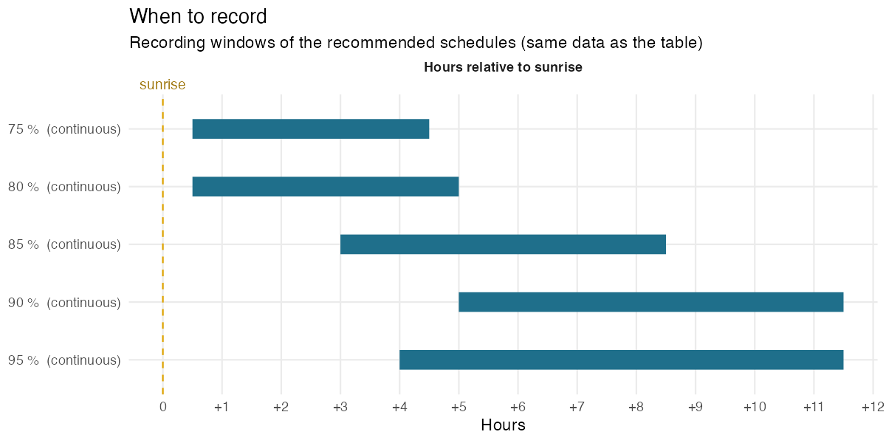
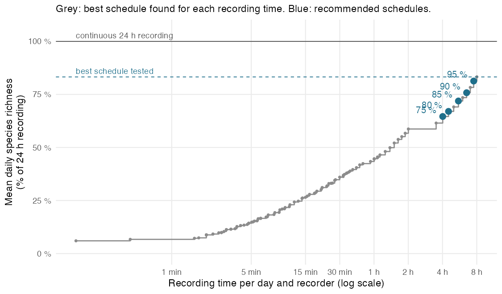
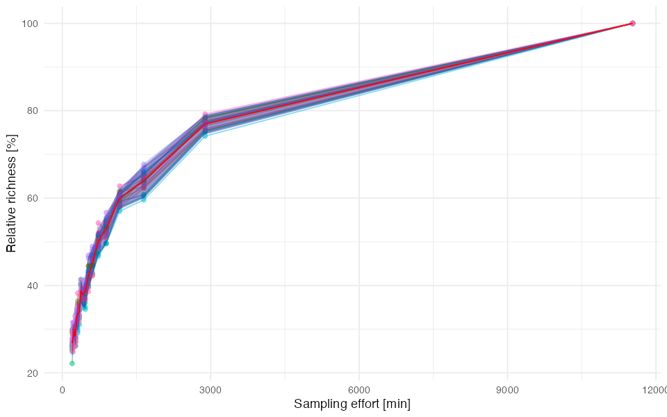
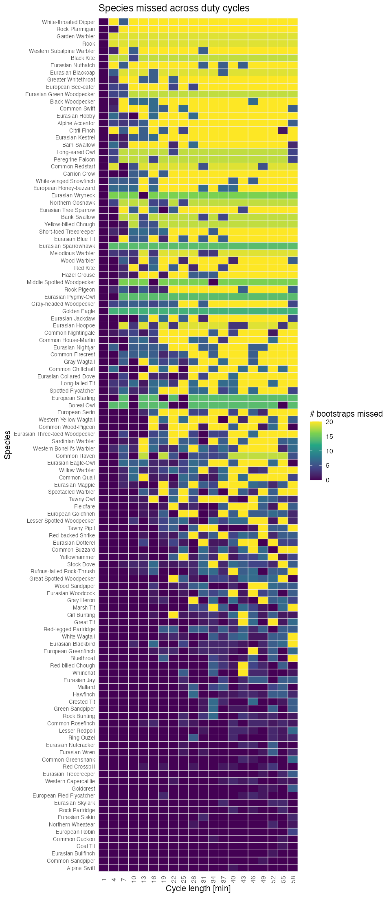
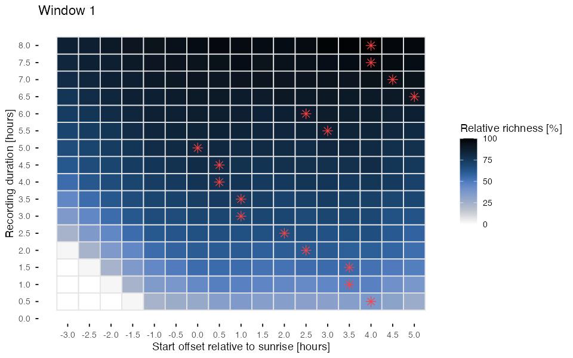
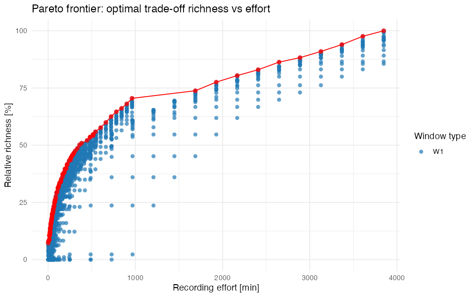

# edw

`CH_w_2024-05-22_8d` · aman · SCORE 1.1.0

[⬇ Download the preset (.json, for the SCORE app)](../CH_w_2024-05-22_8d/CH_w_2024-05-22_8d.json) · [← Back to catalogue](../README.md)

> **Pilot data:** 8 days (2024-05-22 to 2024-05-29), 1 recorder(s), 134 species detected with continuous 24 h recording (99.6 species per day on average).

## Recommended schedules

For each target, the schedule that needs the **least recording** among the 5 410 schedules tested by SCORE.

| Target | Duty cycle | Time windows | Recording per day | Richness (% of 24 h) | Richness (% of best tested) | Species never detected |
|---|---|---|---|---|---|---|
| 75 % | continuous | from sunrise + 0 h 30 to sunrise + 4 h 30 (≈ 06:15–10:15) | 241 min (16.74 % of 24 h) | 64.6 % | 77.6 % | 16 of 134 |
| 80 % | continuous | from sunrise + 0 h 30 to sunrise + 5 h (≈ 06:15–10:45) | 271 min (18.82 % of 24 h) | 67 % | 80.4 % | 12 of 134 |
| 85 % | continuous | from sunrise + 3 h to sunrise + 8 h 30 (≈ 08:45–14:15) | 331 min (22.99 % of 24 h) | 71.9 % | 86.3 % | 7 of 134 |
| 90 % | continuous | from sunrise + 5 h to sunrise + 11 h 30 (≈ 10:45–17:15) | 391 min (27.15 % of 24 h) | 75.8 % | 91 % | 8 of 134 |
| 95 % | continuous | from sunrise + 4 h to sunrise + 11 h 30 (≈ 09:45–17:15) | 451 min (31.32 % of 24 h) | 81.3 % | 97.6 % | 7 of 134 |

<b>How to read this table</b>

- **Target**: share of species richness to reach, relative to the *best schedule tested* (see below).
- **Duty cycle**: how to record *inside* the time windows. *Continuous* = record without pause; *1 min every 7 min* = record 1 min, pause 6 min. It is the duty cycle of the least-effort schedule found, not a fixed choice: when a short continuous window is cheaper than a long sampled one, SCORE recommends the continuous window.
- **Time windows**: relative to sunrise or sunset, so that they follow the season. Clock times (≈) are only indicative: they use the mean sunrise/sunset of the pilot days.
- **Recording per day**: per recorder.
- **Richness (% of 24 h)**: mean number of species detected per day with this schedule, as a % of the species detected per day with continuous 24 h recording (all recorders pooled per day).
- **Richness (% of best tested)**: same, but relative to the best schedule among those tested. SCORE only tests windows within the grid chosen in the app (Tab 3), so the best schedule tested can detect fewer species than 24 h recording (here: 83.2 % of 24 h). The targets refer to this value.
- **Species never detected**: species detected at least once during the pilot with 24 h recording but never with this schedule (details below).

*Each bar is a recording window of a recommended schedule (same data as the table). Positions are in hours relative to sunrise or sunset, so the windows follow the change of day length; the duty cycle in brackets applies inside the bars.*

## Species missed by each schedule

| Target | Recording per day | Species detected over the pilot | Species never detected | Mean daily omission |
|---|---|---|---|---|
| 75 % | 241 min | 118 of 134 | 16 (11.9 %) | 37.1 % |
| 80 % | 271 min | 122 of 134 | 12 (9 %) | 34.7 % |
| 85 % | 331 min | 127 of 134 | 7 (5.2 %) | 29.2 % |
| 90 % | 391 min | 126 of 134 | 8 (6 %) | 24.1 % |
| 95 % | 451 min | 127 of 134 | 7 (5.2 %) | 18.7 % |

- **Species never detected**: detected at least once with 24 h recording during the pilot, but on no day with this schedule.
- **Mean daily omission**: on an average day, share of the species detected with 24 h recording that the schedule misses.
- Detections per species and per schedule are in the table *Species* below.

<b>75 % schedule: 16 species never detected</b>

Barn Swallow, Black Kite, Common Nightingale, Common Raven, Common Redstart, Common Swift, Eurasian Pygmy-Owl, Eurasian Sparrowhawk, European Bee-eater, European Starling, Long-eared Owl, Peregrine Falcon, Rock Ptarmigan, Rook, White-winged Snowfinch, Yellow-billed Chough

<b>80 % schedule: 12 species never detected</b>

Black Kite, Common Raven, Common Redstart, Common Swift, Eurasian Pygmy-Owl, Eurasian Sparrowhawk, European Starling, Peregrine Falcon, Rock Ptarmigan, Rook, White-winged Snowfinch, Yellow-billed Chough

<b>85 % schedule: 7 species never detected</b>

Common Redstart, Eurasian Sparrowhawk, European Starling, Golden Eagle, Northern Goshawk, Peregrine Falcon, White-throated Dipper

<b>90 % schedule: 8 species never detected</b>

Boreal Owl, Eurasian Hoopoe, Eurasian Wryneck, Garden Warbler, Golden Eagle, Melodious Warbler, Middle Spotted Woodpecker, White-throated Dipper

<b>95 % schedule: 7 species never detected</b>

Boreal Owl, Eurasian Hoopoe, Garden Warbler, Golden Eagle, Melodious Warbler, Middle Spotted Woodpecker, White-throated Dipper

## Species

All species detected during the pilot (134), with BirdNET-Analyzer (confidence threshold: 0). Species names are those of the classifier; detections were not verified unless stated in the notes.

<b>Show the table of the 134 species</b>

- **Detections**: number of BirdNET detections during the pilot, all recorders.
- **Mean confidence**: mean classifier confidence of these detections (low values point to possible false positives).
- **24 h, 75 %, 80 %, 85 %, 90 %, 95 %**: number of pilot days (out of 8) on which the species was detected with continuous 24 h recording and with each recommended schedule.
- **Peak activity**: the hour, relative to sunrise, with the most detections.
- **Activity over the day**: detections per hour from 6 h before sunrise to 18 h after it; `┃` marks sunrise, `·` no detection.

| Species | Detections | Mean confidence | 24 h | 75 % | 80 % | 85 % | 90 % | 95 % | Peak activity | Activity over the day |
|---|---|---|---|---|---|---|---|---|---|---|
| Alpine Accentor | 14 | 0.263 | 8 | 4 | 4 | 6 | 2 | 5 | 4–5 h after sunrise | `·····▆┃▆·▃▆█▃▃····▃···▃··` |
| Alpine Swift | 3617 | 0.265 | 8 | 7 | 7 | 7 | 8 | 8 | 7–8 h after sunrise | `····▁▃┃▄▁▁▂▃▆▄█▇▇▅▃▄▆▇█▃·` |
| Black Grouse | 3238 | 0.577 | 8 | 7 | 7 | 4 | 6 | 6 | 0–1 h before sunrise | `····▁█┃█▄▂▁▁▁▁▁·▁·▁▁▂▁▁··` |
| Black Redstart | 2932 | 0.457 | 8 | 6 | 6 | 7 | 8 | 8 | 10–11 h after sunrise | `·····▁┃▃▅▄▅▆▄▄▆███▇▄▅▄▂··` |
| Bluethroat | 109 | 0.154 | 8 | 4 | 5 | 5 | 7 | 7 | 3–4 h after sunrise | `·····▁┃▂▁▂█▄▂▁▃▄▂▂▁▅▁▁▁··` |
| Cirl Bunting | 122 | 0.212 | 8 | 6 | 6 | 6 | 7 | 7 | 12–13 h after sunrise | `·····▁┃▂▁▃▂▃▂▂▁·▂▃▂█·▄▁··` |
| Coal Tit | 1647 | 0.42 | 8 | 7 | 7 | 8 | 8 | 8 | 7–8 h after sunrise | `·····▄┃▄▇█▇▄▆▅█▅█▆▇▅▂▁···` |
| Common Chaffinch | 6547 | 0.378 | 8 | 7 | 7 | 8 | 8 | 8 | 3–4 h after sunrise | `·····▂┃▅▄██▅▄▃▄▃▄▃▆▆█▇▁··` |
| Common Cuckoo | 810 | 0.606 | 8 | 6 | 6 | 6 | 7 | 7 | 3–4 h after sunrise | `·····▃┃▆▆▅█▂▁▁▂▃▁▁▁▂▂▂▂··` |
| Common Greenshank | 416 | 0.267 | 8 | 6 | 6 | 6 | 6 | 6 | 5–6 h after sunrise | `·····▃┃▃▆▄▃▇█▅▂▄▂▅▅▂▂▇▄··` |
| Common Redpoll | 664 | 0.237 | 8 | 7 | 7 | 7 | 8 | 8 | 4–5 h after sunrise | `·····▂┃▆▄▆▆█▇▇▄▄▃▄▇▄▃▄▁··` |
| Common Rosefinch | 163 | 0.206 | 8 | 5 | 5 | 6 | 7 | 7 | 0–1 h before sunrise | `·····█┃▄▃▇▆▅▃▄▃▄▂▂▂▁▃▂···` |
| Common Sandpiper | 377 | 0.232 | 8 | 7 | 7 | 8 | 8 | 8 | 8–9 h after sunrise | `·····▃┃▆▆▇▇▆▇▅▆███▅▇▇▅▃··` |
| Crested Tit | 230 | 0.465 | 8 | 6 | 6 | 7 | 8 | 8 | 10–11 h after sunrise | `······┃·▂·▃▂·▇▃▂▂█▇▅▂▁···` |
| Dunnock | 1305 | 0.348 | 8 | 7 | 7 | 7 | 8 | 8 | 3–4 h after sunrise | `·····▃┃█▆██▄▃▃▁▃▅▄▃▂▂▂▁▁·` |
| Eurasian Bullfinch | 368 | 0.25 | 8 | 7 | 7 | 8 | 8 | 8 | 1–2 h after sunrise | `·····▁┃▂█▄▄▅▃▃▁▁▂▂▃▁▂▂▁··` |
| Eurasian Dotterel | 66 | 0.231 | 8 | 6 | 6 | 6 | 5 | 5 | 1–2 h after sunrise | `·····▂┃▆██▆▆█▆▂▂▇▄▃▇▂▃▆··` |
| Eurasian Linnet | 6958 | 0.559 | 8 | 7 | 7 | 7 | 8 | 8 | 11–12 h after sunrise | `·····▁┃▄▃▄▄▅▅▅▄▅▅██▇▆▅▁··` |
| Eurasian Magpie | 39 | 0.209 | 8 | 5 | 6 | 3 | 6 | 7 | 0–1 h before sunrise | `·····█┃▁▄▆·▃··▃▁▃·▄▃▆·▁··` |
| Eurasian Siskin | 270 | 0.247 | 8 | 7 | 7 | 8 | 8 | 8 | 12–13 h after sunrise | `·····▁┃▄▃▃▃▅▄▂▄▄▃▅▆█▆▂▁··` |
| Eurasian Skylark | 492 | 0.213 | 8 | 6 | 6 | 7 | 8 | 8 | 3–4 h after sunrise | `·····▆┃▄▄▃█▇▄▃▂▃▁▂▂▂▂▂▁··` |
| Eurasian Treecreeper | 375 | 0.265 | 8 | 6 | 6 | 6 | 7 | 7 | 9–10 h after sunrise | `·····▁┃▁▁▁▁▂▂▁▁▁█▆▄▇▃▁▁··` |
| Eurasian Wren | 266 | 0.24 | 8 | 6 | 6 | 7 | 8 | 8 | 0–1 h after sunrise | `······┃█▇▂▁▂▂▂▂▁▂▂▂▃▂▃▁··` |
| European Goldfinch | 43 | 0.188 | 8 | 5 | 6 | 6 | 5 | 7 | 11–12 h after sunrise | `······┃·▂▂▄▅▃▅▂▃▃▅█▅▆····` |
| European Greenfinch | 132 | 0.211 | 8 | 6 | 6 | 7 | 7 | 7 | 5–6 h after sunrise | `·····▁┃▃▃▅▅▆█▅▄▄▆▃▄▃▄▅▂··` |
| European Pied Flycatcher | 277 | 0.208 | 8 | 6 | 6 | 7 | 8 | 8 | 13–14 h after sunrise | `·····▁┃▁▂▂▄▅▄▄▂▄▄▅▆▆█▆▄··` |
| European Robin | 297 | 0.206 | 8 | 6 | 6 | 8 | 8 | 8 | 12–13 h after sunrise | `·····▁┃··▁▄▆▄▄▅▆▄▃▂█▃▅▅▃·` |
| European Stonechat | 514 | 0.197 | 8 | 7 | 7 | 7 | 8 | 8 | 2–3 h after sunrise | `·····▁┃▄▅█▅▅▄▄▃▄▇▅▄▂▃▂▂··` |
| Fieldfare | 100 | 0.226 | 8 | 6 | 6 | 6 | 7 | 7 | 13–14 h after sunrise | `·····▂┃▁▅▂▄▄▁▂▂▃▂·▅▂█▁▂▁·` |
| Goldcrest | 373 | 0.33 | 8 | 6 | 6 | 7 | 8 | 8 | 9–10 h after sunrise | `·····▁┃▂▂▂▂▄▂▅▃▅█▅▇▅▆▁▂▁·` |
| Gray Heron | 73 | 0.214 | 8 | 6 | 6 | 7 | 7 | 7 | 0–1 h before sunrise | `·····█┃▃▃▂▂▄▃▃▃▆▃▁▂▆▂▅▃··` |
| Great Tit | 193 | 0.203 | 8 | 7 | 7 | 7 | 8 | 8 | 11–12 h after sunrise | `·····▂┃▁▃▆▂▇▆▄▅▃▂▅██▆▇▂··` |
| Green Sandpiper | 133 | 0.238 | 8 | 6 | 6 | 7 | 8 | 8 | 13–14 h after sunrise | `·····▂┃▁▅▃▄▂▃▂▃▂▂▂▄██▅▂··` |
| Lesser Redpoll | 131 | 0.245 | 8 | 5 | 6 | 7 | 8 | 8 | 3–4 h after sunrise | `······┃▇▃▆█▅▄█▆█▄█▆▆▂█···` |
| Lesser Whitethroat | 771 | 0.431 | 8 | 7 | 7 | 8 | 8 | 8 | 2–3 h after sunrise | `·····▂┃▄▅█▃▃▅▁▁▂▁▁▂▁▂▂▁··` |
| Mallard | 146 | 0.198 | 8 | 6 | 6 | 7 | 8 | 8 | 0–1 h before sunrise | `····▁█┃▅▄▅▁▁▃▁▂▂▁▁▂▁▄▂▁··` |
| Meadow Pipit | 2162 | 0.229 | 8 | 7 | 7 | 7 | 8 | 8 | 11–12 h after sunrise | `·····▄┃▅▇█▇▆█▇▅▆█▇█▄▄▅▁··` |
| Mistle Thrush | 3155 | 0.576 | 8 | 7 | 7 | 7 | 8 | 8 | 0–1 h after sunrise | `·····▂┃█▆▆▃█▆▅▃▅▂▄▆▄▄▆▄··` |
| Northern Wheatear | 718 | 0.435 | 8 | 6 | 6 | 6 | 8 | 8 | 3–4 h after sunrise | `····▁▃┃▃▃▄█▄▂▂▃▁▂▄▄▅▁▁▁▁·` |
| Ortolan Bunting | 2275 | 0.199 | 8 | 7 | 7 | 8 | 8 | 8 | 14–15 h after sunrise | `·····▂┃▃▃▄▆▅▄▃▃▄▅▅▆▇▇█▃▁·` |
| Red Crossbill | 304 | 0.3 | 8 | 6 | 6 | 6 | 6 | 6 | 0–1 h after sunrise | `·····▂┃█▃▅▆▄▂▃▁·▂▂▃▃▂▂···` |
| Red-backed Shrike | 62 | 0.186 | 8 | 4 | 4 | 5 | 4 | 6 | 11–12 h after sunrise | `·····▆┃·▄▅▄▂·▁▁·▄▃█▃▂▃▁··` |
| Ring Ouzel | 324 | 0.257 | 8 | 6 | 6 | 6 | 7 | 7 | 3–4 h after sunrise | `·····▃┃▃█▇█▇▂▂·▂▁▂▃▁▁·▃▁·` |
| Rock Bunting | 238 | 0.382 | 8 | 2 | 3 | 6 | 6 | 7 | 12–13 h after sunrise | `·····▁┃·▁▄▆▄▁▅▅▆█▂▄█▆▂···` |
| Rock Partridge | 1764 | 0.612 | 8 | 5 | 5 | 5 | 4 | 5 | 0–1 h before sunrise | `·····█┃▂▅▄▂▂▁▁▁▁▄▃▅▁▁·▄▂·` |
| Song Thrush | 601 | 0.234 | 8 | 6 | 6 | 7 | 8 | 8 | 4–5 h after sunrise | `·····▁┃▃▄▄▄█▅▄▃▄▄▄▃▂▂▄▃▁·` |
| Tawny Owl | 59 | 0.171 | 8 | 4 | 4 | 6 | 6 | 6 | 5–6 h after sunrise | `····▂▃┃▄▂·▂▃█▃▃▃▆▄▃▄▆▆▃▃·` |
| Tawny Pipit | 87 | 0.2 | 8 | 6 | 6 | 7 | 8 | 8 | 11–12 h after sunrise | `·····▁┃▃▂▅▆▃▆▂▄▃▄▆█▆▄▆▁··` |
| Tree Pipit | 22005 | 0.462 | 8 | 7 | 7 | 7 | 8 | 8 | 1–2 h after sunrise | `·····▅┃████▇▆▇▆▇▇▇▆▆▆▅▂▁·` |
| Water Pipit | 5709 | 0.494 | 8 | 7 | 7 | 7 | 8 | 8 | 2–3 h after sunrise | `·····▃┃▄▇█▆▆██▅▆▇██▆▅▄▁··` |
| Western Capercaillie | 655 | 0.322 | 8 | 7 | 7 | 5 | 6 | 7 | 0–1 h before sunrise | `·····█┃▃▅▇▅▂▁▁▂▂▆▃█▁▂▁▅▂·` |
| Western Yellow Wagtail | 46 | 0.222 | 8 | 5 | 5 | 4 | 7 | 7 | 11–12 h after sunrise | `······┃▅▃·▄▂·▇·▄▄▄█▃▂▄···` |
| Whinchat | 124 | 0.183 | 8 | 6 | 6 | 7 | 6 | 7 | 2–3 h after sunrise | `·····▂┃▃▄█▄▆▅▃▃▃▅▃▅▅·▅▁··` |
| White Wagtail | 96 | 0.333 | 8 | 6 | 6 | 6 | 8 | 8 | 7–8 h after sunrise | `·····▂┃▁▁▅▄█▂▅█▄█▆▅▂▆▅▂▁·` |
| Willow Tit | 1840 | 0.441 | 8 | 7 | 7 | 8 | 8 | 8 | 11–12 h after sunrise | `·····▄┃▇▅▃▇▅▃▅▃▄▅▄█▅▃·▁··` |
| Wood Lark | 776 | 0.199 | 8 | 7 | 7 | 7 | 7 | 8 | 2–3 h after sunrise | `·····▃┃▇▇█▆▄▂▂▂▂▂▂▃▂▂▂▁··` |
| Wood Sandpiper | 68 | 0.245 | 8 | 5 | 5 | 6 | 7 | 7 | 11–12 h after sunrise | `······┃▃▃▆▁▃█▃▅▁▁▆██▃█▃··` |
| Yellowhammer | 46 | 0.191 | 8 | 4 | 4 | 7 | 6 | 7 | 3–4 h after sunrise | `····▁▇┃▃▃██▄▃▃▁··▁▄▁▁▁▁··` |
| Carrion Crow | 18 | 0.144 | 7 | 4 | 4 | 1 | 1 | 1 | 13–14 h after sunrise | `·····▇┃▄▄▃··▇·······█·▇··` |
| Common Buzzard | 62 | 0.271 | 7 | 6 | 6 | 5 | 4 | 7 | 1–2 h after sunrise | `······┃▁█▃▇▇·▆▂▄▃▃···▂▁··` |
| Common Chiffchaff | 19 | 0.209 | 7 | 1 | 1 | 3 | 4 | 4 | 11–12 h after sunrise | `······┃▃▃···▃▃▃▃··█▄▄·▃··` |
| Common Wood-Pigeon | 56 | 0.26 | 7 | 3 | 3 | 1 | 1 | 1 | 0–1 h after sunrise | `·····▆┃█▄···▃▂·····▃▁▂···` |
| Eurasian Collared-Dove | 18 | 0.245 | 7 | 5 | 5 | 4 | 2 | 2 | 3–4 h after sunrise | `·····▄┃▄▄▃█···▄▇···▃·▃···` |
| Eurasian Eagle-Owl | 18 | 0.193 | 7 | 3 | 3 | 4 | 4 | 5 | 3–4 h after sunrise | `·····▄┃▄··█▄▄▄▄▄█···▄██··` |
| Eurasian Jay | 212 | 0.187 | 7 | 7 | 7 | 3 | 5 | 5 | 0–1 h before sunrise | `····▁█┃█▅▂▁··▁▁▁··▁·▁▁···` |
| Eurasian Nutcracker | 225 | 0.252 | 7 | 7 | 7 | 4 | 3 | 3 | 0–1 h before sunrise | `····▁█┃██▃▁▁▁▁▁·▁···▂▁▁··` |
| Eurasian Three-toed Woodpecker | 33 | 0.184 | 7 | 4 | 4 | 5 | 5 | 5 | 8–9 h after sunrise | `······┃▄▄▄▄·▄▄·█▂▂▄▂▂····` |
| Eurasian Woodcock | 60 | 0.239 | 7 | 1 | 1 | 7 | 6 | 6 | 7–8 h after sunrise | `······┃·▁·▁·▁▂█▁▁▁▂▂·▃▁▁·` |
| Great Spotted Woodpecker | 133 | 0.406 | 7 | 4 | 5 | 4 | 7 | 7 | 1–2 h after sunrise | `······┃▁█▆▂▅▃·▁▅▅▁█▁·····` |
| Hawfinch | 155 | 0.216 | 7 | 5 | 7 | 7 | 7 | 7 | 15–16 h after sunrise | `·····▂┃▁▆▅▄▆▄▇▂▆▆▆▅▅▅▄█▂·` |
| Lesser Spotted Woodpecker | 69 | 0.203 | 7 | 5 | 5 | 5 | 4 | 6 | 1–2 h after sunrise | `······┃·█▄█▆··▁▄·▃█▅▄····` |
| Marsh Tit | 70 | 0.185 | 7 | 5 | 6 | 6 | 6 | 6 | 6–7 h after sunrise | `·····▂┃▄█▃▄▇▄█·▃▄▄▂▃▁▁···` |
| Red-billed Chough | 147 | 0.426 | 7 | 5 | 5 | 4 | 4 | 4 | 0–1 h before sunrise | `·····█┃▆▂▂▂·▁▂▁▁▁···▂····` |
| Common Firecrest | 23 | 0.37 | 6 | 3 | 3 | 3 | 4 | 4 | 0–1 h after sunrise | `······┃█·▃▃·▅··█▃▃▃▃▃····` |
| Common Quail | 51 | 0.206 | 6 | 4 | 4 | 4 | 4 | 4 | 0–1 h before sunrise | `·····█┃··▄▃·▁▃▁▃▇·▃▁▂▁▄··` |
| Eurasian Blackbird | 133 | 0.182 | 6 | 5 | 5 | 5 | 3 | 4 | 0–1 h after sunrise | `·····▁┃█▃▁▃▁▄▆▁▆·▃▃▃·▅▂··` |
| Eurasian Blue Tit | 17 | 0.183 | 6 | 4 | 4 | 4 | 2 | 4 | 4–5 h after sunrise | `······┃···▂█▂▂····▂▄▆····` |
| Eurasian Hobby | 8 | 0.293 | 6 | 3 | 3 | 2 | 1 | 2 | 1–2 h after sunrise | `·····▃┃·█▃·▃···▃··▃······` |
| Eurasian Jackdaw | 18 | 0.185 | 6 | 3 | 3 | 2 | 2 | 2 | 0–1 h after sunrise | `·····▅┃█▃·▃·▂····▂··▂····` |
| Eurasian Kestrel | 20 | 0.339 | 6 | 1 | 1 | 3 | 5 | 5 | 9–10 h after sunrise | `······┃·▃···▃·▃▆█·▃▆▆▃···` |
| European Serin | 18 | 0.246 | 6 | 2 | 2 | 5 | 6 | 6 | 6–7 h after sunrise | `······┃···▆·▃█▃▃▃▃█▃▃▃···` |
| Rock Pigeon | 13 | 0.145 | 6 | 4 | 4 | 2 | 3 | 4 | 0–1 h after sunrise | `·····▃┃█▃█·▃▃··▆···▃·····` |
| Rufous-tailed Rock-Thrush | 60 | 0.196 | 6 | 4 | 5 | 5 | 3 | 5 | 2–3 h after sunrise | `·····▁┃▅▃█▂▂▁▄·▂··▃▂·▁▁▁·` |
| Sardinian Warbler | 47 | 0.283 | 6 | 4 | 5 | 5 | 4 | 5 | 4–5 h after sunrise | `·····▂┃▂▁▄▄█·▁···▂▄▄▁▂···` |
| Spectacled Warbler | 73 | 0.211 | 6 | 3 | 3 | 3 | 4 | 4 | 11–12 h after sunrise | `······┃▇▃▁·▂▁▂▂▃▁▁█▄▄▁···` |
| Spotted Flycatcher | 10 | 0.149 | 6 | 1 | 1 | 3 | 4 | 4 | 8–9 h after sunrise | `······┃·▄·▄·▄·▄█·▄·█··▄··` |
| Stock Dove | 63 | 0.148 | 6 | 6 | 6 | 3 | 3 | 3 | 1–2 h after sunrise | `·····▄┃▆█▆▄▃▁··▁·▁···▂···` |
| Barn Swallow | 8 | 0.208 | 5 | 0 | 2 | 4 | 3 | 4 | 4–5 h after sunrise | `······┃····█·▄█·▄▄▄······` |
| Black Woodpecker | 9 | 0.176 | 5 | 3 | 3 | 3 | 3 | 3 | 4–5 h after sunrise | `······┃·▆·▃█·▆·▃·········` |
| Citril Finch | 9 | 0.205 | 5 | 1 | 2 | 3 | 3 | 3 | 3–4 h after sunrise | `······┃···█▄·▄·█▄▄▄······` |
| Common House-Martin | 23 | 0.226 | 5 | 3 | 3 | 3 | 4 | 4 | 10–11 h after sunrise | `······┃··▂▇·▂▂···█▂▇·▄···` |
| Common Nightingale | 7 | 0.254 | 5 | 0 | 1 | 2 | 3 | 4 | 8–9 h after sunrise | `······┃····▄·▄·█··▄▄▄····` |
| Eurasian Tree Sparrow | 6 | 0.168 | 5 | 3 | 3 | 3 | 3 | 3 | 3–4 h after sunrise | `······┃·▅·█···▅·▅▅·······` |
| Gray Wagtail | 22 | 0.241 | 5 | 2 | 3 | 4 | 5 | 5 | 9–10 h after sunrise | `······┃··▃▄▄·▆··█▃▃▄▃▃▃··` |
| Hazel Grouse | 13 | 0.132 | 5 | 3 | 3 | 4 | 2 | 3 | 0–1 h after sunrise | `······┃██▄█▄▄·▄···█▄·····` |
| Long-tailed Tit | 9 | 0.162 | 5 | 1 | 1 | 3 | 4 | 4 | 6–7 h after sunrise | `······┃▄····▄█▄·▄▄·▄▄····` |
| Red Kite | 17 | 0.249 | 5 | 5 | 5 | 3 | 1 | 3 | 1–2 h after sunrise | `······┃·█▃▅▆▅··▅·▅▃······` |
| Red-legged Partridge | 185 | 0.303 | 5 | 2 | 2 | 1 | 2 | 2 | 0–1 h before sunrise | `·····█┃▂▇▄▃▂·▁··▂▂▇·▁·▃··` |
| Willow Warbler | 30 | 0.177 | 5 | 3 | 4 | 4 | 1 | 4 | 4–5 h after sunrise | `·····▂┃▃▁▃▂█·▁▁····▃▁····` |
| Eurasian Nuthatch | 5 | 0.149 | 4 | 1 | 1 | 4 | 3 | 4 | 2–3 h after sunrise | `······┃··█·███·█·········` |
| Gray-headed Woodpecker | 15 | 0.183 | 4 | 3 | 3 | 3 | 2 | 3 | 4–5 h after sunrise | `······┃▄▄▄·█▂▂····▂······` |
| Greater Whitethroat | 5 | 0.168 | 4 | 1 | 1 | 3 | 2 | 2 | 3–4 h after sunrise | `······┃···█·█··██·█······` |
| Rock Ptarmigan | 7 | 0.185 | 4 | 0 | 0 | 2 | 3 | 3 | 7–8 h after sunrise | `······┃·····▄·█▄▄▄·▄·····` |
| Western Bonelli's Warbler | 19 | 0.206 | 4 | 3 | 3 | 3 | 1 | 2 | 1–2 h after sunrise | `·····▃┃▄██▇▃···▄··▃······` |
| Western Subalpine Warbler | 8 | 0.154 | 4 | 1 | 1 | 3 | 4 | 4 | 7–8 h after sunrise | `······┃··▃··▃·█·▆▃·······` |
| Wood Warbler | 7 | 0.251 | 4 | 3 | 3 | 1 | 1 | 2 | 1–2 h after sunrise | `······┃▄█▄·▄······▄·▄····` |
| Common Swift | 7 | 0.301 | 3 | 0 | 0 | 1 | 3 | 3 | 9–10 h after sunrise | `······┃·····▆···█·▃▃·····` |
| Eurasian Blackcap | 4 | 0.242 | 3 | 1 | 1 | 2 | 1 | 2 | 4–5 h after sunrise | `······┃····█···█······█··` |
| Eurasian Nightjar | 31 | 0.249 | 3 | 1 | 1 | 1 | 3 | 3 | 0–1 h before sunrise | `·····█┃·▃▂▂▁··▁·▁▂▁···▁··` |
| Short-toed Treecreeper | 11 | 0.196 | 3 | 1 | 1 | 3 | 3 | 3 | 7–8 h after sunrise | `······┃··▃·▆·▆█··········` |
| White-throated Dipper | 4 | 0.178 | 3 | 1 | 1 | 0 | 0 | 0 | 15–16 h after sunrise | `·····▄┃··▄············█··` |
| White-winged Snowfinch | 5 | 0.147 | 3 | 0 | 0 | 1 | 2 | 2 | 12–13 h after sunrise | `······┃·····▃····▃·█·····` |
| Yellow-billed Chough | 10 | 0.244 | 3 | 0 | 0 | 1 | 2 | 2 | 9–10 h after sunrise | `······┃·····▃·▃·█▃▃▆·····` |
| Bank Swallow | 7 | 0.239 | 2 | 1 | 1 | 1 | 1 | 1 | 1–2 h after sunrise | `······┃·█·█·█···█····█···` |
| Black Kite | 2 | 0.16 | 2 | 0 | 0 | 1 | 1 | 1 | 7–8 h after sunrise | `······┃·······█·····█····` |
| Common Raven | 13 | 0.325 | 2 | 0 | 0 | 1 | 2 | 2 | 9–10 h after sunrise | `······┃········▂█········` |
| Common Redstart | 6 | 0.235 | 2 | 0 | 0 | 0 | 1 | 1 | 11–12 h after sunrise | `······┃···········█▂·····` |
| Eurasian Green Woodpecker | 6 | 0.331 | 2 | 1 | 1 | 1 | 1 | 1 | 1–2 h after sunrise | `······┃·█······▄·▄····▄··` |
| Eurasian Hoopoe | 4 | 0.135 | 2 | 2 | 2 | 1 | 0 | 0 | 1–2 h after sunrise | `······┃▄█·▄··············` |
| European Bee-eater | 2 | 0.105 | 2 | 0 | 1 | 1 | 1 | 2 | 4–5 h after sunrise | `······┃····█····█········` |
| European Honey-buzzard | 7 | 0.402 | 2 | 1 | 1 | 1 | 1 | 1 | 14–15 h after sunrise | `······┃·▃······▃·▃···█▃··` |
| Garden Warbler | 2 | 0.211 | 2 | 1 | 1 | 1 | 0 | 0 | 0–1 h after sunrise | `······┃█··█··············` |
| Long-eared Owl | 3 | 0.307 | 2 | 0 | 1 | 1 | 1 | 2 | 10–11 h after sunrise | `······┃····▄·····█·······` |
| Melodious Warbler | 4 | 0.176 | 2 | 2 | 2 | 1 | 0 | 0 | 2–3 h after sunrise | `······┃··█▃··············` |
| Northern Goshawk | 3 | 0.147 | 2 | 1 | 1 | 0 | 1 | 1 | 11–12 h after sunrise | `······┃·▄·········█······` |
| Peregrine Falcon | 5 | 0.137 | 2 | 0 | 0 | 0 | 1 | 1 | 15–16 h after sunrise | `······┃·········▄·▄···█▄·` |
| Rook | 4 | 0.153 | 2 | 0 | 0 | 1 | 1 | 1 | 15–16 h after sunrise | `······┃·····▃·········█··` |
| Boreal Owl | 1 | 0.129 | 1 | 1 | 1 | 1 | 0 | 0 | 3–4 h after sunrise | `······┃···█··············` |
| Eurasian Pygmy-Owl | 2 | 0.105 | 1 | 0 | 0 | 1 | 1 | 1 | 8–9 h after sunrise | `······┃········█·····█···` |
| Eurasian Sparrowhawk | 1 | 0.126 | 1 | 0 | 0 | 0 | 1 | 1 | 10–11 h after sunrise | `······┃··········█·······` |
| Eurasian Wryneck | 1 | 0.106 | 1 | 1 | 1 | 1 | 0 | 1 | 4–5 h after sunrise | `······┃····█·············` |
| European Starling | 2 | 0.157 | 1 | 0 | 0 | 0 | 1 | 1 | 10–11 h after sunrise | `······┃··········█·······` |
| Golden Eagle | 1 | 0.199 | 1 | 1 | 1 | 0 | 0 | 0 | 2–3 h after sunrise | `······┃··█···············` |
| Middle Spotted Woodpecker | 2 | 0.354 | 1 | 1 | 1 | 1 | 0 | 0 | 3–4 h after sunrise | `······┃···█··············` |

## How many species for how much recording?

*Each grey point is the best schedule found by SCORE for a given recording time per day (among 5 410 schedules tested). The curve shows how fast richness increases with recording time and where adding recording time brings few additional species. Use it to choose a compromise other than the recommended targets.*

## Study context

| Item | Value |
|---|---|
| Project | dew |
| Objective | community |
| Target taxa | birds |
| Target species | Alpine Accentor, Bank Swallow, Barn Swallow, Black Kite, Black Redstart, Black Woodpecker |
| Country / region | Switzerland / w |
| Habitat (EUNIS) | E |
| Elevation | 2000 m (mean) |
| Location | 46.2° N, 8.1° E (rounded to ~10 km) |
| Period | 2024-05-22 to 2024-05-29 (8 days with data, Europe/Zurich) |
| Timing | post-breeding |
| Recorders | 1 × SMMini 2 |
| Classifier | BirdNET-Analyzer 2.4 |
| Confidence threshold | 0 |

## How well does it transfer?

_No validation provided with this preset._

## Method

- Richness: mean daily species richness; all recorders pooled per day
- Duty cycles tested: 1 min every 1 to 58 min
- Schedules tested: 5 410 (duty cycles × time windows of the grid of Tab 3)
- Selection rule: least effort with richness >= target (% of best candidate); ties: highest richness

## Figures from the SCORE app

<b>Show the original figures of this analysis</b>

**Tab 2 – Richness by duty cycle (bootstrap)**

**Tab 2 – Species missed by duty cycle**

**Tab 3 – Richness by time window (window 1)**

**Tab 4 – Multi-optimum: effort vs richness of all schedules tested**

## Cite

Serrurier et al. (in revision) SCORE: a user-friendly application to optimise recording schedules in passive acoustic monitoring. Journal of Avian Biology.

