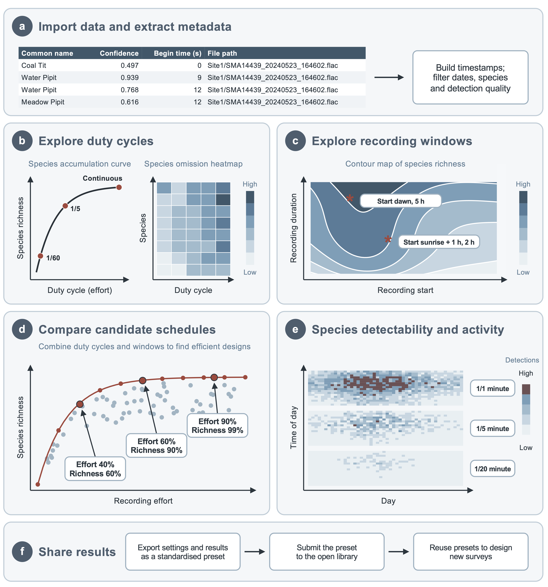
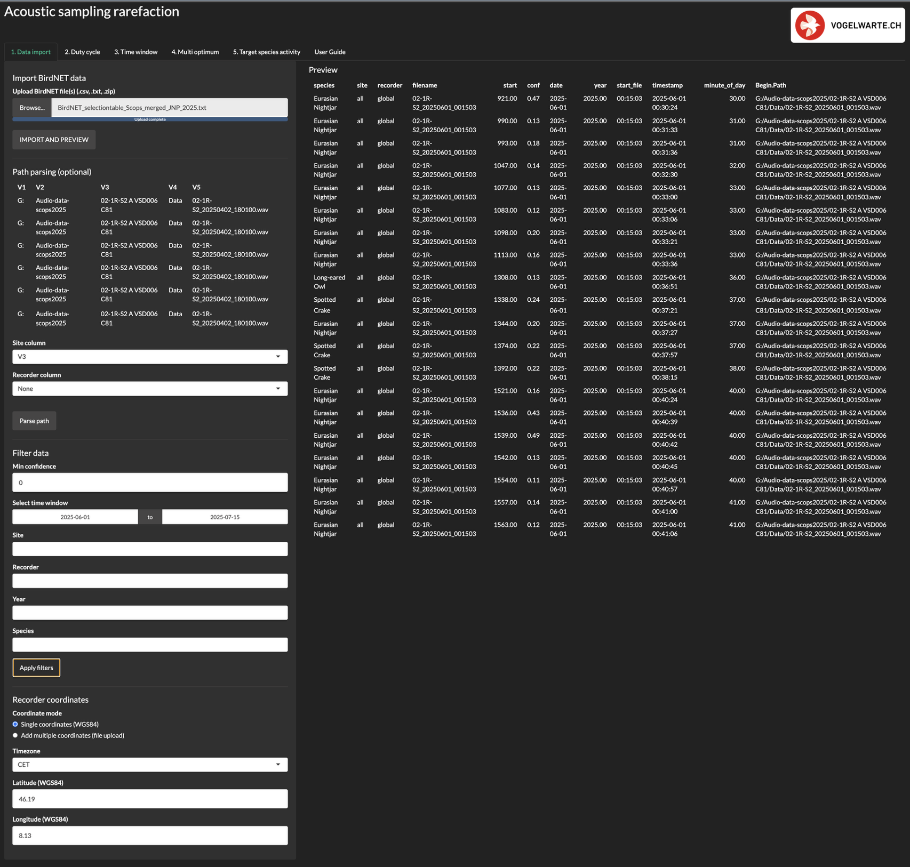
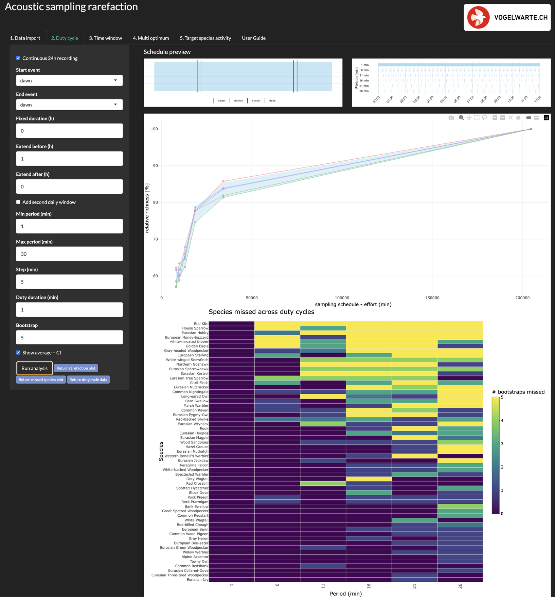
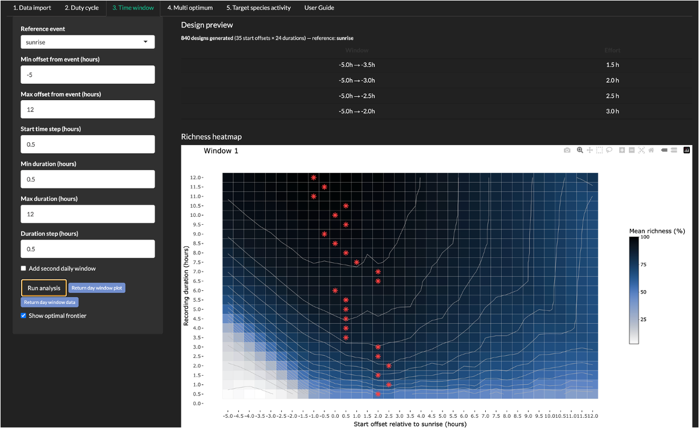
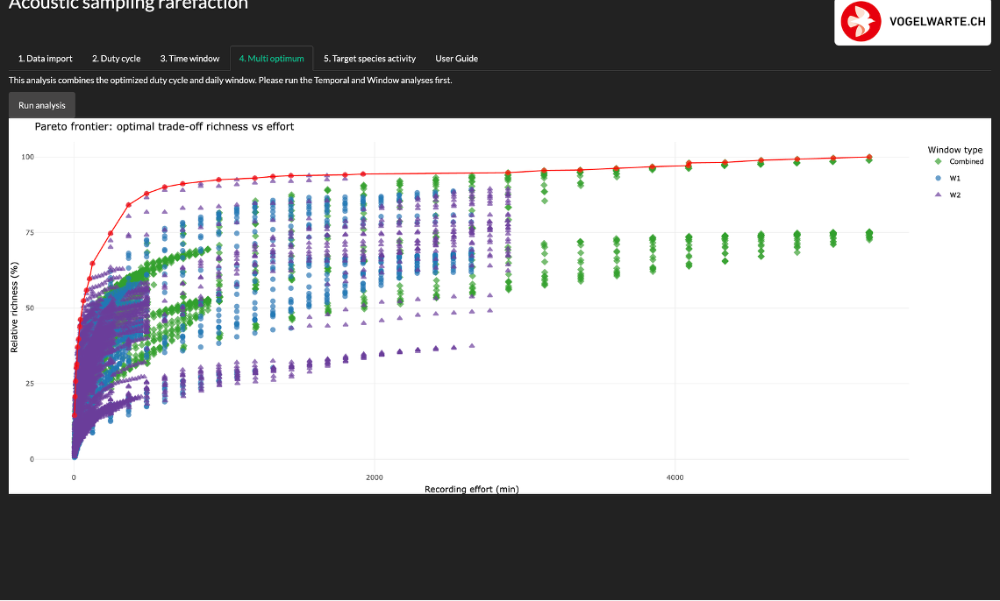
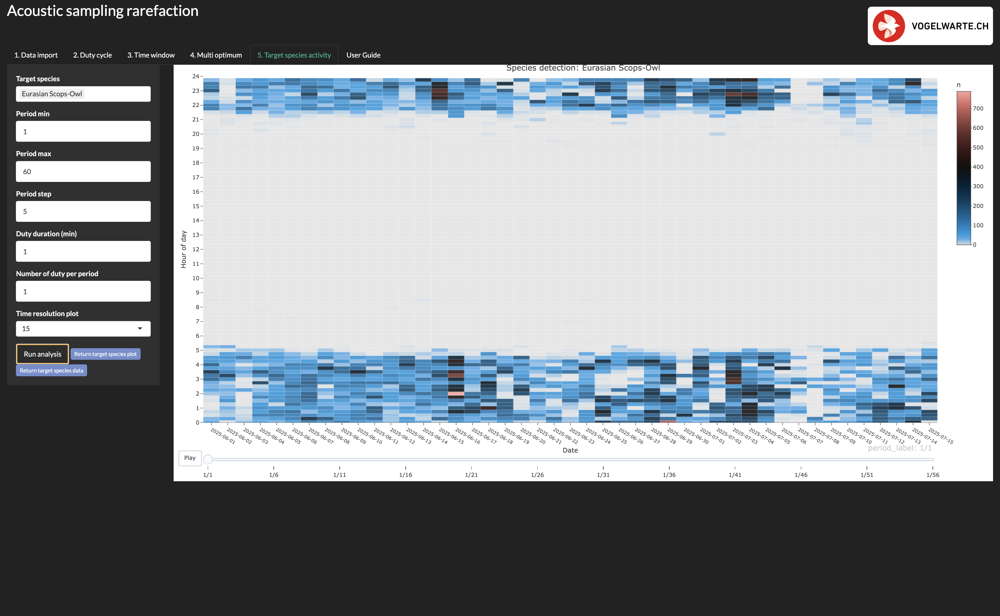

# SCORE – Sampling Coverage Optimiser for Recording Effort

SCORE is an R/Shiny application that helps you choose a recording schedule for passive acoustic monitoring. It uses detections from an automated classifier such as BirdNET to simulate how alternative schedules would have performed on your own data, and shows how much species richness you keep for a given recording effort.

With SCORE you can:

- test **duty cycles** (e.g. 1 min every 5 min) and **daily recording windows** (timing, duration, one or two windows per day);
- combine both into complete schedules and find the most efficient ones on a **richness–effort plot** with a Pareto frontier;
- see **which species are missed** when recording effort is reduced;
- check whether the **daily and seasonal activity** of a target species is still captured;
- estimate the **battery autonomy** of common recorders for a selected schedule;
- **export and share** your results as a standardised preset in an open [preset library](presets_library).

<!-- TODO: replace with the final Figure 3 (scheme_workflow_v10) exported as PNG -->


------------------------------------------------------------------------

## Before you start: pilot data

SCORE selects schedules from the data you give it, so the result is only as good as your pilot dataset. Based on our validation (see the associated manuscript):

- **Use at least one week of recordings.** Schedules selected on 1-day pilots retained on average 78% of the daily richness on the rest of the season, against 87% after 14-day pilots.
- **Include recorders in the main habitat types** of your study area.
- **Cover the period of main interest.** Species composition and vocal activity change over the season; a schedule selected in June may perform less well in August.
- **A few days are enough only if your target species are reliably present and vocally active** during the pilot.
- **Results apply to all recorders pooled.** A schedule that retains 90% of the richness of all recorders together retains less at a single recorder.
- **Performance on the pilot is an upper bound.** chedules are selected and evaluated on the same pilot data. Applied to new days or other recorders, the same schedule will usually perform less well. We therefore recommend setting a target slightly above the richness you want to keep.

No pilot data? You can use an existing dataset from a similar habitat, season and species assemblage, or start from a schedule in the [preset library](presets_library).

------------------------------------------------------------------------

## Installation and launch

SCORE was developed with R 4.5.1. Install the required packages:

<!-- TODO: check that this list matches the packages loaded in SCORE.R (e.g. jsonlite / zip for the Share results tab) -->

``` r
install.packages(c(
  "shiny", "shinythemes", "data.table", "lubridate",
  "ggplot2", "suncalc", "dplyr", "DT", "scico",
  "plotly", "stringr", "readxl"
))
```

Clone the repository, then run:

``` r
shiny::runApp("path/to/SCORE.R")
```

or open `SCORE.R` in RStudio and click **Run App**. The functions in `R/Functions` are sourced automatically.

An online version is available at <https://vogelwarte.shinyapps.io/SCORE_online>. It is convenient for a first look, but computation is much slower and the size of input files is limited, so we recommend running SCORE locally for real analyses.

### Example datasets

The `Example datasets` folder contains three BirdNET outputs used in the manuscript:

<!-- TODO: check durations and file names -->

| Dataset | Location | Period | Use in the manuscript |
|------------------|------------------|------------------|------------------|
| Alpine | Swiss Alps, 2 sites | 1–7 June 2023 (pilot) | Duty cycle, Multi-optimum |
| Sudanian savanna | Burkina Faso, 17 recorders | 3 days, Dec 2025–Jan 2026 | Time window, Multi-optimum |
| Eurasian Scops Owl | Valais, Switzerland | April–September 2025 | Target species activity |

------------------------------------------------------------------------

## Input data

SCORE reads **BirdNET selection tables (Raven format)** as `.csv` or `.txt` files, or several tables packed in a `.zip` archive. Multiple files are merged automatically. Tables from other classifiers can be used if they contain the columns below.

| BirdNET column | Read by SCORE as | Content |
|------------------|------------------|------------------|
| `Begin Path` | `Begin.Path` | Path or name of the audio file, from which date and time are read |
| `Common Name` | `Common.Name` | Species name |
| `Confidence` | `Confidence` | Confidence score (0–1) |
| `Begin Time (s)` | `Begin.Time..s.` | Detection offset within the audio file (seconds) |

**Date and time in file names.** By default, SCORE reads the pattern `YYYYMMDD_HHMMSS` (e.g. `Site_20230502_210202.wav`). Other recorder formats can be selected in the Import tab, detected automatically or defined manually. A preview shows how your file names are read.

**Coordinates (optional file).** For recorder-specific coordinates, provide a `.csv`, `.txt` or `.xlsx` file with the columns `recorder`, `latitude` and `longitude` (WGS 84, decimal degrees). Recorder names must match exactly the names extracted during path parsing.

| recorder | latitude | longitude |
|----------|----------|-----------|
| A        | 47.2090  | 8.1428    |
| B        | 46.2119  | 8.1397    |

**Species list (optional file).** To restrict the analysis to a community (e.g. Red List species), upload a `.xlsx`, `.xls` or `.csv` file with a column named `species`, one species per row. Other columns are ignored.

------------------------------------------------------------------------

## Workflow

1. **Import data** – load detections, set date format, coordinates and time zone, filter.
2. **Duty cycle** – test how intermittent recording affects richness.
3. **Time window** – test when and how long to record each day.
4. **Multi-optimum** – combine duty cycles and windows, compare all schedules.
5. **Target species activity** – check the activity pattern of focal species.
6. **Share results** – export a preset and submit it to the library.

In every tab, result tables can be downloaded, and figures can be saved as images or returned to R as `ggplot`/`plotly` objects with the **Return object** buttons. Returned objects appear in your global environment after closing the app. A detailed user guide is also available in the **User guide** tab of the app.

------------------------------------------------------------------------

## 1. Import data

Prepare the detection dataset used in all following tabs.

1. Browse one or several BirdNET files and click **Import and preview**.
2. Check the **date–time format** of your file names and the **time zone** of your recorders.
3. *Optional:* use **path parsing** to extract site or recorder names from the file path (e.g. `V1 = site`), then click **Parse path**.
4. Apply filters: date range, confidence score, site, recorder, species. The **species list selector** imports a list of focal species from a file.
5. Provide coordinates: one pair for the whole dataset, or a file with recorder-specific coordinates. Coordinates and time zone are used to calculate dawn, sunrise, sunset and dusk.

> **Note**
>
> - Without path parsing, one pair of coordinates is used for the whole dataset. This is fine when all recorders are in the same area, but less accurate when they are far apart.
> - With path parsing, provide a coordinate file whose recorder names match the parsed names.



------------------------------------------------------------------------

## 2. Duty cycle

A duty cycle records for a fixed time at regular intervals, for example 1 min every 5 min. This tab shows how richness changes as recording becomes sparser.

**Main settings**

- **Recording window:** start and end events (`dawn`, `sunrise`, `sunset`, `dusk`), with optional shifts, a fixed duration or a second daily window. Tick **24h recording** for continuous recorders.
- **Min / Max period** and **Step (min):** the cycle lengths to test.
- **Duty duration (min):** recording time within each cycle.
- **Bootstrap:** number of replicates. Days are resampled with replacement.

> **Example:** `Min = 1`, `Max = 30`, `Step = 5`, `Duty duration = 1` tests 1/1, 1/6, 1/11 … up to 1/26 min.

**Outputs**

- **Richness–effort curve:** mean daily richness of each duty cycle relative to the highest-effort design, for each bootstrap replicate, with the mean and its 95% interval.
- **Species omission heatmap:** how often each species is missed under each duty cycle. Species most often missed are at the top.

> **How many bootstrap replicates?** Start with a moderate number (e.g. 100) and increase it until the curve and its interval no longer change. More replicates reduce simulation noise but do not add information: the bootstrap only resamples your pilot days. With 3 days there are only 10 distinct bootstrap samples, with 7 days 1,716.



------------------------------------------------------------------------

## 3. Time window

This tab tests when and for how long to record each day, assuming continuous recording within the window.

**Main settings**

- **Reference time:** a daylight event (`dawn`, `sunrise`, `sunset`, `dusk`) or a **fixed clock time**, for recorders that cannot follow sunrise and sunset.
- **Min / Max offset** and **Start time step:** start times to test relative to the reference time (`Min offset` must be smaller than `Max offset`).
- **Min / Max duration** and **Duration step:** window durations to test.
- **Window 2:** optional second window with its own settings.
- **Keep top combined windows:** for each duration, only the best `N` windows of Window 1 and Window 2 are combined (default: 3). Lower values make the analysis and the plots faster; higher values explore more combinations.

> **Example:** 12 start times × 12 durations give 144 windows. With a similar second window, testing all pairs would give 144 × 144 = 20,736 combinations. With `Keep top = 3`, only 3 × 3 combinations per duration are kept.

**Outputs**

- A heatmap of richness across start times and durations for each window, with the best start time for each duration marked.
- With two windows, a richness–effort plot of single and combined windows.

<!-- TODO: check what 100% refers to in the current version (continuous 24 hr recording, as in the manuscript?) -->

> **Note:** if tested windows extend beyond the hours actually recorded in your dataset, richness will be underestimated. Windows crossing midnight include detections from the next day.



------------------------------------------------------------------------

## 4. Multi-optimum

This is the decision step. Every duty cycle from Tab 2 is combined with every window design from Tab 3, and all resulting schedules are compared. Run Tabs 2 and 3 first; no extra settings are needed.

**Outputs**

- **Richness–effort plot:** one point per schedule, with the **Pareto frontier** in red, i.e. the schedules that keep the most species for a given effort.
- **Click on a point** to see its recording windows, duty cycle and the **estimated battery autonomy** of common recorders (Wildlife Acoustics SM Micro 2, SM Mini 2, SM4, SM5; Open Acoustic Devices AudioMoth). Optionally, enter a deployment length to get the number of battery sets needed.
- **Download table:** all schedules with effort, retained richness, detected species and battery autonomy.

Battery autonomy is the nominal battery life reported by manufacturers divided by the daily recording time. Real autonomy is shorter at low temperatures, higher sample rates or with more channels.

> **Choosing a schedule:** a simple rule is to take the schedule with the least recording effort among those retaining your target richness (e.g. 90%). As performance on new days is usually lower, choose a target slightly above what you need. The optimisation criterion is mean daily richness, not cumulative seasonal richness.



------------------------------------------------------------------------

## 5. Target species activity

This tab shows whether the daily and seasonal activity of one or several focal species is still visible under reduced duty cycles.

- Select the target species, the duty cycles to test and the size of time bins.
- Detections are counted in bins of time of day × date for each duty cycle and shown as heatmaps with the same scale.
- Sparser schedules make the heatmaps paler and more fragmented. Check whether the main activity periods, the first detections and the end of the season remain visible.

This tab is descriptive: it does not select an optimal schedule.



------------------------------------------------------------------------

## 6. Share results

This tab exports your analysis as a **SCORE preset**: a `.zip` file with a standardised JSON file and the figures of Tabs 2–4. A preset contains:

- the settings of the analysis;
- the recommended schedules, with the species detected and their omission rate;
- the daily activity of each species relative to sunrise;
- short metadata: study objective, taxa, country, habitat, period, elevation and, optionally, rounded coordinates.

<!-- TODO: add the link to the issue template and the contact e-mail -->

**Submit your preset** through the [GitHub issue template](../../issues/new/choose) or by e-mail to amandine.serrurier@vogelwarte.ch. After checking, it is added to the **[preset library](presets_library)**, where each preset is displayed. The library currently contains the case studies of the manuscript. As it grows, it will help users without pilot data find schedules tested in similar habitats and seasons.

------------------------------------------------------------------------

## Limitations

- SCORE works on classifier detections, not on true species presence. Results depend on the performance of the classifier for each species and on the confidence threshold used. Species-specific thresholds can be set before running SCORE.
- Schedules are optimised for the pilot data. See [Before you start](#before-you-start-pilot-data) for recommendations.
- SCORE was developed for birds and BirdNET, but works with any classifier output in the required format and other vocal taxa (bats, amphibians, orthopterans, mammals...).

------------------------------------------------------------------------

## Contact and contributions

Questions, bugs and suggestions are welcome as [GitHub issues](../../issues).

## Acknowledgements

This application is designed to work with output from [BirdNET](https://github.com/kahst/BirdNET-Analyzer), a powerful AI-based bird sound identification system developed by the K. Lisa Yang Center for Conservation Bioacoustics at the Cornell Lab of Ornithology.

Associated manuscript in preparation. Contribution from Amandine Serrurier, Christian Schano, Jean-Nicolas Pradervand, Gabriel Marcacci, Christophe Sahli, Stéphane Aubert, Alain Jacot, Urs G. Kormann
