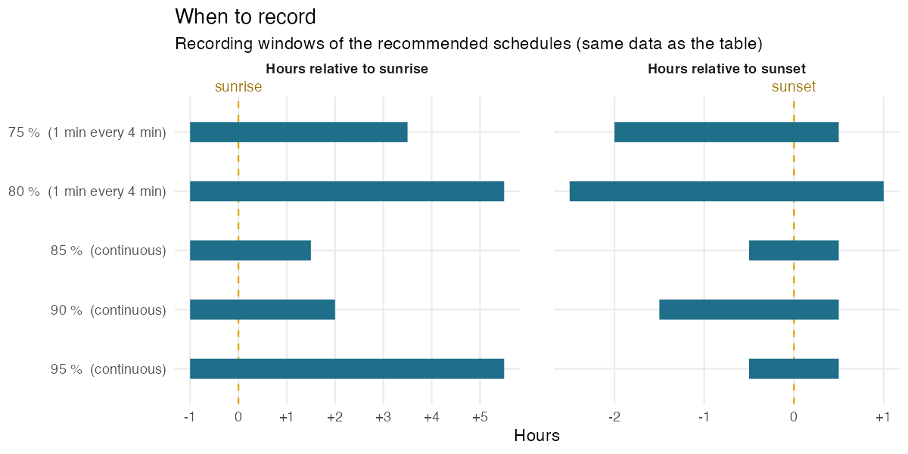
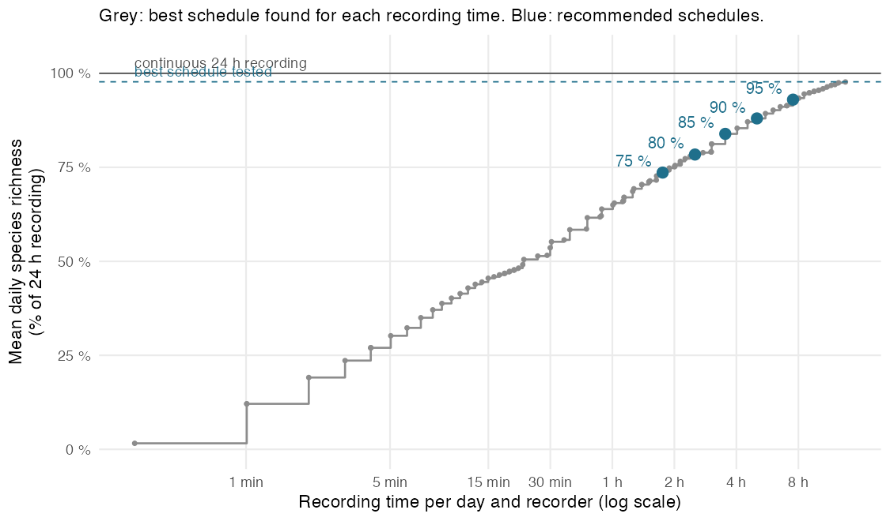
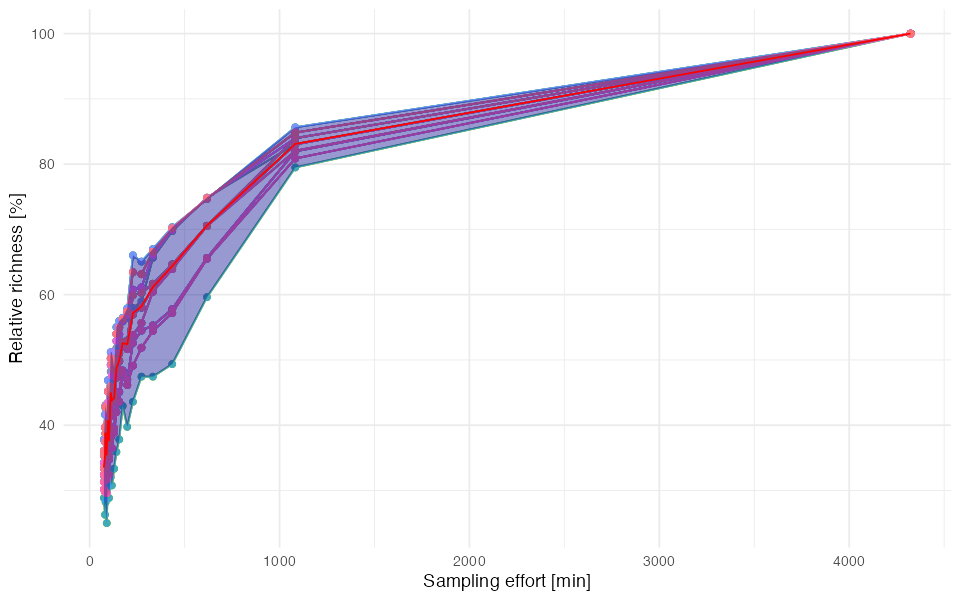
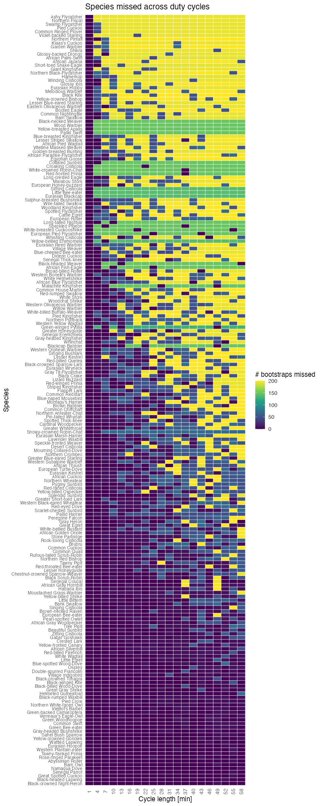
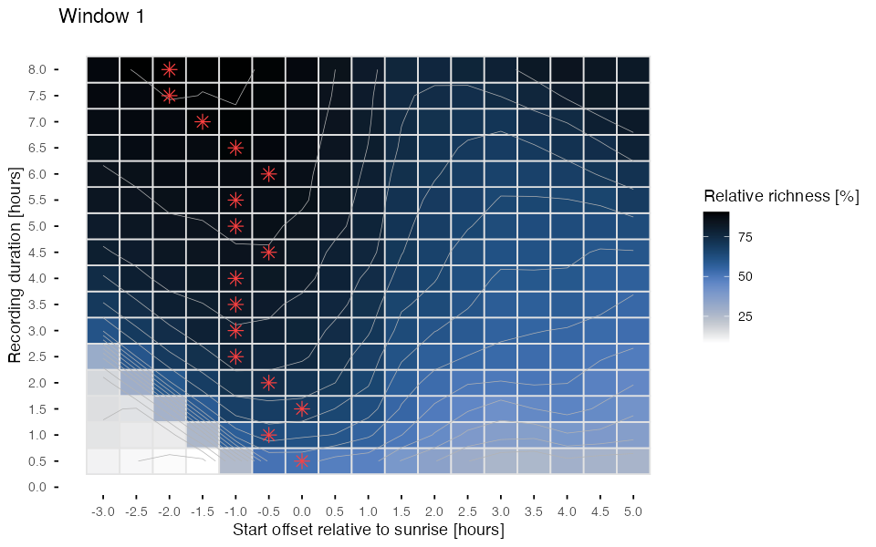
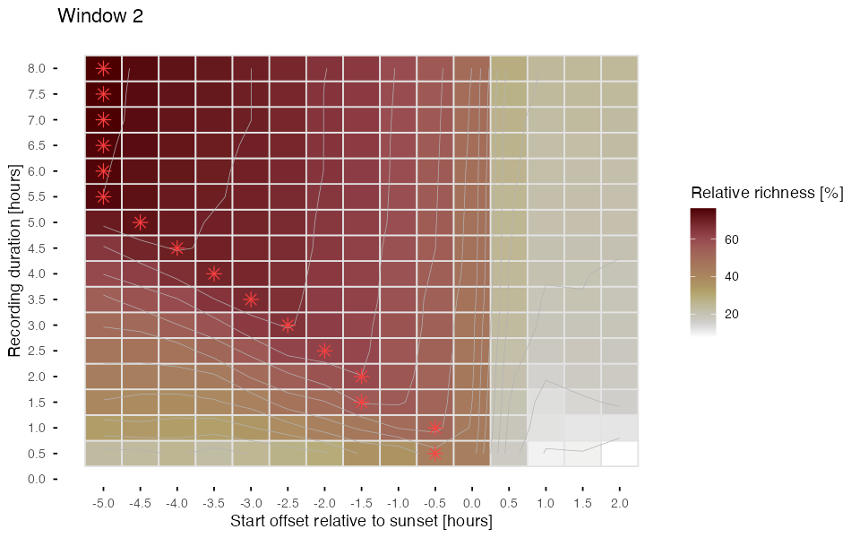
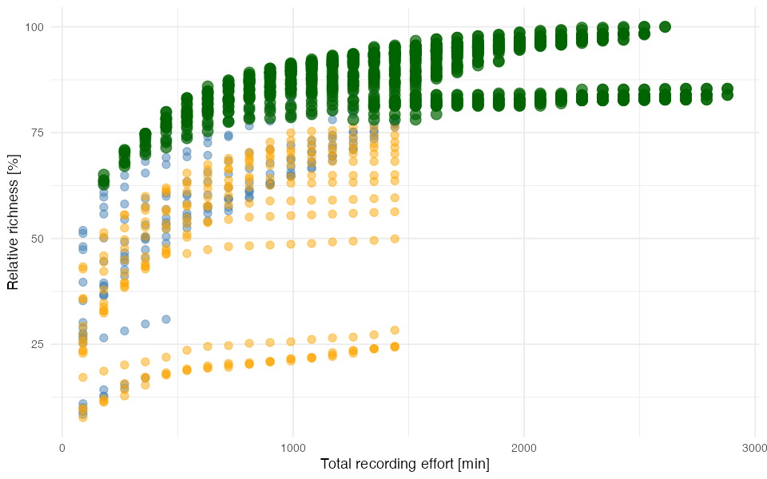
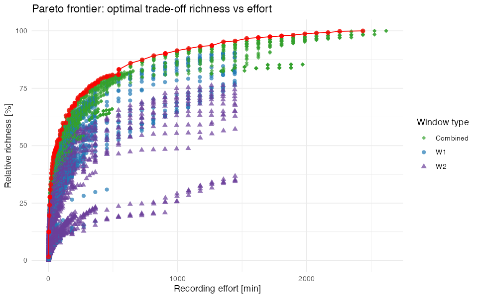

# Sudanian savanna bird community, Burkina Faso: December

`BF_2025-12-31_3d` · Gabriel Marcacci · SCORE 1.1.0

[⬇ Download the preset (.json, for the SCORE app)](../presets/BF_2025-12-31_3d/BF_2025-12-31_3d.json) · [← Back to catalogue](../README.md)

> **Pilot data:** 3 days (2025-12-31 to 2026-01-02), 16 recorder(s), 215 species detected with continuous 24 h recording (186.7 species per day on average).

## Recommended schedules

For each target, the schedule that needs the **least recording** among the 20 402 schedules tested by SCORE.

| Target | Duty cycle | Time windows | Recording per day | Richness (% of 24 h) | Richness (% of best tested) | Species never detected |
|---|---|---|---|---|---|---|
| 75 % | 1 min every 4 min | from sunrise − 1 h to sunrise + 3 h 30 (≈ 05:24–09:54) from sunset − 2 h to sunset + 0 h 30 (≈ 15:49–18:19) | 106 min (7.31 % of 24 h) | 73.6 % | 75.3 % | 36 of 215 |
| 80 % | 1 min every 4 min | from sunrise − 1 h to sunrise + 5 h 30 (≈ 05:24–11:54) from sunset − 2 h 30 to sunset + 1 h (≈ 15:19–18:49) | 151 min (10.49 % of 24 h) | 78.4 % | 80.3 % | 31 of 215 |
| 85 % | continuous | from sunrise − 1 h to sunrise + 1 h 30 (≈ 05:24–07:54) from sunset − 0 h 30 to sunset + 0 h 30 (≈ 17:19–18:19) | 212 min (14.72 % of 24 h) | 83.9 % | 85.9 % | 18 of 215 |
| 90 % | continuous | from sunrise − 1 h to sunrise + 2 h (≈ 05:24–08:24) from sunset − 1 h 30 to sunset + 0 h 30 (≈ 16:19–18:19) | 302 min (20.97 % of 24 h) | 88 % | 90.1 % | 13 of 215 |
| 95 % | continuous | from sunrise − 1 h to sunrise + 5 h 30 (≈ 05:24–11:54) from sunset − 0 h 30 to sunset + 0 h 30 (≈ 17:19–18:19) | 452 min (31.39 % of 24 h) | 93 % | 95.2 % | 12 of 215 |

<b>How to read this table</b>

- **Target**: share of species richness to reach, relative to the *best schedule tested* (see below).
- **Duty cycle**: how to record *inside* the time windows. *Continuous* = record without pause; *1 min every 7 min* = record 1 min, pause 6 min. It is the duty cycle of the least-effort schedule found, not a fixed choice: when a short continuous window is cheaper than a long sampled one, SCORE recommends the continuous window.
- **Time windows**: relative to sunrise or sunset, so that they follow the season. Clock times (≈) are only indicative: they use the mean sunrise/sunset of the pilot days.
- **Recording per day**: per recorder.
- **Richness (% of 24 h)**: mean number of species detected per day with this schedule, as a % of the species detected per day with continuous 24 h recording (all recorders pooled per day).
- **Richness (% of best tested)**: same, but relative to the best schedule among those tested. SCORE only tests windows within the grid chosen in the app (Tab 3), so the best schedule tested can detect fewer species than 24 h recording (here: 97.7 % of 24 h). The targets refer to this value.
- **Species never detected**: species detected at least once during the pilot with 24 h recording but never with this schedule (details below).

*Each bar is a recording window of a recommended schedule (same data as the table). Positions are in hours relative to sunrise or sunset, so the windows follow the change of day length; the duty cycle in brackets applies inside the bars.*

## Species missed by each schedule

| Target | Recording per day | Species detected over the pilot | Species never detected | Mean daily omission |
|---|---|---|---|---|
| 75 % | 106 min | 179 of 215 | 36 (16.7 %) | 27.1 % |
| 80 % | 151 min | 184 of 215 | 31 (14.4 %) | 22.1 % |
| 85 % | 212 min | 197 of 215 | 18 (8.4 %) | 16.7 % |
| 90 % | 302 min | 202 of 215 | 13 (6 %) | 12.7 % |
| 95 % | 452 min | 203 of 215 | 12 (5.6 %) | 6.9 % |

- **Species never detected**: detected at least once with 24 h recording during the pilot, but on no day with this schedule.
- **Mean daily omission**: on an average day, share of the species detected with 24 h recording that the schedule misses.
- Detections per species and per schedule are in the table *Species* below.

<b>75 % schedule: 36 species never detected</b>

African Cuckoo, African Jacana, Ashy Flycatcher, Black-necked Weaver, Blue-breasted Kingfisher, Booted Eagle, Common Ringed Plover, Croaking Cisticola, Eurasian Blackcap, Eurasian Hobby, European Pied Flycatcher, European Roller, Garden Warbler, Giant Kingfisher, Glossy-backed Drongo, Green-winged Pytilia, Hamerkop, Klaas's Cuckoo, Little Bee-eater, Long-tailed Nightjar, Northern Black-Flycatcher, Northern Fiscal, Pallid Harrier, Pallid Swift, Red-fronted Prinia, Shikra, Siffling Cisticola, Speckled Pigeon, Spotted Thick-knee, Violet-backed Starling, Western Bonelli's Warbler, White-breasted Cuckooshrike, White-crowned Robin-Chat, Wood Warbler, Yellow-bellied Eremomela, Yellow-breasted Apalis

<b>80 % schedule: 31 species never detected</b>

African Cuckoo, African Jacana, Ashy Flycatcher, Black-necked Weaver, Blue-breasted Kingfisher, Croaking Cisticola, Eurasian Blackcap, Eurasian Hobby, European Pied Flycatcher, Garden Warbler, Giant Kingfisher, Glossy-backed Drongo, Green-winged Pytilia, Hamerkop, Klaas's Cuckoo, Little Bee-eater, Long-tailed Nightjar, Northern Fiscal, Pallid Harrier, Pallid Swift, Red-fronted Prinia, Shikra, Siffling Cisticola, Speckled Pigeon, Spotted Thick-knee, Violet-backed Starling, White-breasted Cuckooshrike, White-crowned Robin-Chat, Wood Warbler, Yellow-bellied Eremomela, Yellow-breasted Apalis

<b>85 % schedule: 18 species never detected</b>

African Jacana, Common Ringed Plover, Croaking Cisticola, Eastern Olivaceous Warbler, Eurasian Blackcap, Eurasian Hobby, Garden Warbler, Giant Kingfisher, Little Bee-eater, Long-tailed Nightjar, Pied Cuckoo, Red-fronted Prinia, Short-toed Snake-Eagle, Snowy-crowned Robin-Chat, Speckled Pigeon, Spotted Thick-knee, Western Bonelli's Warbler, Wood Warbler

<b>90 % schedule: 13 species never detected</b>

African Jacana, Common Ringed Plover, Eurasian Blackcap, Eurasian Hobby, Garden Warbler, Giant Kingfisher, Little Bee-eater, Long-tailed Nightjar, Red-fronted Prinia, Speckled Pigeon, Spotted Thick-knee, Western Bonelli's Warbler, Wood Warbler

<b>95 % schedule: 12 species never detected</b>

African Jacana, Croaking Cisticola, Eurasian Blackcap, Eurasian Hobby, Giant Kingfisher, Little Bee-eater, Long-tailed Nightjar, Pied Cuckoo, Snowy-crowned Robin-Chat, Speckled Pigeon, Spotted Thick-knee, Wood Warbler

## Species

All species detected during the pilot (215), with BirdNET-Analyzer (confidence threshold: 0). Species names are those of the classifier; detections were not verified unless stated in the notes.

<b>Show the table of the 215 species</b>

- **Detections**: number of BirdNET detections during the pilot, all recorders.
- **Mean confidence**: mean classifier confidence of these detections (low values point to possible false positives).
- **24 h, 75 %, 80 %, 85 %, 90 %, 95 %**: number of pilot days (out of 3) on which the species was detected with continuous 24 h recording and with each recommended schedule.
- **Peak activity**: the hour, relative to sunrise, with the most detections.
- **Activity over the day**: detections per hour from 6 h before sunrise to 18 h after it; `┃` marks sunrise, `·` no detection.

| Species | Detections | Mean confidence | 24 h | 75 % | 80 % | 85 % | 90 % | 95 % | Peak activity | Activity over the day |
|---|---|---|---|---|---|---|---|---|---|---|
| Abyssinian Roller | 522 | 0.258 | 3 | 3 | 3 | 3 | 3 | 3 | 0–1 h after sunrise | `·▁··▁▃┃█▅▂▁▁▁▁▁▁▂▃▆···▁·▁` |
| African Cuckoo | 52 | 0.257 | 3 | 0 | 0 | 1 | 1 | 2 | 7–8 h after sunrise | `······┃·▃···▃▆█▂·········` |
| African Golden Oriole | 72 | 0.167 | 3 | 2 | 2 | 3 | 3 | 3 | 11–12 h after sunrise | `▁····▂┃▂▁·▁·····▁▁█······` |
| African Gray Hornbill | 386 | 0.556 | 3 | 3 | 3 | 3 | 3 | 3 | 0–1 h after sunrise | `·▁···▃┃█▆▁▁···▁··▂▃······` |
| African Gray Woodpecker | 425 | 0.184 | 3 | 3 | 3 | 3 | 3 | 3 | 11–12 h after sunrise | `·····▁┃▁··▁▁····▁▅█▁·▁▁▁·` |
| African Jacana | 5 | 0.171 | 3 | 0 | 0 | 0 | 0 | 0 | 14–15 h after sunrise | `·▄····┃·············▄█··▄` |
| African Paradise-Flycatcher | 13 | 0.134 | 3 | 1 | 1 | 3 | 3 | 3 | 0–1 h before sunrise | `·····█┃▄▂·······▂▂▄······` |
| African Scops-Owl | 4751 | 0.312 | 3 | 3 | 3 | 3 | 3 | 3 | 5–6 h before sunrise | `█▇█▆▃▂┃··········▁▁▅▄▄▆▆▇` |
| African Silverbill | 296 | 0.339 | 3 | 3 | 3 | 3 | 3 | 3 | 0–1 h after sunrise | `·····▃┃█▇▁▁▂▁▁▁▁▄▆▃······` |
| Bank Swallow | 121 | 0.201 | 3 | 2 | 3 | 3 | 3 | 3 | 10–11 h after sunrise | `·▁···▂┃▆▆▅▂█▃▃▄▃▅█▇······` |
| Barn Owl | 324 | 0.317 | 3 | 2 | 3 | 3 | 3 | 3 | 1–2 h before sunrise | `▆▄▇▆█▂┃▃▄▂▃▃▂▂▁▆▃▃▂█▆▅▃▄▃` |
| Beautiful Sunbird | 268 | 0.249 | 3 | 3 | 3 | 3 | 3 | 3 | 1–2 h after sunrise | `·▁···▃┃██▃▁▁▁▁▁▁▂▅▁····▁·` |
| Black Crake | 47 | 0.189 | 3 | 2 | 3 | 3 | 3 | 3 | 11–12 h after sunrise | `·▁▁··▁┃▄▃··▁·▁·▁·▃█▂▃▁···` |
| Black Kite | 10 | 0.186 | 3 | 1 | 1 | 3 | 3 | 3 | 0–1 h before sunrise | `·····█┃·▃··▆·····▆▆······` |
| Black Scrub-Robin | 159 | 0.202 | 3 | 3 | 3 | 3 | 3 | 3 | 0–1 h after sunrise | `·····▂┃█▆▂▂▃▃▂·▁▃▄▃······` |
| Black-billed Wood-Dove | 571 | 0.237 | 3 | 3 | 3 | 3 | 3 | 3 | 6–7 h after sunrise | `··▁··▂┃▇▆▁▁▂▆█▇▄▂▂█··▁··▁` |
| Black-crowned Night-Heron | 879 | 0.239 | 3 | 3 | 3 | 3 | 3 | 3 | 5–6 h before sunrise | `█▇▃▂▂▃┃▂▃▁▁▁▃▃▂▁▂▁▂▄▅▇▅▆▇` |
| Black-crowned Sparrow-Lark | 36 | 0.157 | 3 | 2 | 2 | 2 | 2 | 3 | 10–11 h after sunrise | `·····▃┃···▁·▃▃▃▁██▇······` |
| Black-crowned Tchagra | 562 | 0.301 | 3 | 3 | 3 | 3 | 3 | 3 | 0–1 h after sunrise | `▁▁···▄┃█▆▁▂▁▁▁▁▁▂▇▆▁▁▁·▁·` |
| Black-headed Lapwing | 3234 | 0.505 | 3 | 3 | 3 | 3 | 3 | 3 | 13–14 h after sunrise | `█▇▅▂▁▄┃▁▁▁·▁···▁▁▁▃▄███▅▆` |
| Black-rumped Waxbill | 1697 | 0.341 | 3 | 3 | 3 | 3 | 3 | 3 | 11–12 h after sunrise | `·····▃┃▄▁▁▁▁···▁▁▄█······` |
| Black-winged Kite | 315 | 0.186 | 3 | 3 | 3 | 3 | 3 | 3 | 0–1 h after sunrise | `▁▁·▁▁█┃█▃▁▁▁··▁▁▁▄▆·▁▁·▁▁` |
| Blue-naped Mousebird | 45 | 0.19 | 3 | 3 | 3 | 3 | 3 | 3 | 0–1 h after sunrise | `·····█┃█▄▄▁▁··▁·▂▅▅··▁···` |
| Blue-spotted Wood-Dove | 291 | 0.219 | 3 | 3 | 3 | 3 | 3 | 3 | 0–1 h after sunrise | `·····▅┃█▅▁▁▁▄▆▇▃▁·▃▁▁▁···` |
| Booted Eagle | 11 | 0.183 | 3 | 0 | 1 | 2 | 2 | 2 | 4–5 h after sunrise | `·····▃┃·▃··█▃··▆·▃·······` |
| Brown Babbler | 61 | 0.258 | 3 | 3 | 3 | 3 | 3 | 3 | 11–12 h after sunrise | `·····▆┃▆▄····▁··▂▁█··▂···` |
| Brown-necked Raven | 205 | 0.233 | 3 | 3 | 3 | 3 | 3 | 3 | 10–11 h after sunrise | `▁▂▁▁▁·┃▆▇▃▁·▂▂▁▁▅█▃······` |
| Brubru | 135 | 0.267 | 3 | 3 | 3 | 3 | 3 | 3 | 0–1 h after sunrise | `·····▂┃██▆▂▁▁▂▂▃▃▆▆······` |
| Cardinal Woodpecker | 40 | 0.182 | 3 | 3 | 3 | 3 | 3 | 3 | 0–1 h after sunrise | `·····▇┃█▄▁·····▁▁▁▂······` |
| Cattle Egret | 15 | 0.163 | 3 | 1 | 1 | 2 | 2 | 2 | 11–12 h after sunrise | `·▂▄·▄▄┃··▂▂······▂█······` |
| Common Bulbul | 6276 | 0.276 | 3 | 3 | 3 | 3 | 3 | 3 | 0–1 h after sunrise | `·····▄┃██▆▅▆▄▅▆▆▆▅▃······` |
| Common Chiffchaff | 74 | 0.295 | 3 | 2 | 2 | 2 | 3 | 3 | 1–2 h after sunrise | `▁··▁··┃▂█▂▄▂▃▁▁▃▄▄·······` |
| Common Cuckoo | 97 | 0.216 | 3 | 2 | 2 | 1 | 2 | 3 | 5–6 h after sunrise | `▁▁▁··▁┃·▁▂▃▂█▂▂▁▂▁···▁▂··` |
| Common House-Martin | 24 | 0.217 | 3 | 1 | 1 | 3 | 3 | 3 | 0–1 h before sunrise | `·····█┃▂▄▇·▄█▄▂▂·▂·······` |
| Common Quail | 99 | 0.161 | 3 | 3 | 3 | 3 | 3 | 3 | 0–1 h before sunrise | `▁▁▃▄▅█┃▆▃▂▂▂▁·▂▂▄▃·······` |
| Common Redstart | 28 | 0.29 | 3 | 2 | 3 | 2 | 2 | 3 | 1–2 h after sunrise | `······┃▄█·▂▇▄▄·▄▂▂·······` |
| Common Swift | 476 | 0.185 | 3 | 1 | 3 | 2 | 2 | 3 | 16–17 h after sunrise | `▄▃▅▂▃▁┃···▁▁▁·▁··▁▁▄▂▅██▄` |
| Crested Lark | 335 | 0.232 | 3 | 3 | 3 | 3 | 3 | 3 | 11–12 h after sunrise | `·····▅┃▃▂▁▁▃▃▃▁▅█▇█······` |
| Desert Cisticola | 48 | 0.208 | 3 | 3 | 3 | 3 | 3 | 3 | 10–11 h after sunrise | `·····▅┃▅▅▅·······█▂······` |
| Dideric Cuckoo | 20 | 0.253 | 3 | 3 | 3 | 3 | 3 | 3 | 0–1 h after sunrise | `·····▃┃█▇▃·······▂▃······` |
| Double-spurred Francolin | 359 | 0.395 | 3 | 3 | 3 | 3 | 3 | 3 | 0–1 h before sunrise | `▁····█┃▄▁·▁···▁·▁▁▄▁·▁···` |
| Egyptian Goose | 21 | 0.218 | 3 | 2 | 2 | 3 | 3 | 3 | 0–1 h before sunrise | `·▂···█┃█▅▂▄·····▂▂·····▂·` |
| Eurasian Hoopoe | 1471 | 0.249 | 3 | 3 | 3 | 3 | 3 | 3 | 2–3 h after sunrise | `▁▂▃▁▁▅┃▄▄███▇▇▆▇▇▅▁▁·▁▁▁▁` |
| Eurasian Kestrel | 69 | 0.3 | 3 | 2 | 2 | 2 | 2 | 3 | 3–4 h before sunrise | `▇·█··▅┃▄▇▄▇▅▄▂·▂▄▅▅▂▅·█▅▅` |
| Eurasian Marsh-Harrier | 45 | 0.227 | 3 | 3 | 3 | 1 | 3 | 3 | 3–4 h after sunrise | `······┃··▇█▃▇█▄▄▂▄▃······` |
| Eurasian Reed Warbler | 12 | 0.184 | 3 | 1 | 1 | 1 | 2 | 3 | 4–5 h after sunrise | `······┃··▂▂█▂····▂▄······` |
| Eurasian Wryneck | 21 | 0.191 | 3 | 1 | 3 | 2 | 2 | 3 | 4–5 h after sunrise | `··▂··▂┃···▄█▂▂▃▃▄·▂······` |
| European Bee-eater | 236 | 0.218 | 3 | 3 | 3 | 2 | 3 | 3 | 2–3 h after sunrise | `▁▁·▁·▃┃▄▆█▇▆▅▄▅▃▂▂···▁▁▁▁` |
| European Honey-buzzard | 21 | 0.213 | 3 | 3 | 3 | 1 | 2 | 3 | 3–4 h after sunrise | `···▂·▄┃··▂█▂▂▄▂▅▂▂▂······` |
| European Roller | 20 | 0.208 | 3 | 0 | 1 | 2 | 3 | 2 | 9–10 h after sunrise | `····▄·┃▅··▂▂▂▄▄▄█▂·······` |
| European Turtle-Dove | 44 | 0.237 | 3 | 1 | 3 | 2 | 2 | 3 | 2–3 h after sunrise | `··▁·▁▄┃··█▃▃▁▁▇▃▄▃·······` |
| Flappet Lark | 256 | 0.453 | 3 | 2 | 2 | 3 | 3 | 3 | 0–1 h before sunrise | `·····█┃▂▅▁▁·······▃······` |
| Gabar Goshawk | 1019 | 0.281 | 3 | 3 | 3 | 3 | 3 | 3 | 11–12 h after sunrise | `·····▁┃▂▁▁▁▁···▁▁▅█▂▁▁▁··` |
| Garden Warbler | 6 | 0.229 | 3 | 0 | 0 | 0 | 0 | 2 | 7–8 h after sunrise | `······┃····▄▄·█▄·········` |
| Glossy Ibis | 6 | 0.227 | 3 | 2 | 2 | 1 | 2 | 1 | 7–8 h after sunrise | `·····▅┃·······█··█···▅···` |
| Gray Heron | 130 | 0.191 | 3 | 3 | 3 | 3 | 3 | 3 | 8–9 h after sunrise | `▇▆▄▆▃█┃▅▄▄▃▃▁▂▁██▅▂··▂▁▂▁` |
| Gray-headed Bushshrike | 448 | 0.222 | 3 | 3 | 3 | 3 | 3 | 3 | 11–12 h after sunrise | `··▁·▁▅┃█▄▂▁▁▁▁▁▁▁▄█▂▁▁··▁` |
| Gray-headed Kingfisher | 35 | 0.225 | 3 | 3 | 3 | 3 | 3 | 3 | 11–12 h after sunrise | `······┃▆▄▄·▁···▁▂▃█······` |
| Great Egret | 127 | 0.2 | 3 | 2 | 2 | 3 | 3 | 3 | 5–6 h before sunrise | `█▅▇▅▅▆┃▂▁▁▂▁··▁·▂▂█▂▂▂▃▂▃` |
| Great Gray Shrike | 275 | 0.206 | 3 | 3 | 3 | 3 | 3 | 3 | 0–1 h after sunrise | `·····▃┃█▆▄▂▃▅▂▂▂▄▇▃······` |
| Great Spotted Cuckoo | 511 | 0.234 | 3 | 3 | 3 | 3 | 3 | 3 | 5–6 h before sunrise | `██▇▅▃▇┃▁▁▁▁▁▁·▁▂▁▂▃▂▃▄▄▄▆` |
| Greater Blue-eared Starling | 53 | 0.16 | 3 | 3 | 3 | 3 | 3 | 3 | 11–12 h after sunrise | `·····▃┃▅▁▃▁·▁▂▁▃▁·█······` |
| Greater Short-toed Lark | 71 | 0.191 | 3 | 2 | 3 | 2 | 2 | 3 | 9–10 h after sunrise | `▁····▂┃▂▄▄▂▃▆▃▃▃█▃▁······` |
| Greater Whitethroat | 61 | 0.277 | 3 | 2 | 3 | 3 | 3 | 3 | 5–6 h after sunrise | `·····▃┃▂▇·▃▄█▇▆█▆▄·······` |
| Green Bee-eater | 382 | 0.438 | 3 | 3 | 3 | 3 | 3 | 3 | 9–10 h after sunrise | `······┃▅▇▁▂▁▁▂▂▂█▄▃······` |
| Green Woodhoopoe | 230 | 0.325 | 3 | 3 | 3 | 3 | 3 | 3 | 0–1 h after sunrise | `▁▁▁▁·▅┃█▂·▂▁▁··▁▁▂█▂▃▃▃▂·` |
| Green-backed Camaroptera | 1435 | 0.417 | 3 | 3 | 3 | 3 | 3 | 3 | 0–1 h after sunrise | `▁····▃┃█▇▄▂▂▂▃▂▃▄▅▅······` |
| Hadada Ibis | 132 | 0.182 | 3 | 3 | 3 | 3 | 3 | 3 | 0–1 h after sunrise | `·▁▁·▁▄┃█▁▃▂▁▁▂·▂▁▆█▅▄▃▁▂▂` |
| Helmeted Guineafowl | 508 | 0.322 | 3 | 3 | 3 | 3 | 3 | 3 | 0–1 h after sunrise | `▁▁▁··▄┃█▁▁▁▁▁▁▁▁▂▃▃▁▁▁▁▁▁` |
| Laughing Dove | 16576 | 0.368 | 3 | 3 | 3 | 3 | 3 | 3 | 2–3 h after sunrise | `▃▃▃▄▂▇┃████▇█▇▆▅▆▆▅▁▁▁▁▁▁` |
| Lavender Waxbill | 72 | 0.222 | 3 | 3 | 3 | 3 | 3 | 3 | 11–12 h after sunrise | `·····▁┃▄▁········▁█······` |
| Lesser Honeyguide | 315 | 0.196 | 3 | 2 | 3 | 2 | 2 | 3 | 12–13 h after sunrise | `·····▁┃▁·▁▁▁▁▁▁▁▁▁▃█▁▁···` |
| Lesser Kestrel | 35 | 0.231 | 3 | 2 | 2 | 3 | 3 | 3 | 9–10 h after sunrise | `▂·▂··▇┃▂▃▂▂··▄▄▂█▄▃▂···▂·` |
| Lesser Striped Swallow | 11 | 0.222 | 3 | 2 | 3 | 3 | 3 | 3 | 0–1 h after sunrise | `·····▃┃█▃·······▃·█······` |
| Little Bittern | 135 | 0.209 | 3 | 3 | 3 | 3 | 3 | 3 | 9–10 h after sunrise | `▃▇▄▆▃▇┃·▁▃▃▁▄▃▆▅██▁▆▆▇▅▁·` |
| Little Egret | 239 | 0.198 | 3 | 3 | 3 | 3 | 3 | 3 | 0–1 h before sunrise | `▄▃▃▇▅█┃▄▅▄▂▂▂▂▂▄▄█▅▄▂▂▂▁▄` |
| Long-crested Eagle | 13 | 0.216 | 3 | 3 | 3 | 3 | 3 | 3 | 0–1 h after sunrise | `·····▂┃█▂▂▂▂·····▂▂······` |
| Long-tailed Glossy Starling | 4791 | 0.578 | 3 | 3 | 3 | 3 | 3 | 3 | 3–4 h after sunrise | `▂▁▁▁▁▇┃▃▃▃█▄▄▅▅▅▇▇█▃▁▁··▁` |
| Melodious Warbler | 11 | 0.193 | 3 | 1 | 1 | 1 | 2 | 2 | 1–2 h after sunrise | `▄▄▄··▄┃·█▄········▄·····▄` |
| Montagu's Harrier | 46 | 0.196 | 3 | 2 | 2 | 2 | 2 | 3 | 10–11 h after sunrise | `·····▁┃▂▁▃▃▃▁▆▁▂▃█▃······` |
| Mourning Collared-Dove | 63 | 0.158 | 3 | 2 | 2 | 3 | 3 | 3 | 11–12 h after sunrise | `█▂▁▂·▆┃▆▂▁······▁▃█··▄▃▁▇` |
| Moustached Grass-Warbler | 168 | 0.171 | 3 | 3 | 3 | 3 | 3 | 3 | 0–1 h after sunrise | `·····▇┃█▃▁▁▁···▁▁▃▆▁·····` |
| Namaqua Dove | 1339 | 0.236 | 3 | 3 | 3 | 3 | 3 | 3 | 4–5 h after sunrise | `·····▄┃▆▄▆▇█▇▇▆▇▇▇▁·····▁` |
| Northern Anteater-Chat | 45 | 0.187 | 3 | 2 | 2 | 2 | 2 | 3 | 11–12 h after sunrise | `······┃▁·▁··▁·▁··▂█······` |
| Northern Black-Flycatcher | 10 | 0.164 | 3 | 0 | 1 | 2 | 2 | 3 | 0–1 h after sunrise | `·····▆┃█····▃····▃█······` |
| Northern Crombec | 94 | 0.271 | 3 | 2 | 2 | 3 | 3 | 3 | 0–1 h after sunrise | `·····▃┃█▅▁··▁·▁··▄▇······` |
| Northern Gray-headed Sparrow | 779 | 0.278 | 3 | 3 | 3 | 3 | 3 | 3 | 0–1 h after sunrise | `·····▃┃█▆▁▁▁▁▁▁▁▁▁▃······` |
| Northern Pintail | 10 | 0.219 | 3 | 2 | 3 | 1 | 1 | 3 | 2–3 h after sunrise | `·····▄┃·▄█▄▄····▄·······▄` |
| Northern Puffback | 15 | 0.131 | 3 | 3 | 3 | 3 | 3 | 3 | 0–1 h after sunrise | `·····▄┃█▂·········▄······` |
| Northern Red Bishop | 130 | 0.177 | 3 | 3 | 3 | 3 | 3 | 3 | 1–2 h after sunrise | `·····▃┃██▃▁▁▁·▁▁▁▃▄······` |
| Northern Red-billed Hornbill | 4922 | 0.347 | 3 | 3 | 3 | 3 | 3 | 3 | 0–1 h after sunrise | `··▁··▄┃██▃▃▂▁▂▁▄▄▄▃▁·····` |
| Northern Wheatear | 76 | 0.253 | 3 | 2 | 2 | 2 | 2 | 3 | 2–3 h after sunrise | `▂▃····┃▁·█·▃▄█▁··▂▁▅▅▅▁▂▄` |
| Northern White-faced Owl | 1002 | 0.25 | 3 | 2 | 2 | 2 | 2 | 2 | 12–13 h after sunrise | `▇▅▃▂▁▁┃··········▁▃█▇██▅▇` |
| Osprey | 186 | 0.225 | 3 | 3 | 3 | 3 | 3 | 3 | 5–6 h before sunrise | `██▂▂▁▄┃▅▇▅▃▂▇▄▇▄▅█▅▅▂▄▅██` |
| Pallid Harrier | 8 | 0.184 | 3 | 0 | 0 | 1 | 1 | 1 | 4–5 h before sunrise | `·█▄▄·▄┃·············▄···▄` |
| Pearl-spotted Owlet | 514 | 0.496 | 3 | 2 | 2 | 3 | 3 | 3 | 14–15 h after sunrise | `██▅▂▂▅┃▃▁·▁▁··▁··▂▂▂▄█▆▃▁` |
| Peregrine Falcon | 99 | 0.202 | 3 | 3 | 3 | 2 | 2 | 3 | 2–3 h after sunrise | `▃▁▁··▁┃▁▂█▆█▅█▅█▃▁·▁··▁▂▃` |
| Pied Crow | 1216 | 0.435 | 3 | 3 | 3 | 3 | 3 | 3 | 10–11 h after sunrise | `···▁▁▃┃█▅▄▂▁▄▁▂▁▅█▇······` |
| Pied Kingfisher | 27 | 0.162 | 3 | 1 | 1 | 3 | 3 | 3 | 11–12 h after sunrise | `·····▃┃▇▆▂·▃·▂····█······` |
| Pin-tailed Whydah | 53 | 0.185 | 3 | 3 | 3 | 3 | 3 | 3 | 1–2 h after sunrise | `·····▁┃▂█▂··▁▁··▂▁▂·▁····` |
| Pygmy Sunbird | 73 | 0.212 | 3 | 2 | 2 | 3 | 3 | 3 | 11–12 h after sunrise | `·····▂┃▅▇▃·▁···▁·▃█······` |
| Red-billed Firefinch | 281 | 0.241 | 3 | 3 | 3 | 3 | 3 | 3 | 0–1 h after sunrise | `·····▂┃█▇▂▁▁▂▂▂▂▃▅▆······` |
| Red-billed Quelea | 129 | 0.211 | 3 | 2 | 2 | 3 | 3 | 3 | 11–12 h after sunrise | `······┃▂▁·······▁▅█······` |
| Red-cheeked Cordonbleu | 10731 | 0.377 | 3 | 3 | 3 | 3 | 3 | 3 | 0–1 h after sunrise | `·····▃┃██▇▃▆▅▅▅▅▅▅▅······` |
| Red-eyed Dove | 87 | 0.158 | 3 | 3 | 3 | 3 | 3 | 3 | 11–12 h after sunrise | `··▂▁▁▂┃▂▂·▁·▁····▂█▁·▁▁▂▁` |
| Red-faced Cisticola | 70 | 0.174 | 3 | 2 | 2 | 3 | 3 | 3 | 0–1 h before sunrise | `·····█┃▅▄▂▁▂▂▁▄▁▁·▇······` |
| Red-rumped Swallow | 28 | 0.176 | 3 | 2 | 3 | 3 | 3 | 3 | 10–11 h after sunrise | `······┃▂▇▅▅▄▂▂▅▂▄█▄······` |
| Red-throated Bee-eater | 126 | 0.201 | 3 | 3 | 3 | 3 | 3 | 3 | 11–12 h after sunrise | `·▁···▁┃▃▂▁······▁▂█··▁···` |
| Rock-loving Cisticola | 103 | 0.203 | 3 | 2 | 2 | 3 | 3 | 3 | 1–2 h after sunrise | `·····▂┃▆█▅▁▂▇▄▇▅█▂▃······` |
| Rose-ringed Parakeet | 644 | 0.255 | 3 | 3 | 3 | 3 | 3 | 3 | 1–2 h after sunrise | `·····▁┃▅█▅▂▄▃▄▂▂▃▅▆······` |
| Rufous-tailed Scrub-Robin | 375 | 0.416 | 3 | 3 | 3 | 3 | 3 | 3 | 9–10 h after sunrise | `·····▁┃▆▃▃·▆█▃▆▆█▅▁······` |
| Sahel Bush Sparrow | 860 | 0.309 | 3 | 3 | 3 | 3 | 3 | 3 | 0–1 h after sunrise | `·····▆┃█▆▄▂▄▂▃▄▂▅▅▃······` |
| Scarlet-chested Sunbird | 154 | 0.307 | 3 | 2 | 3 | 3 | 3 | 3 | 10–11 h after sunrise | `·····▂┃▆▇▄▂▂▂▁▂▃▅█▆······` |
| Senegal Parrot | 2485 | 0.54 | 3 | 3 | 3 | 3 | 3 | 3 | 0–1 h after sunrise | `·····▃┃█▇▃▁▁▂▁▁▁▁▄▆▁▁▁···` |
| Senegal Thick-knee | 11 | 0.204 | 3 | 2 | 3 | 3 | 3 | 3 | 1–2 h after sunrise | `·▃····┃▃█······▃··█▆·····` |
| Singing Bushlark | 31 | 0.159 | 3 | 3 | 3 | 3 | 3 | 3 | 1–2 h after sunrise | `·····▂┃▇█▅·█·▂·▂·▅▅······` |
| Singing Cisticola | 532 | 0.333 | 3 | 3 | 3 | 3 | 3 | 3 | 0–1 h after sunrise | `·····▇┃█▇▂▁▂·▁▁▁▂▅█······` |
| Snowy-crowned Robin-Chat | 3 | 0.119 | 3 | 1 | 1 | 0 | 1 | 0 | 10–11 h after sunrise | `······┃··········█·█····█` |
| Speckle-fronted Weaver | 78 | 0.228 | 3 | 3 | 3 | 3 | 3 | 3 | 0–1 h before sunrise | `·····█┃▄▅▂▃··▁▁·▂▄▂······` |
| Spotted Flycatcher | 16 | 0.192 | 3 | 1 | 1 | 1 | 2 | 2 | 8–9 h after sunrise | `······┃·▃▃··▃▄▄█▄▄·······` |
| Spotted Thick-knee | 99 | 0.256 | 3 | 0 | 0 | 0 | 0 | 0 | 16–17 h after sunrise | `▁▅····┃············▁▃▁▃█▁` |
| Stone Partridge | 434 | 0.471 | 3 | 3 | 3 | 3 | 3 | 3 | 11–12 h after sunrise | `·····▃┃▁▂··▁▁··▁▁▁█▂▁▁···` |
| Tawny Pipit | 77 | 0.233 | 3 | 3 | 3 | 3 | 3 | 3 | 1–2 h after sunrise | `·····▄┃▅█▁▅▅▇▃▃▆▂▁▂······` |
| Tawny-flanked Prinia | 1061 | 0.316 | 3 | 3 | 3 | 3 | 3 | 3 | 1–2 h after sunrise | `·····▅┃██▃▂▄▂▃▂▃▅▅▃······` |
| Tree Pipit | 169 | 0.243 | 3 | 3 | 3 | 3 | 3 | 3 | 10–11 h after sunrise | `·▁▂▂▂▅┃▃▅▂▃▄▂▄▃▅▄█▂·····▁` |
| Verreaux's Eagle-Owl | 441 | 0.219 | 3 | 3 | 3 | 3 | 3 | 3 | 15–16 h after sunrise | `▂·▁▁▁▅┃▇▃▁·▁▁▁▁··▁█▂▁▂█▃▂` |
| Vieillot's Barbet | 630 | 0.324 | 3 | 3 | 3 | 3 | 3 | 3 | 0–1 h after sunrise | `▁▁▂▂▂▄┃█▆▃▂▂▂▁▂▄▅█▅··▁▁▁▁` |
| Village Indigobird | 224 | 0.192 | 3 | 3 | 3 | 3 | 3 | 3 | 1–2 h after sunrise | `·····▃┃▆█▄▂▂▁▁▃▂▃▄▄······` |
| Vinaceous Dove | 34771 | 0.38 | 3 | 3 | 3 | 3 | 3 | 3 | 1–2 h after sunrise | `▃▃▃▄▄█┃████▇▆▆▅▆▆▆▆▄▂▂▂▂▂` |
| Vitelline Masked-Weaver | 10 | 0.154 | 3 | 2 | 2 | 3 | 3 | 3 | 0–1 h after sunrise | `·····▆┃█·········▆█······` |
| Wattled Lapwing | 1435 | 0.299 | 3 | 3 | 3 | 3 | 3 | 3 | 13–14 h after sunrise | `█▅▅▂▁▄┃▂▁▁·▁···▁▁▂▇▅███▄▅` |
| Western Black-eared Wheatear | 59 | 0.161 | 3 | 3 | 3 | 1 | 3 | 3 | 2–3 h after sunrise | `······┃▂▃█▅▇▆▄▅▅██·······` |
| Western Bonelli's Warbler | 9 | 0.117 | 3 | 0 | 1 | 0 | 0 | 3 | 4–5 h after sunrise | `··▃·▃·┃···▆█▃··▃·········` |
| Western Orphean Warbler | 29 | 0.165 | 3 | 2 | 3 | 2 | 2 | 3 | 4–5 h after sunrise | `·····▂┃▂·▃▄█▅·▇▂▂▃·······` |
| Western Plantain-eater | 550 | 0.31 | 3 | 3 | 3 | 3 | 3 | 3 | 11–12 h after sunrise | `··▁▁▁▁┃▄▆▄▁▁▁▁▁·▁▅█▁·▁···` |
| Western Subalpine Warbler | 28 | 0.155 | 3 | 2 | 2 | 1 | 2 | 3 | 5–6 h after sunrise | `·····▃┃·▃▄▁▂█▄···▁·······` |
| Western Yellow Wagtail | 30 | 0.191 | 3 | 1 | 1 | 3 | 3 | 3 | 0–1 h before sunrise | `·····█┃▃▃▂·▂▇·▃▆▃········` |
| White Helmetshrike | 39 | 0.247 | 3 | 2 | 2 | 3 | 3 | 3 | 11–12 h after sunrise | `·····▂┃▂▃······▁·▂█▁·····` |
| White Wagtail | 344 | 0.216 | 3 | 3 | 3 | 3 | 3 | 3 | 0–1 h before sunrise | `·····█┃▃▃▂▁▃▂▂▁▂▃▅▁······` |
| White-bellied Bustard | 130 | 0.185 | 3 | 3 | 3 | 3 | 3 | 3 | 11–12 h after sunrise | `···▁▁▃┃▂▂▁▁···▁·▁▄█▆▁▂▁··` |
| White-billed Buffalo-Weaver | 24 | 0.26 | 3 | 1 | 1 | 3 | 3 | 3 | 1–2 h after sunrise | `······┃▄█▂····▂▆·▂▄······` |
| Wire-tailed Swallow | 9 | 0.188 | 3 | 2 | 2 | 3 | 3 | 3 | 10–11 h after sunrise | `·····▂┃▂▄·······▂█·······` |
| Woodchat Shrike | 22 | 0.164 | 3 | 2 | 2 | 2 | 2 | 3 | 1–2 h after sunrise | `·····▂┃·█▄·▂▄▄▂▂▂▄▆······` |
| Woodland Kingfisher | 8 | 0.238 | 3 | 1 | 1 | 3 | 3 | 3 | 11–12 h after sunrise | `······┃▂▄·········█▂·····` |
| Yellow-billed Oxpecker | 48 | 0.168 | 3 | 3 | 3 | 3 | 3 | 3 | 0–1 h before sunrise | `·····█┃█▄········▂▅······` |
| Yellow-billed Shrike | 396 | 0.405 | 3 | 3 | 3 | 3 | 3 | 3 | 11–12 h after sunrise | `▁····█┃▄▁▁▁▁▁·▃▁▁▂█▂·▁···` |
| Yellow-crowned Bishop | 6 | 0.155 | 3 | 1 | 1 | 3 | 3 | 3 | 11–12 h after sunrise | `······┃▄▄·▄·······█······` |
| Yellow-crowned Gonolek | 1122 | 0.518 | 3 | 3 | 3 | 3 | 3 | 3 | 0–1 h after sunrise | `·····▃┃█▅▂▁▁▁▁·▁▁▂▄······` |
| Yellow-fronted Canary | 301 | 0.308 | 3 | 3 | 3 | 3 | 3 | 3 | 9–10 h after sunrise | `·····▇┃▆▁▁·▅▁▂▁▃█▅▃······` |
| Yellow-fronted Tinkerbird | 8336 | 0.469 | 3 | 3 | 3 | 3 | 3 | 3 | 4–5 h after sunrise | `▁▁···▂┃▇▇███▇▇▇▇▇▆▄▁·▁·▁▁` |
| Zitting Cisticola | 231 | 0.233 | 3 | 3 | 3 | 3 | 3 | 3 | 4–5 h after sunrise | `·····▃┃█▇▇▃█▄▂▃▃▅▂█······` |
| African Blue Flycatcher | 33 | 0.195 | 2 | 2 | 2 | 2 | 2 | 2 | 0–1 h before sunrise | `·····█┃··················` |
| African Palm-Swift | 6 | 0.132 | 2 | 1 | 1 | 2 | 2 | 2 | 0–1 h after sunrise | `······┃█··▃·······▃······` |
| African Pied Wagtail | 13 | 0.232 | 2 | 2 | 2 | 2 | 2 | 2 | 1–2 h after sunrise | `······┃▃█················` |
| African Thrush | 58 | 0.176 | 2 | 2 | 2 | 2 | 2 | 2 | 11–12 h after sunrise | `▁····▂┃·▁········▄█▁·▁▁▁·` |
| Ashy Flycatcher | 2 | 0.596 | 2 | 0 | 0 | 1 | 1 | 1 | 9–10 h after sunrise | `······┃·········█·█······` |
| Barn Swallow | 7 | 0.154 | 2 | 1 | 2 | 1 | 1 | 2 | 2–3 h after sunrise | `·····▄┃··█·█····█········` |
| Blue-breasted Kingfisher | 5 | 0.258 | 2 | 0 | 0 | 2 | 2 | 2 | 0–1 h after sunrise | `▄·····┃█··········▄··▄···` |
| Blue-cheeked Bee-eater | 16 | 0.171 | 2 | 1 | 2 | 1 | 1 | 2 | 7–8 h after sunrise | `······┃▃▃▆▃▆·▃█··▃▆······` |
| Broad-billed Roller | 15 | 0.161 | 2 | 1 | 2 | 1 | 2 | 2 | 4–5 h before sunrise | `▄█···▄┃·▄·······▄·█▄·▄·▄█` |
| Chestnut-crowned Sparrow-Weaver | 175 | 0.549 | 2 | 2 | 2 | 2 | 2 | 2 | 0–1 h before sunrise | `·····█┃▇▄···▁·▁·▁█▆······` |
| Common Nightingale | 2 | 0.13 | 2 | 2 | 2 | 1 | 1 | 1 | 0–1 h after sunrise | `······┃█········█········` |
| Common Ringed Plover | 2 | 0.119 | 2 | 0 | 1 | 0 | 0 | 2 | 2–3 h after sunrise | `······┃··█·█·············` |
| Eastern Olivaceous Warbler | 5 | 0.149 | 2 | 1 | 1 | 0 | 1 | 1 | 6–7 h after sunrise | `······┃··▄···█··█········` |
| Eurasian Hobby | 6 | 0.163 | 2 | 0 | 0 | 0 | 0 | 0 | 17–18 h after sunrise | `▃·····┃·········▃······▃█` |
| Giant Kingfisher | 5 | 0.166 | 2 | 0 | 0 | 0 | 0 | 0 | 13–14 h after sunrise | `······┃·············█·█··` |
| Glossy-backed Drongo | 11 | 0.176 | 2 | 0 | 0 | 2 | 2 | 2 | 11–12 h after sunrise | `······┃···········█······` |
| Golden-breasted Bunting | 5 | 0.144 | 2 | 1 | 1 | 1 | 2 | 2 | 0–1 h before sunrise | `·····█┃····█·····▄·······` |
| Gray Tit-Flycatcher | 33 | 0.216 | 2 | 2 | 2 | 2 | 2 | 2 | 11–12 h after sunrise | `····▁·┃▁·········▁█······` |
| Greater Honeyguide | 28 | 0.25 | 2 | 2 | 2 | 2 | 2 | 2 | 11–12 h after sunrise | `·▂···▆┃·▂··▂······█▄·▃▂▃·` |
| Hamerkop | 6 | 0.218 | 2 | 0 | 0 | 1 | 1 | 2 | 7–8 h after sunrise | `······┃··▅▅···█···█······` |
| Klaas's Cuckoo | 5 | 0.134 | 2 | 0 | 0 | 1 | 1 | 2 | 5–6 h after sunrise | `······┃·····█·····▄··▄···` |
| Lesser Blue-eared Starling | 8 | 0.182 | 2 | 1 | 1 | 2 | 2 | 2 | 11–12 h after sunrise | `▂·····┃··········▂█·····▂` |
| Lizard Buzzard | 81 | 0.28 | 2 | 1 | 1 | 1 | 1 | 1 | 15–16 h after sunrise | `▅▃▁···┃···········▃▁·▄█▃▇` |
| Marabou Stork | 3 | 0.179 | 2 | 1 | 1 | 2 | 2 | 2 | 1–2 h after sunrise | `······┃·█·········██·····` |
| Northern Fiscal | 2 | 0.128 | 2 | 0 | 0 | 2 | 2 | 2 | 11–12 h after sunrise | `······┃···········█······` |
| Pied Cuckoo | 3 | 0.117 | 2 | 1 | 1 | 0 | 1 | 0 | 6–7 h after sunrise | `······┃······█··██·······` |
| Red-winged Prinia | 146 | 0.368 | 2 | 2 | 2 | 2 | 2 | 2 | 0–1 h before sunrise | `·····█┃▃▁·······▁▄█······` |
| Senegal Coucal | 302 | 0.19 | 2 | 2 | 2 | 2 | 2 | 2 | 11–12 h after sunrise | `▁▁▁▁·▂┃▁▁·······▁▁█▂▂▂▂▁▁` |
| Senegal Eremomela | 33 | 0.166 | 2 | 2 | 2 | 2 | 2 | 2 | 11–12 h after sunrise | `·····▃┃▂▂·····▁▁▁▇█······` |
| Shikra | 5 | 0.246 | 2 | 0 | 0 | 2 | 2 | 2 | 0–1 h after sunrise | `······┃█···▄▄············` |
| Short-toed Snake-Eagle | 8 | 0.221 | 2 | 2 | 2 | 0 | 1 | 2 | 2–3 h after sunrise | `······┃··█▆·▃▃···▃·······` |
| Splendid Sunbird | 48 | 0.15 | 2 | 2 | 2 | 2 | 2 | 2 | 11–12 h after sunrise | `·▁▁··▂┃▂·········▃█▁·····` |
| Striped Kingfisher | 46 | 0.38 | 2 | 2 | 2 | 2 | 2 | 2 | 11–12 h after sunrise | `·····▄┃▄···▂·····▁█······` |
| Sulphur-breasted Bushshrike | 4 | 0.139 | 2 | 2 | 2 | 1 | 2 | 1 | 0–1 h after sunrise | `······┃█·······█·██······` |
| Swamp Flycatcher | 2 | 0.148 | 2 | 1 | 1 | 1 | 2 | 1 | 0–1 h after sunrise | `······┃█·········█·······` |
| Village Weaver | 7 | 0.196 | 2 | 2 | 2 | 2 | 2 | 2 | 11–12 h after sunrise | `······┃·▃········▆█······` |
| Violet-backed Starling | 2 | 0.128 | 2 | 0 | 0 | 2 | 2 | 2 | 11–12 h after sunrise | `······┃···········█······` |
| Western Olivaceous Warbler | 11 | 0.15 | 2 | 2 | 2 | 2 | 2 | 2 | 10–11 h after sunrise | `······┃·▆··▃▃··▃·██······` |
| Whinchat | 13 | 0.208 | 2 | 2 | 2 | 2 | 2 | 2 | 9–10 h after sunrise | `·····▆┃▆▃▃····▃▃█▃·······` |
| Whistling Cisticola | 17 | 0.169 | 2 | 1 | 1 | 2 | 2 | 2 | 11–12 h after sunrise | `·▂▂··▄┃▂▂·········█▂▂·▂··` |
| White Stork | 43 | 0.26 | 2 | 2 | 2 | 2 | 2 | 2 | 11–12 h after sunrise | `···▁·▁┃▄▃···▁·▁·▁▃█······` |
| Willow Warbler | 21 | 0.221 | 2 | 2 | 2 | 2 | 2 | 2 | 4–5 h after sunrise | `·····▆┃▆▆··█·▃▆▃▆▆·······` |
| Winding Cisticola | 4 | 0.119 | 2 | 2 | 2 | 2 | 2 | 2 | 11–12 h after sunrise | `······┃··▄·······▄█······` |
| African Fish-Eagle | 2 | 0.253 | 1 | 1 | 1 | 1 | 1 | 1 | 0–1 h after sunrise | `······┃██················` |
| Black-headed Weaver | 4 | 0.158 | 1 | 1 | 1 | 1 | 1 | 1 | 11–12 h after sunrise | `······┃··········▃█······` |
| Black-necked Weaver | 1 | 0.104 | 1 | 0 | 0 | 1 | 1 | 1 | 0–1 h after sunrise | `······┃█·················` |
| Blackcap Babbler | 14 | 0.156 | 1 | 1 | 1 | 1 | 1 | 1 | 11–12 h after sunrise | `······┃▁··········█······` |
| Collared Sunbird | 1 | 0.161 | 1 | 1 | 1 | 1 | 1 | 1 | 11–12 h after sunrise | `······┃···········█······` |
| Croaking Cisticola | 1 | 0.248 | 1 | 0 | 0 | 0 | 1 | 0 | 10–11 h after sunrise | `······┃··········█·······` |
| Eurasian Blackcap | 1 | 0.174 | 1 | 0 | 0 | 0 | 0 | 0 | 7–8 h after sunrise | `······┃·······█··········` |
| European Pied Flycatcher | 1 | 0.223 | 1 | 0 | 0 | 1 | 1 | 1 | 11–12 h after sunrise | `······┃···········█······` |
| Green-winged Pytilia | 2 | 0.119 | 1 | 0 | 0 | 1 | 1 | 1 | 0–1 h after sunrise | `······┃█·█···············` |
| Little Bee-eater | 1 | 0.103 | 1 | 0 | 0 | 0 | 0 | 0 | 4–5 h before sunrise | `·█····┃··················` |
| Long-tailed Nightjar | 2 | 0.162 | 1 | 0 | 0 | 0 | 0 | 0 | 13–14 h after sunrise | `······┃·············█····` |
| Malachite Kingfisher | 1 | 0.101 | 1 | 1 | 1 | 1 | 1 | 1 | 0–1 h after sunrise | `······┃█·················` |
| Pallid Swift | 2 | 0.164 | 1 | 0 | 0 | 1 | 1 | 1 | 0–1 h after sunrise | `······┃█·················` |
| Red-fronted Prinia | 2 | 0.128 | 1 | 0 | 0 | 0 | 0 | 1 | 2–3 h after sunrise | `······┃··█···············` |
| Siffling Cisticola | 2 | 0.192 | 1 | 0 | 0 | 1 | 1 | 1 | 11–12 h after sunrise | `······┃···········█······` |
| Speckled Pigeon | 3 | 0.244 | 1 | 0 | 0 | 0 | 0 | 0 | 15–16 h after sunrise | `······┃··············▄█··` |
| White-breasted Cuckooshrike | 2 | 0.125 | 1 | 0 | 0 | 1 | 1 | 1 | 11–12 h after sunrise | `······┃···········█······` |
| White-crowned Robin-Chat | 2 | 0.172 | 1 | 0 | 0 | 1 | 1 | 1 | 11–12 h after sunrise | `······┃···········█······` |
| Wood Warbler | 1 | 0.23 | 1 | 0 | 0 | 0 | 0 | 0 | 8–9 h after sunrise | `······┃········█·········` |
| Yellow-bellied Eremomela | 3 | 0.366 | 1 | 0 | 0 | 1 | 1 | 1 | 7–8 h after sunrise | `······┃·······█·██·······` |
| Yellow-breasted Apalis | 1 | 0.115 | 1 | 0 | 0 | 1 | 1 | 1 | 1–2 h after sunrise | `······┃·█················` |

## How many species for how much recording?

*Each grey point is the best schedule found by SCORE for a given recording time per day (among 20 402 schedules tested). The curve shows how fast richness increases with recording time and where adding recording time brings few additional species. Use it to choose a compromise other than the recommended targets.*

## Study context

| Item | Value |
|---|---|
| Project | 17 in Burkina Faso 24h for 3 days |
| Objective | community |
| Target taxa | birds |
| Country / region | Burkina Faso / – |
| Habitat (EUNIS) | E, G, Sudanian savanna |
| Elevation | 200 m (mean) |
| Location | 12.2° N, -0.6° E (rounded to ~10 km) |
| Period | 2025-12-31 to 2026-01-02 (3 days with data, Africa/Ouagadougou) |
| Timing | December |
| Recorders | 16 × SMMicro |
| Classifier | BirdNET-Analyzer 2.4 |
| Confidence threshold | 0 |

_Notes: no confidence threshold_

## How well does it transfer?

_No validation provided with this preset._

## Method

- Richness: mean daily species richness; all recorders pooled per day
- Duty cycles tested: 1 min every 1 to 58 min
- Schedules tested: 20 402 (duty cycles × time windows of the grid of Tab 3)
- Selection rule: least effort with richness >= target (% of best candidate); ties: highest richness

## Figures from the SCORE app

<b>Show the original figures of this analysis</b>

**Tab 2 – Richness by duty cycle (bootstrap)**

**Tab 2 – Species missed by duty cycle**

**Tab 3 – Richness by time window (window 1)**

**Tab 3 – Richness by time window (window 2)**

**Tab 3 – Richness of combined windows**

**Tab 4 – Multi-optimum: effort vs richness of all schedules tested**

## Cite

Serrurier et al. (in revision) SCORE: a user-friendly application to optimise recording schedules in passive acoustic monitoring. Journal of Avian Biology.

