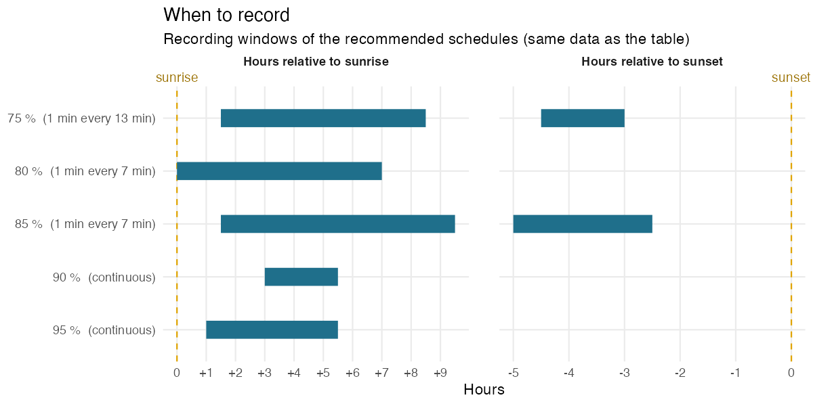
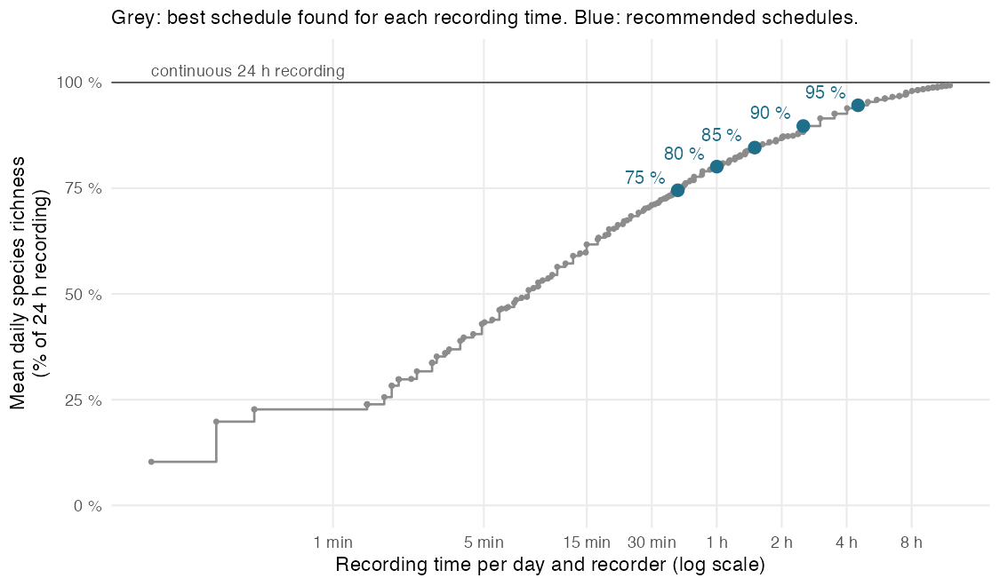
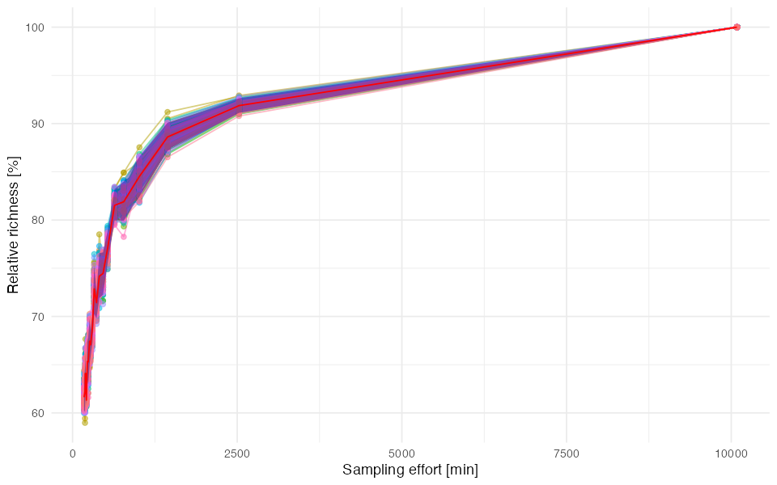
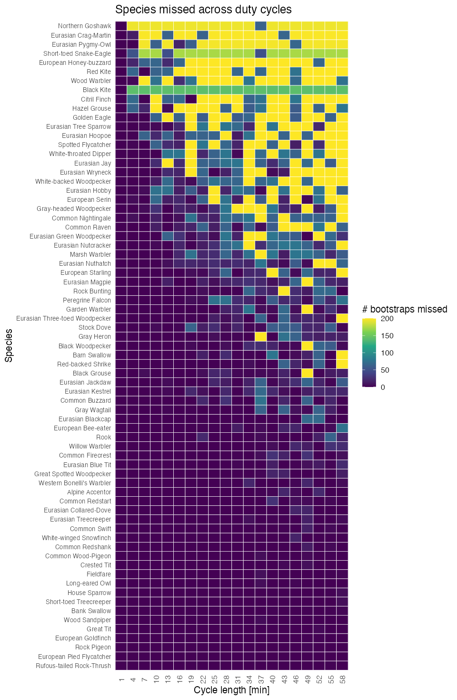
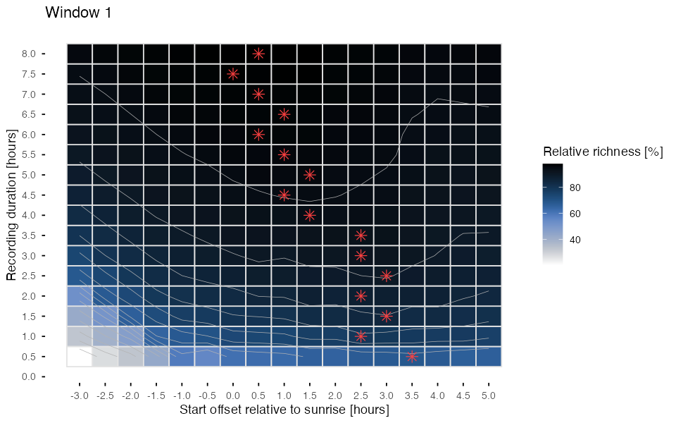
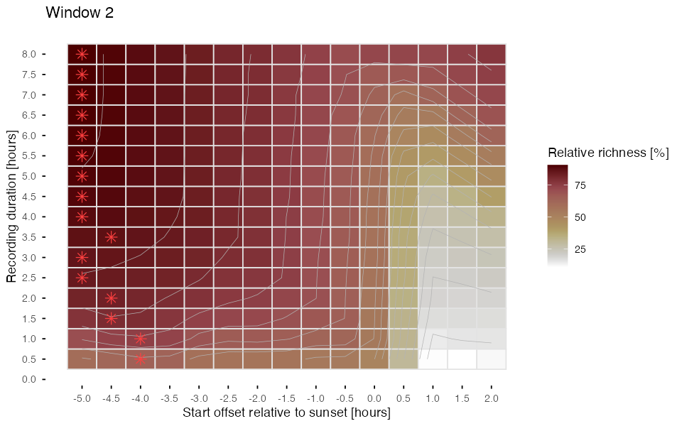
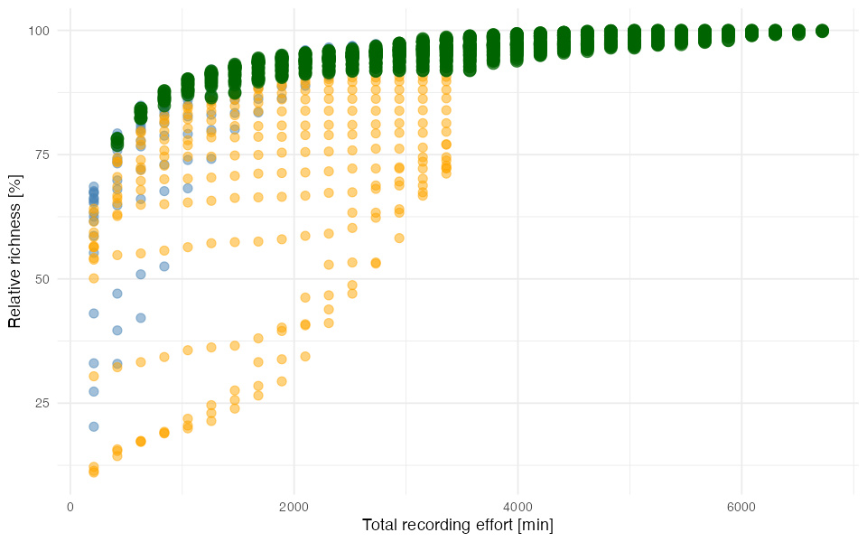
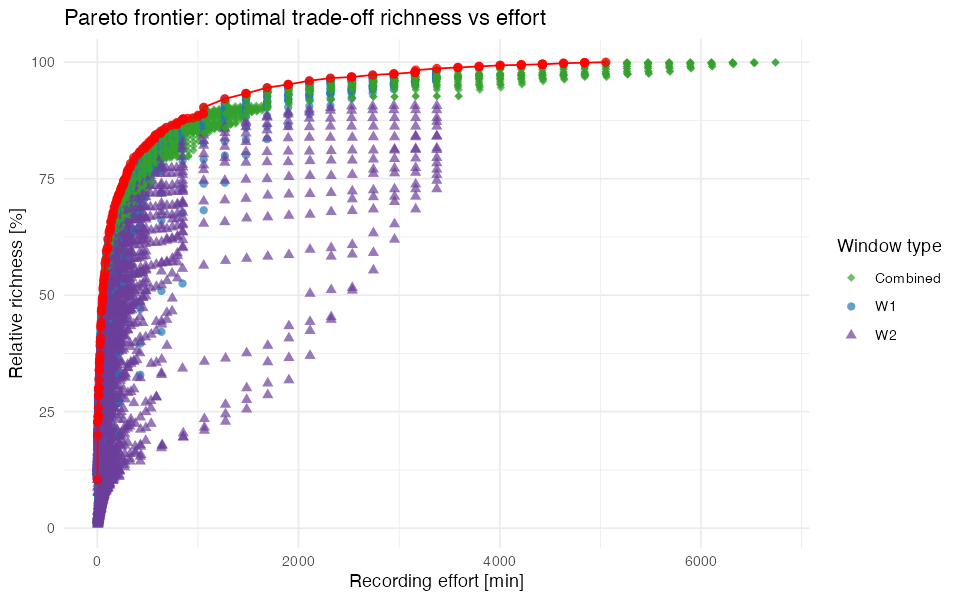

# Alpine bird community, Valais (CH): early breeding season

`CH_Valais_2023-06-01_7d` · Amandine Serrurier · SCORE 1.1.0

[⬇ Download the preset (.json, for the SCORE app)](../presets/CH_Valais_2023-06-01_7d/CH_Valais_2023-06-01_7d.json) · [← Back to catalogue](../README.md)

> **Pilot data:** 7 days (2023-06-01 to 2023-06-07), 14 recorder(s), 131 species detected with continuous 24 h recording (126.3 species per day on average).

## Recommended schedules

For each target, the schedule that needs the **least recording** among the 20 420 schedules tested by SCORE.

| Target | Duty cycle | Time windows | Recording per day | Richness (% of 24 h) | Richness (% of best tested) | Species never detected |
|---|---|---|---|---|---|---|
| 75 % | 1 min every 13 min | from sunrise + 1 h 30 to sunrise + 8 h 30 (≈ 07:09–14:09) from sunset − 4 h 30 to sunset − 3 h (≈ 16:44–18:14) | 40 min (2.75 % of 24 h) | 74.5 % | 75.1 % | 10 of 131 |
| 80 % | 1 min every 7 min | from sunrise to sunrise + 7 h (≈ 05:39–12:39) | 60 min (4.17 % of 24 h) | 80.1 % | 80.6 % | 8 of 131 |
| 85 % | 1 min every 7 min | from sunrise + 1 h 30 to sunrise + 9 h 30 (≈ 07:09–15:09) from sunset − 5 h to sunset − 2 h 30 (≈ 16:14–18:44) | 90 min (6.25 % of 24 h) | 84.6 % | 85.2 % | 6 of 131 |
| 90 % | continuous | from sunrise + 3 h to sunrise + 5 h 30 (≈ 08:39–11:09) | 151 min (10.49 % of 24 h) | 89.7 % | 90.3 % | 4 of 131 |
| 95 % | continuous | from sunrise + 1 h to sunrise + 5 h 30 (≈ 06:39–11:09) | 271 min (18.82 % of 24 h) | 94.6 % | 95.2 % | 3 of 131 |

<b>How to read this table</b>

- **Target**: share of species richness to reach, relative to the *best schedule tested* (see below).
- **Duty cycle**: how to record *inside* the time windows. *Continuous* = record without pause; *1 min every 7 min* = record 1 min, pause 6 min. It is the duty cycle of the least-effort schedule found, not a fixed choice: when a short continuous window is cheaper than a long sampled one, SCORE recommends the continuous window.
- **Time windows**: relative to sunrise or sunset, so that they follow the season. Clock times (≈) are only indicative: they use the mean sunrise/sunset of the pilot days.
- **Recording per day**: per recorder.
- **Richness (% of 24 h)**: mean number of species detected per day with this schedule, as a % of the species detected per day with continuous 24 h recording (all recorders pooled per day).
- **Richness (% of best tested)**: same, but relative to the best schedule among those tested. SCORE only tests windows within the grid chosen in the app (Tab 3), so the best schedule tested can detect fewer species than 24 h recording (here: 99.2 % of 24 h). The targets refer to this value.
- **Species never detected**: species detected at least once during the pilot with 24 h recording but never with this schedule (details below).

*Each bar is a recording window of a recommended schedule (same data as the table). Positions are in hours relative to sunrise or sunset, so the windows follow the change of day length; the duty cycle in brackets applies inside the bars.*

## Species missed by each schedule

| Target | Recording per day | Species detected over the pilot | Species never detected | Mean daily omission |
|---|---|---|---|---|
| 75 % | 40 min | 121 of 131 | 10 (7.6 %) | 25.5 % |
| 80 % | 60 min | 123 of 131 | 8 (6.1 %) | 19.9 % |
| 85 % | 90 min | 125 of 131 | 6 (4.6 %) | 15.4 % |
| 90 % | 151 min | 127 of 131 | 4 (3.1 %) | 10.3 % |
| 95 % | 271 min | 128 of 131 | 3 (2.3 %) | 5.4 % |

- **Species never detected**: detected at least once with 24 h recording during the pilot, but on no day with this schedule.
- **Mean daily omission**: on an average day, share of the species detected with 24 h recording that the schedule misses.
- Detections per species and per schedule are in the table *Species* below.

<b>75 % schedule: 10 species never detected</b>

Black Kite, Eurasian Green Woodpecker, Eurasian Hobby, Eurasian Jay, Eurasian Pygmy-Owl, Golden Eagle, Northern Goshawk, Red Kite, White-backed Woodpecker, Wood Warbler

<b>80 % schedule: 8 species never detected</b>

Black Kite, Common Raven, Eurasian Crag-Martin, Eurasian Pygmy-Owl, European Honey-buzzard, Northern Goshawk, Short-toed Snake-Eagle, Wood Warbler

<b>85 % schedule: 6 species never detected</b>

Black Kite, Eurasian Crag-Martin, Eurasian Pygmy-Owl, Northern Goshawk, Short-toed Snake-Eagle, Wood Warbler

<b>90 % schedule: 4 species never detected</b>

Black Kite, Eurasian Crag-Martin, Eurasian Pygmy-Owl, Short-toed Snake-Eagle

<b>95 % schedule: 3 species never detected</b>

Black Kite, Eurasian Crag-Martin, Eurasian Pygmy-Owl

## Species

All species detected during the pilot (131), with BirdNET-Analyzer (confidence threshold: 0). Species names are those of the classifier; detections were not verified unless stated in the notes.

<b>Show the table of the 131 species</b>

- **Detections**: number of BirdNET detections during the pilot, all recorders.
- **Mean confidence**: mean classifier confidence of these detections (low values point to possible false positives).
- **24 h, 75 %, 80 %, 85 %, 90 %, 95 %**: number of pilot days (out of 7) on which the species was detected with continuous 24 h recording and with each recommended schedule.
- **Peak activity**: the hour, relative to sunrise, with the most detections.
- **Activity over the day**: detections per hour from 6 h before sunrise to 18 h after it; `┃` marks sunrise, `·` no detection.

| Species | Detections | Mean confidence | 24 h | 75 % | 80 % | 85 % | 90 % | 95 % | Peak activity | Activity over the day |
|---|---|---|---|---|---|---|---|---|---|---|
| Alpine Accentor | 299 | 0.216 | 7 | 6 | 7 | 7 | 7 | 7 | 4–5 h after sunrise | `··▁▁▅▆┃█▄▇▅█▇▆▅▃▄▂▃▃▃▅▂▁·` |
| Alpine Swift | 1710 | 0.2 | 7 | 7 | 7 | 7 | 7 | 7 | 6–7 h after sunrise | `▁▁▂▂▂▁┃▁▁▁▁▂▅██▇▆▄▃▂▄▂▄▂▁` |
| Bank Swallow | 290 | 0.212 | 7 | 6 | 6 | 7 | 7 | 7 | 5–6 h after sunrise | `···▁▁▆┃▃▆▄▄▆█▆▇▄▆▃▃▂▄▂▅··` |
| Barn Swallow | 131 | 0.224 | 7 | 2 | 3 | 4 | 4 | 6 | 14–15 h after sunrise | `······┃▂·▂·▁▄▅▄▆▄▅▃▅██▅▁·` |
| Black Grouse | 289 | 0.531 | 7 | 1 | 3 | 1 | 4 | 7 | 0–1 h after sunrise | `·····▆┃█▆▃▂·▁▁··▁▃▁▁····▁` |
| Black Redstart | 4140 | 0.445 | 7 | 7 | 7 | 7 | 7 | 7 | 0–1 h before sunrise | `·▁▁▁▂█┃▂▂▂▃▃▃▃▃▄▄▃▃▄▃▃▄▁·` |
| Black Woodpecker | 101 | 0.22 | 7 | 3 | 6 | 7 | 6 | 7 | 0–1 h before sunrise | `····▁█┃▃▃▇▅▄▃▃▁▂▂▂▂▂▁▂▁▁·` |
| Bluethroat | 3023 | 0.238 | 7 | 7 | 7 | 7 | 7 | 7 | 0–1 h after sunrise | `▁··▁▅▆┃█▆▇▇▆▆▃▃▃▂▂▃▃▃▃▃▁·` |
| Carrion Crow | 833 | 0.142 | 7 | 6 | 6 | 6 | 6 | 7 | 3–4 h before sunrise | `▆▅█▆▃▃┃▁▁▁▁▁▁▁▁▂▁▁▃▂▃▃▂▅▄` |
| Coal Tit | 5271 | 0.347 | 7 | 7 | 7 | 7 | 7 | 7 | 5–6 h after sunrise | `····▁▄┃▇▅▅████▇▆▇▆▆▅▃▃▃▁·` |
| Common Buzzard | 231 | 0.272 | 7 | 4 | 2 | 5 | 7 | 7 | 3–4 h after sunrise | `··▁▂▅▆┃▅▁▆█▆▅▄▅▄▇▅█▅▅▅▄▁·` |
| Common Chaffinch | 11745 | 0.353 | 7 | 7 | 7 | 7 | 7 | 7 | 3–4 h after sunrise | `···▁▁▄┃▇▇▇███▇▇▇▆▄▄▆▄▃▂▁·` |
| Common Chiffchaff | 3253 | 0.466 | 7 | 7 | 6 | 7 | 7 | 7 | 6–7 h after sunrise | `···▁▂▁┃▃▅▄▅▇██▅▄▄▅▆▄▇▃▂··` |
| Common Cuckoo | 4777 | 0.536 | 7 | 7 | 7 | 7 | 7 | 7 | 0–1 h before sunrise | `····▁█┃█▆▅▆▄▃▃▃▃▂▃▁▁▂▁▂▁▁` |
| Common Firecrest | 214 | 0.221 | 7 | 5 | 7 | 7 | 7 | 7 | 3–4 h after sunrise | `·····▃┃▄▁▆█▄▄▇▄▂▄▁▄▅▂▁▁··` |
| Common Greenshank | 3254 | 0.278 | 7 | 7 | 7 | 7 | 7 | 7 | 0–1 h before sunrise | `··▁▂▆█┃▄▆▆▆▄▅▄▄▃▄▄▄▅▄▅▆▁·` |
| Common House-Martin | 741 | 0.268 | 7 | 5 | 7 | 7 | 6 | 7 | 15–16 h after sunrise | `▁▁▁▁▁▄┃▃▂▃▃▁▃▃▂▃▄▃▅▃▅██▁▁` |
| Common Quail | 39083 | 0.155 | 7 | 7 | 7 | 7 | 7 | 7 | 0–1 h before sunrise | `·▁▁▁▆█┃█████▆▅▄▃▄▃▄▃▄▄▆▂▁` |
| Common Raven | 133 | 0.33 | 7 | 3 | 0 | 4 | 2 | 3 | 10–11 h after sunrise | `·▁···▄┃·▂·▁·▂▁▂▄▄█▇▂▁··▄·` |
| Common Redpoll | 5397 | 0.254 | 7 | 7 | 7 | 7 | 7 | 7 | 8–9 h after sunrise | `▂▂▁▂▆▅┃▆▆▆▆▇▇█▇██▇▇▆▆▇▇▂▂` |
| Common Redshank | 535 | 0.187 | 7 | 7 | 7 | 7 | 7 | 7 | 0–1 h before sunrise | `▁·▁▂▅█┃▂▄▄▅▂▃▂▃▂▃▂▂▃▂▄▄▁·` |
| Common Redstart | 301 | 0.209 | 7 | 5 | 6 | 6 | 7 | 7 | 1–2 h before sunrise | `·▁·▂█▇┃▇█▅▆▇▆▁█▆▅▅▄▇▄▇▃▁·` |
| Common Sandpiper | 975 | 0.218 | 7 | 7 | 7 | 7 | 7 | 7 | 2–3 h after sunrise | `▁···▁▄┃▆▇█▇▆▆▆▆▅▇▇▇▆▆▇▅▁▁` |
| Common Swift | 406 | 0.231 | 7 | 6 | 7 | 7 | 7 | 7 | 2–3 h after sunrise | `·▁·▁▂▄┃▇██▆▆▇▅▄▃▅▂▃▅▃▅▆▂▁` |
| Common Wood-Pigeon | 545 | 0.231 | 7 | 6 | 6 | 6 | 7 | 7 | 7–8 h after sunrise | `▂·▃·▁▆┃▄▂▅▆▃▃▅██▃█▅▇▆▃▄▇▅` |
| Crested Tit | 383 | 0.27 | 7 | 6 | 5 | 5 | 7 | 7 | 8–9 h after sunrise | `··▁▁·▂┃▃▃▆▆▆▅█▅█▇▅▅▄▅▃▁··` |
| Dunnock | 18284 | 0.551 | 7 | 7 | 7 | 7 | 7 | 7 | 0–1 h after sunrise | `···▁▁▄┃████▇▇▆▇▆▇▆▆▇▆▅▅▁·` |
| Eurasian Blackbird | 1236 | 0.224 | 7 | 7 | 7 | 7 | 7 | 7 | 5–6 h after sunrise | `·▁·▁▃▅┃█▆██▇█▅▅▅▇▆▇▅▃▄▇▁·` |
| Eurasian Blackcap | 664 | 0.244 | 7 | 6 | 7 | 6 | 7 | 7 | 5–6 h after sunrise | `·····▂┃▅▆▅▄▅█▃▃▂▄▂▃▄▂▂▂▁·` |
| Eurasian Blue Tit | 189 | 0.202 | 7 | 5 | 3 | 6 | 7 | 7 | 8–9 h after sunrise | `·····▂┃▃▂▃▄▇▆███▇▃▇▆▄▄▂··` |
| Eurasian Bullfinch | 2946 | 0.249 | 7 | 7 | 7 | 7 | 7 | 7 | 3–4 h after sunrise | `·▁▁▂▅█┃▆▇███▇▇▆▇█▅▆▆▅▅▄▁·` |
| Eurasian Collared-Dove | 196 | 0.205 | 7 | 5 | 5 | 5 | 7 | 7 | 4–5 h after sunrise | `··▁▁·▃┃▄▅▅▆██▅▅▇▃█▂▃▃▁▂▁·` |
| Eurasian Dotterel | 17251 | 0.195 | 7 | 7 | 7 | 7 | 7 | 7 | 2–3 h after sunrise | `··▁▁▆▆┃████▇▆▄▄▃▄▃▄▄▄▃▄▁·` |
| Eurasian Eagle-Owl | 2147 | 0.226 | 7 | 7 | 7 | 7 | 7 | 7 | 8–9 h after sunrise | `▃▃▄▄▂▁┃▁▂▁▂▄▅▇███▇▅▅▅▂▂▂▄` |
| Eurasian Green Woodpecker | 81 | 0.354 | 7 | 0 | 3 | 5 | 5 | 7 | 1–2 h after sunrise | `····▁▄┃▅█▅█▄▃▃▁▆▂▄▂▂▆▃▁··` |
| Eurasian Hoopoe | 29 | 0.19 | 7 | 1 | 1 | 1 | 2 | 3 | 5–6 h after sunrise | `···▂·▂┃·▂·▃▃█▂▃█▂▃▄······` |
| Eurasian Jackdaw | 127 | 0.242 | 7 | 2 | 4 | 5 | 7 | 7 | 2–3 h after sunrise | `···▁·▁┃▂▄█▄▅▄▁▄▂▄▂▂▂▂····` |
| Eurasian Jay | 31 | 0.188 | 7 | 0 | 2 | 4 | 5 | 5 | 2–3 h after sunrise | `······┃▆▂██▂▆··▂▆▂▄▂▄····` |
| Eurasian Kestrel | 145 | 0.381 | 7 | 2 | 5 | 6 | 6 | 7 | 15–16 h after sunrise | `····▄▆┃▃▇▆█▅▄▃▃▄▅▃▆▂▃▅█▁·` |
| Eurasian Linnet | 13486 | 0.549 | 7 | 7 | 7 | 7 | 7 | 7 | 0–1 h after sunrise | `··▁▁▃▅┃█▇████▇▆▆▆▅▅▄▃▄▂▁·` |
| Eurasian Magpie | 90 | 0.228 | 7 | 1 | 4 | 4 | 6 | 7 | 11–12 h after sunrise | `··▁·▁▂┃▂▅▂▅▄▆▄▆▆▅▅█▃▄·▄▁·` |
| Eurasian Nightjar | 2718 | 0.239 | 7 | 6 | 7 | 7 | 7 | 7 | 3–4 h after sunrise | `▄▂▁▁▁▃┃▅▇██▄▄▆▅▅▅█▅▆▆▆▄▃▆` |
| Eurasian Nutcracker | 81 | 0.373 | 7 | 5 | 2 | 4 | 5 | 5 | 12–13 h after sunrise | `·····▁┃·▃▄▄▇·▁▄█·▅▄█▁··▃·` |
| Eurasian Nuthatch | 88 | 0.236 | 7 | 3 | 4 | 5 | 7 | 7 | 5–6 h after sunrise | `·····▁┃▄▃▁▄██▂·▄▃·▁▅▄▂▂··` |
| Eurasian Siskin | 2199 | 0.279 | 7 | 7 | 7 | 7 | 7 | 7 | 1–2 h before sunrise | `·▁▁▂█▇┃▄▇▆▆▅▄▅▄▃▄▃▅▅▅▇▆▂·` |
| Eurasian Skylark | 202917 | 0.481 | 7 | 7 | 7 | 7 | 7 | 7 | 0–1 h before sunrise | `···▁▆█┃███████▇▆▆▅▆▆▆▆▇▂·` |
| Eurasian Three-toed Woodpecker | 193 | 0.183 | 7 | 4 | 7 | 5 | 7 | 7 | 3–4 h after sunrise | `·····▂┃▅▄▃█▇▃▇▃▂▄▃▃▆▃▃·▁·` |
| Eurasian Tree Sparrow | 38 | 0.214 | 7 | 2 | 1 | 1 | 5 | 5 | 6–7 h after sunrise | `······┃··▂▆▃▄█·▂▄▃█·▂·▂··` |
| Eurasian Treecreeper | 634 | 0.384 | 7 | 7 | 7 | 7 | 7 | 7 | 3–4 h after sunrise | `·····▂┃▃▄▆█▅▅▇▇▅▆▃▆▄▂▄▁··` |
| Eurasian Woodcock | 1374 | 0.202 | 7 | 7 | 6 | 7 | 7 | 7 | 15–16 h after sunrise | `▇▄▃▃▄▃┃▂▄▃▃▃▅▅▅▇▆▇▇██▇██▇` |
| Eurasian Wren | 17799 | 0.544 | 7 | 7 | 7 | 7 | 7 | 7 | 0–1 h after sunrise | `·····▇┃██▇▇▇▅▄▃▃▄▃▃▃▂▃▂··` |
| Eurasian Wryneck | 27 | 0.134 | 7 | 2 | 4 | 4 | 6 | 6 | 0–1 h before sunrise | `·····█┃▆▆▆▇▃·▂···········` |
| European Bee-eater | 412 | 0.326 | 7 | 6 | 4 | 6 | 7 | 7 | 9–10 h after sunrise | `····▁·┃▁▄▃▄▄▄▅▇▇█▅▇▆▄▂▁··` |
| European Goldfinch | 600 | 0.281 | 7 | 7 | 6 | 7 | 7 | 7 | 7–8 h after sunrise | `·▁·▁▁▃┃▂▂▃▄▇█▇█▆▆▄▄▂▄▆▃▁·` |
| European Greenfinch | 2743 | 0.256 | 7 | 7 | 7 | 7 | 7 | 7 | 4–5 h after sunrise | `▁▁▁▁▃▃┃▃▄▅▇██▇▆▅▅▄▃▃▂▃▂▁▁` |
| European Pied Flycatcher | 510 | 0.208 | 7 | 5 | 7 | 7 | 7 | 7 | 0–1 h before sunrise | `▁··▁▁█┃▃▂▃▃▄▄▆▃▄▄▃▃▅▄▇▇··` |
| European Robin | 6634 | 0.257 | 7 | 7 | 7 | 7 | 7 | 7 | 13–14 h after sunrise | `▇▇▇▆▇▄┃▄▃▃▄▆▅▆▅▇▇▅▇████▅█` |
| European Serin | 42 | 0.267 | 7 | 1 | 2 | 4 | 5 | 6 | 9–10 h after sunrise | `······┃·▃▂·▇·▅·▄█▄▂▅·▃▂··` |
| European Starling | 92 | 0.169 | 7 | 6 | 4 | 4 | 5 | 7 | 1–2 h after sunrise | `······┃·████▂▄▄▃▃▁·▁·····` |
| European Stonechat | 4439 | 0.217 | 7 | 7 | 7 | 7 | 7 | 7 | 0–1 h after sunrise | `···▁▁▅┃█▇▇█▇▆▅▆▅▅▄▅▆▅▅▄▁·` |
| Fieldfare | 476 | 0.297 | 7 | 6 | 7 | 7 | 7 | 7 | 2–3 h after sunrise | `▁·▁▂▃▇┃▆██▇▄▃▇▅▇▇▂▆▆▅▆▅▂·` |
| Garden Warbler | 108 | 0.16 | 7 | 4 | 6 | 6 | 7 | 7 | 0–1 h before sunrise | `··▁▁▄█┃▃▇▆▄▆▂▄▂▂▅▂▄▃▁▂···` |
| Goldcrest | 2663 | 0.556 | 7 | 7 | 7 | 7 | 7 | 7 | 3–4 h after sunrise | `····▁▁┃▁▂▆█▅▄▆▄▆▅▄▄▄▂▂▁··` |
| Gray Heron | 197 | 0.218 | 7 | 2 | 7 | 7 | 7 | 7 | 10–11 h after sunrise | `▂▁▂▂▂▂┃▂▅▂▃▅▄▃▄▅▆█▆█▂▁▁▄▂` |
| Gray Wagtail | 165 | 0.259 | 7 | 2 | 3 | 5 | 5 | 7 | 14–15 h after sunrise | `▂·▂▂▁▄┃▃▅█▃▁▄█▄▇▅▃▆▅██▇··` |
| Gray-headed Woodpecker | 37 | 0.154 | 7 | 3 | 3 | 2 | 4 | 6 | 2–3 h after sunrise | `·····▂┃▅▅█▇▇▄▄▄··▇▄▂·▂···` |
| Great Spotted Woodpecker | 661 | 0.528 | 7 | 5 | 7 | 7 | 7 | 7 | 2–3 h after sunrise | `▁▁··▂▂┃▇▇███▂▇▃▃▄▅▅▅▂▁▂··` |
| Great Tit | 620 | 0.184 | 7 | 6 | 7 | 7 | 7 | 7 | 4–5 h after sunrise | `···▁·▄┃▃▃▂▆█▇▇▇▆▄▄▃▃▄▃▂▁·` |
| Greater Whitethroat | 1668 | 0.17 | 7 | 7 | 7 | 7 | 7 | 7 | 0–1 h before sunrise | `·▁▁▁▃█┃▅▄████▆▅▄▄▃▃▄▂▃▃▁·` |
| Green Sandpiper | 1290 | 0.254 | 7 | 7 | 7 | 7 | 7 | 7 | 1–2 h before sunrise | `▁▁▁▂█▆┃▄▇▇█▆▄▅▆▅▆▆▅▇▆▇█▁·` |
| Hawfinch | 950 | 0.224 | 7 | 7 | 7 | 7 | 7 | 7 | 12–13 h after sunrise | `▂▃▂▁▁▂┃▄▆▄▄▃▃▄▅▅▅▆██▇▇▆▁▂` |
| House Sparrow | 397 | 0.192 | 7 | 7 | 7 | 7 | 7 | 7 | 3–4 h after sunrise | `▂▂▂▁▆▂┃▃▄▆█▆▄▃▅▄▄▅▃▂▂▃▆▁▂` |
| Lesser Redpoll | 964 | 0.248 | 7 | 7 | 7 | 7 | 7 | 7 | 1–2 h after sunrise | `·▁·▁▄▆┃▆██▆▇▆▆▅▆▆▅▅▄▄▇▅··` |
| Lesser Whitethroat | 5390 | 0.367 | 7 | 7 | 7 | 7 | 7 | 7 | 5–6 h after sunrise | `··▁▁▃█┃███▇▇█▆▅▄▅▃▃▃▃▃▂▁·` |
| Long-eared Owl | 505 | 0.187 | 7 | 6 | 6 | 7 | 7 | 7 | 2–3 h before sunrise | `▁▁▃█▂▁┃▁▁·▂▃▃▇▆█▇▅▄▃▄▂▁▁▂` |
| Mallard | 2974 | 0.2 | 7 | 7 | 7 | 7 | 7 | 7 | 7–8 h after sunrise | `▂▁▂▁▁▁┃▂▆▆▆▆▇██▇██▆▇▅▄▂▃▂` |
| Marsh Tit | 5249 | 0.247 | 7 | 7 | 7 | 7 | 7 | 7 | 14–15 h after sunrise | `·····▅┃█▅▅▅▆▆▇▆▆▇▆▅▇▅█▅··` |
| Marsh Warbler | 79 | 0.14 | 7 | 3 | 4 | 4 | 3 | 7 | 1–2 h after sunrise | `·····▃┃▄█▂·▂▂▁▁·▁·▁··▁···` |
| Meadow Pipit | 247476 | 0.456 | 7 | 7 | 7 | 7 | 7 | 7 | 0–1 h after sunrise | `····▁▇┃███████████████▇▁▁` |
| Mistle Thrush | 27195 | 0.665 | 7 | 7 | 7 | 7 | 7 | 7 | 1–2 h after sunrise | `·····▇┃▇██▇▆▆▅▅▄▄▃▄▄▃▃▃··` |
| Northern Wheatear | 35274 | 0.462 | 7 | 7 | 7 | 7 | 7 | 7 | 1–2 h before sunrise | `▁▁▂▅██┃█████▇▇▇▆▆▆▆▆▆▇▆▃▁` |
| Ortolan Bunting | 7086 | 0.22 | 7 | 7 | 7 | 7 | 7 | 7 | 14–15 h after sunrise | `▁▁▁▂▆▅┃▅▅▆▆▅▅▆▅▆▆▆▆▇▇█▇▂▁` |
| Peregrine Falcon | 99 | 0.18 | 7 | 1 | 2 | 5 | 6 | 6 | 9–10 h after sunrise | `·····▁┃▂·▄▄▄▆▇▅▂█▂▅▆▄▁▂▂·` |
| Red Crossbill | 857 | 0.231 | 7 | 7 | 7 | 7 | 7 | 7 | 14–15 h after sunrise | `▁··▁▂▄┃▄▄▃▆▆▇██▇▅▄▆▅▇██▁▁` |
| Red Kite | 18 | 0.145 | 7 | 0 | 2 | 3 | 4 | 5 | 4–5 h after sunrise | `·····▅┃·▅▅▅█▅█▅·█▅▅▅·····` |
| Red-backed Shrike | 191 | 0.188 | 7 | 4 | 6 | 7 | 7 | 7 | 0–1 h after sunrise | `▁···▁▂┃██▆▇▆▆▃▅▃▃▅▄▃▁▂▁▁·` |
| Red-billed Chough | 3570 | 0.711 | 7 | 7 | 7 | 7 | 7 | 7 | 3–4 h after sunrise | `···▁▁▁┃▅▇██▅▃▃▂▂▂▂▂▁▁▁···` |
| Ring Ouzel | 1296 | 0.43 | 7 | 7 | 7 | 7 | 7 | 7 | 0–1 h before sunrise | `·▁▁▁▁█┃▆▇▇▄▃▃▂▃▂▂▂▃▂▂▁▅▂·` |
| Rock Bunting | 163 | 0.22 | 7 | 4 | 6 | 6 | 7 | 7 | 3–4 h after sunrise | `···▁·▅┃▅▆▇█▆▄▃▄▃▄▂▄▅▃▆▄··` |
| Rock Partridge | 19978 | 0.553 | 7 | 7 | 7 | 7 | 7 | 7 | 0–1 h after sunrise | `····▁█┃██▇▇▆▆▆▆▅▅▆▆▆▅▅▄▂·` |
| Rock Pigeon | 1082 | 0.266 | 7 | 7 | 4 | 7 | 7 | 7 | 9–10 h after sunrise | `▁▁▆█▃▂┃▂▁▁▂▅▄▅█▆██▄▅▅▃▂▃▃` |
| Rock Ptarmigan | 1341 | 0.505 | 7 | 4 | 6 | 6 | 7 | 7 | 0–1 h before sunrise | `▁▁▁▁▃█┃▅▂▁▁▁▁▁▁▁▁▁▁▁▁▁▁▃▁` |
| Rook | 230 | 0.196 | 7 | 1 | 4 | 5 | 6 | 6 | 0–1 h before sunrise | `▂·▁▂▅█┃▂▁▂▂▂▂▂▅▃▅▄▃▂▁▂▂▇·` |
| Rufous-tailed Rock-Thrush | 561 | 0.227 | 7 | 6 | 7 | 7 | 7 | 7 | 0–1 h after sunrise | `··▁▁▅█┃██▆▇▅▄▃▂▂▄▂▄▄▃▃▅▁·` |
| Sardinian Warbler | 1075 | 0.209 | 7 | 7 | 7 | 7 | 7 | 7 | 0–1 h before sunrise | `▁·▁▂██┃▆▄▄▃▄▄▃▃▃▃▂▂▃▂▃▃▁·` |
| Short-toed Treecreeper | 597 | 0.184 | 7 | 7 | 7 | 7 | 7 | 7 | 4–5 h after sunrise | `·····▂┃▅▃▄▇██▆▄▄▄▄▄▂▁▁▂··` |
| Song Thrush | 3229 | 0.191 | 7 | 7 | 7 | 7 | 7 | 7 | 1–2 h before sunrise | `▆▆▆▇█▅┃▅▅▄▄▄▃▄▄▄▆▆▆▆▇▆█▄▆` |
| Spectacled Warbler | 1079 | 0.202 | 7 | 7 | 7 | 7 | 7 | 7 | 0–1 h before sunrise | `▁·▁▂▄█┃▅▄▄▅▇▅▄▅▃▄▂▃▄▃▄▄▁▁` |
| Spotted Flycatcher | 26 | 0.185 | 7 | 1 | 1 | 5 | 4 | 5 | 11–12 h after sunrise | `······┃·▂·▄▄▄·▂▂▅▂█▅▂▄▂··` |
| Stock Dove | 119 | 0.145 | 7 | 6 | 6 | 5 | 6 | 7 | 1–2 h after sunrise | `▁··▁·▂┃▅█▇▅▂▂▂·▁▁▁▁▁·▂▁▁▁` |
| Tawny Owl | 3355 | 0.217 | 7 | 7 | 7 | 7 | 7 | 7 | 10–11 h after sunrise | `▃▁▂▁▂▁┃▁▂▂▂▄▅▅▆▇▇█▅▄▆▅▃▅▄` |
| Tawny Pipit | 3787 | 0.201 | 7 | 7 | 7 | 7 | 7 | 7 | 2–3 h after sunrise | `··▁▁▃▅┃▅▇██▇▆▅▅▄▄▃▃▃▃▃▄▁·` |
| Tree Pipit | 116927 | 0.349 | 7 | 7 | 7 | 7 | 7 | 7 | 0–1 h after sunrise | `▃▃▃▃▃█┃███████████████▇▂▃` |
| Water Pipit | 162815 | 0.34 | 7 | 7 | 7 | 7 | 7 | 7 | 0–1 h after sunrise | `····▁▇┃███████████████▇··` |
| Western Bonelli's Warbler | 260 | 0.194 | 7 | 6 | 7 | 7 | 7 | 7 | 1–2 h after sunrise | `·▁·▁▂▄┃███▇▃▇▂▂▂▁·▃▂▁▂▂··` |
| Western Capercaillie | 2299 | 0.288 | 7 | 7 | 7 | 7 | 7 | 7 | 1–2 h after sunrise | `▁▁▁▁▁▄┃▇█▆▆▇▆▄▆▄▅▇▇▇▆▄▂▄▂` |
| Western Subalpine Warbler | 1003 | 0.226 | 7 | 7 | 7 | 7 | 7 | 7 | 5–6 h after sunrise | `····▁▂┃▄▄▃▃▆█▄▄▃▃▂▃▂▂▂▂▁·` |
| Western Yellow Wagtail | 3619 | 0.21 | 7 | 7 | 7 | 7 | 7 | 7 | 0–1 h before sunrise | `·····█┃█▅▅▄▄▄▄▅▄▄▃▄▅▅█▇▁·` |
| Whinchat | 14674 | 0.249 | 7 | 7 | 7 | 7 | 7 | 7 | 0–1 h before sunrise | `···▁▃█┃█▇██▇▆▅▄▃▃▃▃▄▄▃▅▁·` |
| White Wagtail | 821 | 0.331 | 7 | 7 | 6 | 7 | 7 | 7 | 14–15 h after sunrise | `····▁▁┃▅▄▄▄▄▄▅▆▇▆▇▅▆▆█▄▁·` |
| White-backed Woodpecker | 50 | 0.176 | 7 | 0 | 3 | 3 | 5 | 6 | 3–4 h after sunrise | `······┃▂▄▄██▄▄▄▄▂▂▅█▂▄···` |
| White-throated Dipper | 41 | 0.195 | 7 | 1 | 1 | 1 | 3 | 6 | 1–2 h after sunrise | `·····▄┃▄█▆▄·▂·▂·▂▂▂▆▄▆▆··` |
| White-winged Snowfinch | 1044 | 0.48 | 7 | 7 | 7 | 7 | 7 | 7 | 0–1 h before sunrise | `···▁▁█┃▂▁▄▂▂▂▁▁▁▁▁▁▁▁▁▁··` |
| Willow Tit | 3286 | 0.392 | 7 | 7 | 7 | 7 | 7 | 7 | 6–7 h after sunrise | `····▁▅┃▃▅▆▇█▆█▇▆▅▄▃▃▂▁▁··` |
| Willow Warbler | 230 | 0.179 | 7 | 4 | 6 | 7 | 6 | 7 | 0–1 h before sunrise | `···▁▂█┃▄▃▅▃▃▂▃▃▃▁▂▁▂▂▁▂▁·` |
| Wood Lark | 11915 | 0.215 | 7 | 7 | 7 | 7 | 7 | 7 | 0–1 h before sunrise | `·▁▁▂▅█┃█▇█▇▇▇▆▆▅▆▅▄▅▄▅▅▁·` |
| Wood Sandpiper | 393 | 0.242 | 7 | 7 | 7 | 7 | 7 | 7 | 4–5 h after sunrise | `··▁▁▃▃┃▄▅▄▅█▅▅▄▄▄▃▄▃▂▅▅··` |
| Yellow-billed Chough | 64376 | 0.687 | 7 | 7 | 7 | 7 | 7 | 7 | 2–3 h after sunrise | `····▁▁┃▃███████▆▆▅▄▃▁▁▁··` |
| Yellowhammer | 1131 | 0.224 | 7 | 7 | 7 | 7 | 7 | 7 | 0–1 h before sunrise | `·▁··▁█┃█▆▅▆▅▅▄▇▄▃▄▃▄▂▄▃··` |
| Citril Finch | 14 | 0.261 | 6 | 1 | 2 | 2 | 1 | 4 | 1–2 h after sunrise | `······┃·██▄▄·▄█▄·▄▄··▄▄··` |
| Common Nightingale | 30 | 0.186 | 6 | 3 | 4 | 3 | 4 | 5 | 3–4 h after sunrise | `···▂▄▂┃▄▂▄█·█·▂▂··▆▂··▆··` |
| Eurasian Hobby | 27 | 0.172 | 6 | 0 | 3 | 3 | 4 | 5 | 0–1 h after sunrise | `····▂·┃█▄▃▄▃▂▄▂·▃·▂·▂····` |
| Golden Eagle | 32 | 0.318 | 6 | 0 | 3 | 2 | 2 | 2 | 10–11 h after sunrise | `······┃▄··▄▂▂▂·▂▄█▄▄▄····` |
| Hazel Grouse | 26 | 0.158 | 5 | 3 | 1 | 2 | 2 | 5 | 2–3 h after sunrise | `······┃▄▁█▄·▁·▃▁···▁·····` |
| Wood Warbler | 15 | 0.172 | 5 | 0 | 0 | 0 | 3 | 4 | 3–4 h after sunrise | `······┃·▄▂█·▄▆·▂···▂·····` |
| Eurasian Crag-Martin | 5 | 0.264 | 4 | 1 | 0 | 0 | 0 | 0 | 7–8 h after sunrise | `······┃·······█▃····▃····` |
| European Honey-buzzard | 8 | 0.281 | 4 | 1 | 0 | 1 | 1 | 1 | 6–7 h after sunrise | `······┃····▄·█····▄█··▄··` |
| Eurasian Pygmy-Owl | 23 | 0.228 | 3 | 0 | 0 | 0 | 0 | 0 | 9–10 h after sunrise | `······┃········▄█··▂▅····` |
| Northern Goshawk | 4 | 0.143 | 3 | 0 | 0 | 0 | 2 | 2 | 0–1 h after sunrise | `······┃█··██·········█···` |
| Short-toed Snake-Eagle | 2 | 0.189 | 2 | 1 | 0 | 0 | 0 | 1 | 2–3 h after sunrise | `······┃··█·········█·····` |
| Black Kite | 1 | 0.104 | 1 | 0 | 0 | 0 | 0 | 0 | 8–9 h after sunrise | `······┃········█·········` |

## How many species for how much recording?

*Each grey point is the best schedule found by SCORE for a given recording time per day (among 20 420 schedules tested). The curve shows how fast richness increases with recording time and where adding recording time brings few additional species. Use it to choose a compromise other than the recommended targets.*

## Study context

| Item | Value |
|---|---|
| Project | 15 recorders in 2 sites of swiss alps |
| Objective | community |
| Target taxa | birds |
| Country / region | Switzerland / Valais |
| Habitat (EUNIS) | E, South faced Alpine grassland, above treeline |
| Elevation | 2200 m (mean) |
| Location | 46.2° N, 8.1° E (rounded to ~10 km) |
| Period | 2023-06-01 to 2023-06-07 (7 days with data, Europe/Zurich) |
| Timing | breeding, June |
| Recorders | 14 × SMMini 2 |
| Sample rate | 48000 Hz |
| Deployment height | 1 m |
| Classifier | BirdNET-Analyzer 2.4 |
| Confidence threshold | 0 |

_Notes: Reference preset from Serrurier et al. (JAV, in revision); same settings as in the paper._

## How well does it transfer?

**Temporal transfer** (90 % schedule applied to other days, same recorders):

| Test | Richness (% of 24 h) |
|---|---|
| Pilot days (in-sample) | 89.7 % |
| Later days of the season | 78.2 % |
| All other days of the season | 79.5 % |

**Spatial transfer** (schedule selected on some recorders, applied to others, same days):

| Test | Richness (% of 24 h) |
|---|---|
| Between sites (mean of both directions) | 86.6 % |
| Random recorder subsets | 75.6 % (69.6–82.3) |
| Single recorder left out | 59.2 % (46.5–71.6) |

> Transfers well within the same season phase and between these two Alpine sites; not to single recorders or to late summer (69-83% from late July).

## Method

- Richness: mean daily species richness; all recorders pooled per day
- Duty cycles tested: 1 min every 1 to 58 min
- Schedules tested: 20 420 (duty cycles × time windows of the grid of Tab 3)
- Selection rule: least effort with richness >= target (% of best candidate); ties: highest richness

## Figures from the SCORE app

<b>Show the original figures of this analysis</b>

**Tab 2 – Richness by duty cycle (bootstrap)**

**Tab 2 – Species missed by duty cycle**

**Tab 3 – Richness by time window (window 1)**

**Tab 3 – Richness by time window (window 2)**

**Tab 3 – Richness of combined windows**

**Tab 4 – Multi-optimum: effort vs richness of all schedules tested**

## Cite

Serrurier et al. (in revision) SCORE: a user-friendly application to optimise recording schedules in passive acoustic monitoring. Journal of Avian Biology.

