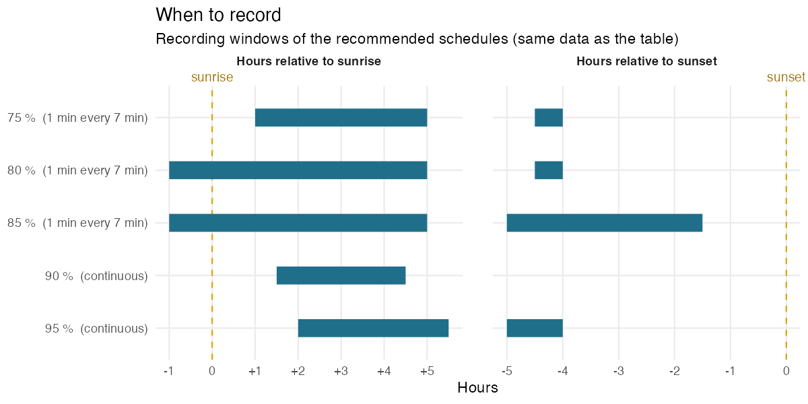
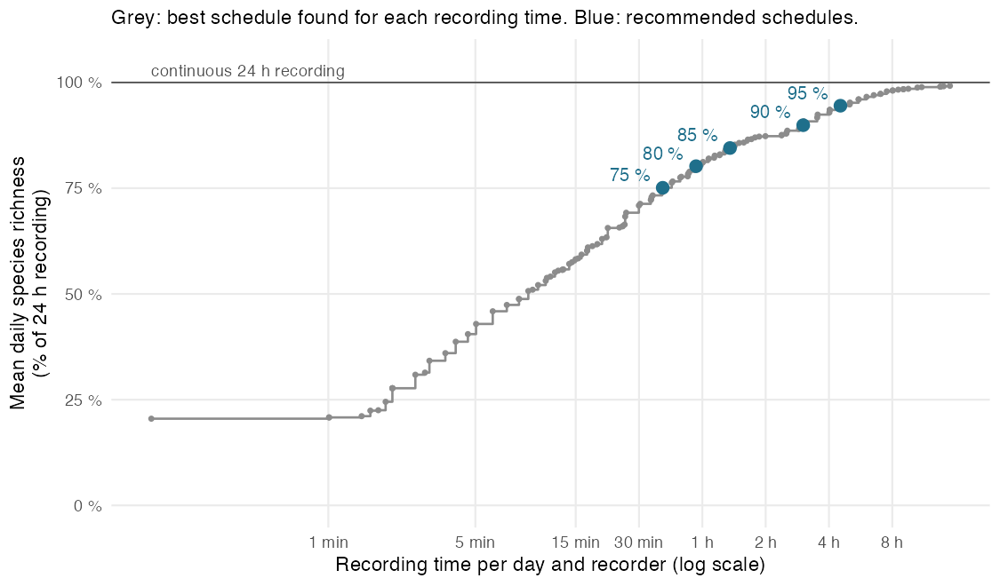
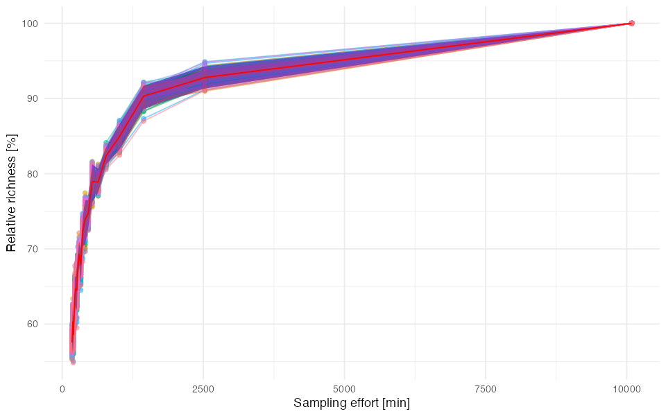
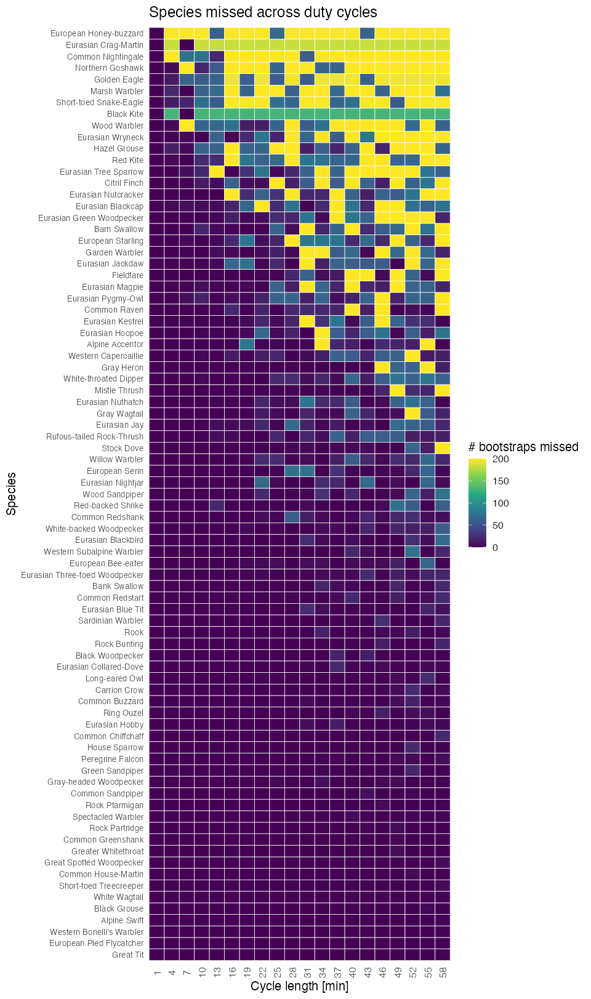
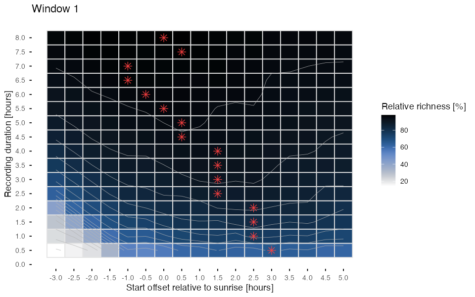
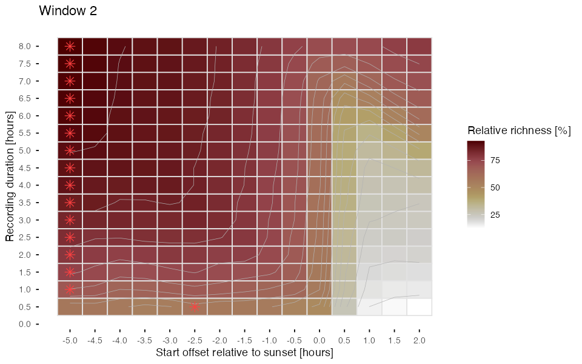
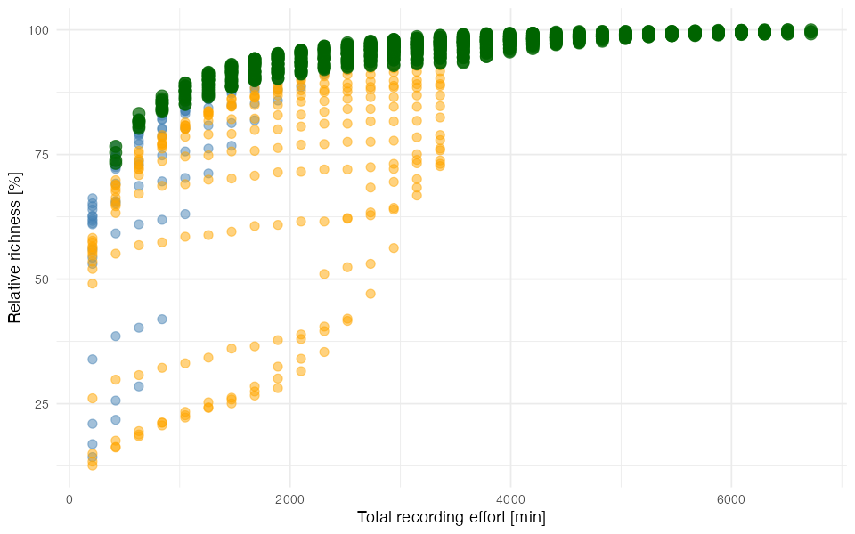
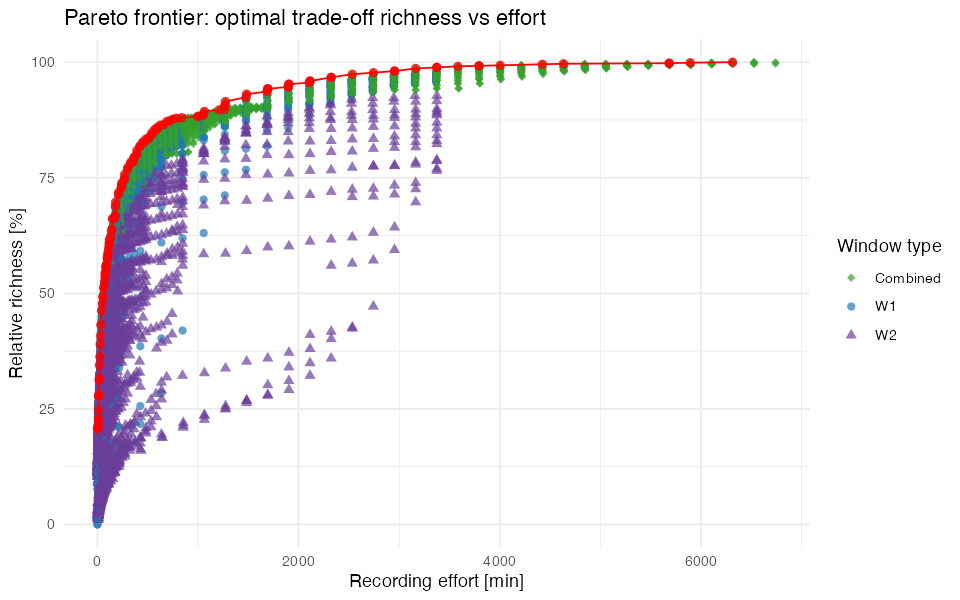

# Alpine bird community, Valais (CH): late breeding season

`CH_Valais_2023-07-01_7d` · Amandine Serrurier · SCORE 1.1.0

[⬇ Download the preset (.json, for the SCORE app)](../presets/CH_Valais_2023-07-01_7d/CH_Valais_2023-07-01_7d.json) · [← Back to catalogue](../README.md)

> **Pilot data:** 7 days (2023-07-01 to 2023-07-07), 14 recorder(s), 131 species detected with continuous 24 h recording (127 species per day on average).

## Recommended schedules

For each target, the schedule that needs the **least recording** among the 20 417 schedules tested by SCORE.

| Target | Duty cycle | Time windows | Recording per day | Richness (% of 24 h) | Richness (% of best tested) | Species never detected |
|---|---|---|---|---|---|---|
| 75 % | 1 min every 7 min | from sunrise + 1 h to sunrise + 5 h (≈ 06:42–10:42) from sunset − 4 h 30 to sunset − 4 h (≈ 16:53–17:23) | 39 min (2.7 % of 24 h) | 75.1 % | 75.7 % | 5 of 131 |
| 80 % | 1 min every 7 min | from sunrise − 1 h to sunrise + 5 h (≈ 04:42–10:42) from sunset − 4 h 30 to sunset − 4 h (≈ 16:53–17:23) | 56 min (3.89 % of 24 h) | 80.2 % | 80.8 % | 5 of 131 |
| 85 % | 1 min every 7 min | from sunrise − 1 h to sunrise + 5 h (≈ 04:42–10:42) from sunset − 5 h to sunset − 1 h 30 (≈ 16:23–19:53) | 81 min (5.64 % of 24 h) | 84.5 % | 85.1 % | 4 of 131 |
| 90 % | continuous | from sunrise + 1 h 30 to sunrise + 4 h 30 (≈ 07:12–10:12) | 181 min (12.57 % of 24 h) | 89.9 % | 90.6 % | 1 of 131 |
| 95 % | continuous | from sunrise + 2 h to sunrise + 5 h 30 (≈ 07:42–11:12) from sunset − 5 h to sunset − 4 h (≈ 16:23–17:23) | 272 min (18.89 % of 24 h) | 94.5 % | 95.2 % | 0 of 131 |

<b>How to read this table</b>

- **Target**: share of species richness to reach, relative to the *best schedule tested* (see below).
- **Duty cycle**: how to record *inside* the time windows. *Continuous* = record without pause; *1 min every 7 min* = record 1 min, pause 6 min. It is the duty cycle of the least-effort schedule found, not a fixed choice: when a short continuous window is cheaper than a long sampled one, SCORE recommends the continuous window.
- **Time windows**: relative to sunrise or sunset, so that they follow the season. Clock times (≈) are only indicative: they use the mean sunrise/sunset of the pilot days.
- **Recording per day**: per recorder.
- **Richness (% of 24 h)**: mean number of species detected per day with this schedule, as a % of the species detected per day with continuous 24 h recording (all recorders pooled per day).
- **Richness (% of best tested)**: same, but relative to the best schedule among those tested. SCORE only tests windows within the grid chosen in the app (Tab 3), so the best schedule tested can detect fewer species than 24 h recording (here: 99.2 % of 24 h). The targets refer to this value.
- **Species never detected**: species detected at least once during the pilot with 24 h recording but never with this schedule (details below).

*Each bar is a recording window of a recommended schedule (same data as the table). Positions are in hours relative to sunrise or sunset, so the windows follow the change of day length; the duty cycle in brackets applies inside the bars.*

## Species missed by each schedule

| Target | Recording per day | Species detected over the pilot | Species never detected | Mean daily omission |
|---|---|---|---|---|
| 75 % | 39 min | 126 of 131 | 5 (3.8 %) | 24.9 % |
| 80 % | 56 min | 126 of 131 | 5 (3.8 %) | 19.8 % |
| 85 % | 81 min | 127 of 131 | 4 (3.1 %) | 15.5 % |
| 90 % | 181 min | 130 of 131 | 1 (0.8 %) | 10.1 % |
| 95 % | 272 min | 131 of 131 | 0 (0 %) | 5.5 % |

- **Species never detected**: detected at least once with 24 h recording during the pilot, but on no day with this schedule.
- **Mean daily omission**: on an average day, share of the species detected with 24 h recording that the schedule misses.
- Detections per species and per schedule are in the table *Species* below.

<b>75 % schedule: 5 species never detected</b>

Common Nightingale, European Honey-buzzard, Golden Eagle, Northern Goshawk, Wood Warbler

<b>80 % schedule: 5 species never detected</b>

Common Nightingale, European Honey-buzzard, Golden Eagle, Northern Goshawk, Wood Warbler

<b>85 % schedule: 4 species never detected</b>

Common Nightingale, European Honey-buzzard, Northern Goshawk, Wood Warbler

<b>90 % schedule: 1 species never detected</b>

Short-toed Snake-Eagle

<b>95 % schedule: 0 species never detected</b>

_none_

## Species

All species detected during the pilot (131), with BirdNET-Analyzer (confidence threshold: 0). Species names are those of the classifier; detections were not verified unless stated in the notes.

<b>Show the table of the 131 species</b>

- **Detections**: number of BirdNET detections during the pilot, all recorders.
- **Mean confidence**: mean classifier confidence of these detections (low values point to possible false positives).
- **24 h, 75 %, 80 %, 85 %, 90 %, 95 %**: number of pilot days (out of 7) on which the species was detected with continuous 24 h recording and with each recommended schedule.
- **Peak activity**: the hour, relative to sunrise, with the most detections.
- **Activity over the day**: detections per hour from 6 h before sunrise to 18 h after it; `┃` marks sunrise, `·` no detection.

| Species | Detections | Mean confidence | 24 h | 75 % | 80 % | 85 % | 90 % | 95 % | Peak activity | Activity over the day |
|---|---|---|---|---|---|---|---|---|---|---|
| Alpine Accentor | 171 | 0.202 | 7 | 5 | 6 | 6 | 7 | 7 | 5–6 h after sunrise | `···▁▁▅┃▃▂▅▆▆██▆▃▃▂▂▂▃▁▂▁·` |
| Alpine Swift | 1338 | 0.202 | 7 | 4 | 4 | 4 | 5 | 6 | 5–6 h after sunrise | `▁▁▁▁·▁┃▁▁▁▂▄█▇▆▇▄▆▃▂▁▂▂▁▁` |
| Bank Swallow | 294 | 0.211 | 7 | 6 | 6 | 6 | 7 | 7 | 0–1 h before sunrise | `·····█┃▇▆▅▅▆▄▄▅▅▅▂▄▃▄▅▇▂·` |
| Barn Swallow | 48 | 0.184 | 7 | 2 | 2 | 4 | 4 | 6 | 13–14 h after sunrise | `·····▂┃▁▁·▁▂▁▂▄▂▃▁▆▂█▆▃··` |
| Black Grouse | 607 | 0.275 | 7 | 4 | 5 | 7 | 5 | 6 | 14–15 h after sunrise | `▃▇▄▃▆▂┃▂▃▆▃▄▂▂▄▄▆▅▆▆▆█▆▆▅` |
| Black Redstart | 23829 | 0.567 | 7 | 7 | 7 | 7 | 7 | 7 | 0–1 h before sunrise | `····▂█┃▅▅▄▆▅▃▄▄▅▅▆▅▄▆▆▆▁·` |
| Black Woodpecker | 918 | 0.24 | 7 | 6 | 6 | 6 | 7 | 7 | 14–15 h after sunrise | `▁▁▁·▁▁┃▃▅▃▆▅▃▃▂▄▂▆▆▇▇█▂▁▁` |
| Bluethroat | 2047 | 0.166 | 7 | 7 | 7 | 7 | 7 | 7 | 0–1 h after sunrise | `···▁▁▄┃██▆▄▄▅▄▃▃▃▃▂▃▃▃▄▁·` |
| Carrion Crow | 423 | 0.187 | 7 | 1 | 4 | 6 | 6 | 7 | 16–17 h after sunrise | `▄▆▇▇▅▃┃▁▂▁▂▁▂▃▂▂▃▁▁▂▁▃▃██` |
| Citril Finch | 35 | 0.264 | 7 | 3 | 3 | 4 | 5 | 6 | 1–2 h after sunrise | `·····▂┃·█▆·▆▂▂▄▆▆·▆▂▂▂···` |
| Coal Tit | 8200 | 0.379 | 7 | 7 | 7 | 7 | 7 | 7 | 1–2 h after sunrise | `·····▅┃██▆▆▄▅▄▄▄▄▅▅▄▄▃▃▁·` |
| Common Buzzard | 370 | 0.268 | 7 | 4 | 5 | 6 | 7 | 7 | 11–12 h after sunrise | `···▁▁▁┃▃▁▃▂▂▃▁▃▄▂▃█▃▂▂▂▁▁` |
| Common Chaffinch | 68772 | 0.438 | 7 | 7 | 7 | 7 | 7 | 7 | 5–6 h after sunrise | `····▁▄┃▇█████████▇▇█▇█▆··` |
| Common Chiffchaff | 900 | 0.35 | 7 | 7 | 7 | 7 | 7 | 7 | 1–2 h after sunrise | `···▁▁▃┃▆█▂▄▄▃▅▂▅▄▆▂▄▂▂▁▁·` |
| Common Cuckoo | 2185 | 0.41 | 7 | 7 | 7 | 7 | 7 | 7 | 2–3 h after sunrise | `▁▁▁▁▁▇┃▇▇█▇▄▃▂▂▂▁▂▃▃▂▃▃▁▁` |
| Common Firecrest | 1442 | 0.201 | 7 | 6 | 6 | 7 | 6 | 7 | 5–6 h after sunrise | `·····▁┃▂▃▆▅▆█▅▆▅▅▅▄▃▆▄▁··` |
| Common Greenshank | 512 | 0.239 | 7 | 6 | 7 | 7 | 7 | 7 | 0–1 h before sunrise | `▁▁·▁▃█┃▄▆▅▄▄▃▃▄▃▂▃▅▃▄▃▆▂▁` |
| Common House-Martin | 740 | 0.252 | 7 | 7 | 7 | 7 | 7 | 7 | 2–3 h after sunrise | `····▁▅┃▄▆██▄▅▅▃▄▅▃▇▅▅▆▆▁·` |
| Common Quail | 10128 | 0.195 | 7 | 7 | 7 | 7 | 7 | 7 | 3–4 h after sunrise | `▁▁▁▂▅▇┃▇▆▇██▇▅▄▂▂▂▂▂▂▄▄▁·` |
| Common Raven | 207 | 0.294 | 7 | 3 | 3 | 4 | 6 | 7 | 5–6 h after sunrise | `··▁▁·▁┃▂▂▃█▅█▂▁·▃▃█▁▃·▁·▁` |
| Common Redpoll | 5727 | 0.299 | 7 | 7 | 7 | 7 | 7 | 7 | 5–6 h after sunrise | `·▁·▁▂█┃▇██▇████▇▆▆▆▅▅▅▆▂▁` |
| Common Redshank | 156 | 0.195 | 7 | 2 | 4 | 4 | 6 | 7 | 0–1 h before sunrise | `·▁▄▁▅█┃▂▄▆▄▃▅▅▂▄·▂▄▂▃▄▆▂▃` |
| Common Redstart | 437 | 0.197 | 7 | 6 | 6 | 6 | 7 | 7 | 6–7 h after sunrise | `····▁▅┃▄▄▅▆▇▃█▆▆▄▇▅▃▃▂▄▁·` |
| Common Sandpiper | 458 | 0.218 | 7 | 7 | 7 | 7 | 7 | 7 | 4–5 h after sunrise | `···▁▁▄┃▄▆▆▆█▆▆▄▄▄▄▅▄▆▆▆▁·` |
| Common Swift | 670 | 0.307 | 7 | 6 | 7 | 7 | 7 | 7 | 13–14 h after sunrise | `···▁·▂┃▃▃▄▅▅▅▄▅▅▇▆▄▆█▄▄▁·` |
| Common Wood-Pigeon | 7525 | 0.312 | 7 | 7 | 7 | 7 | 7 | 7 | 14–15 h after sunrise | `▆█▇▇▅▄┃▅▅▄▄▂▂▂▃▄▄▄▅▅▆█▇▇▇` |
| Crested Tit | 5261 | 0.506 | 7 | 7 | 7 | 7 | 7 | 7 | 2–3 h after sunrise | `·····▁┃▂▇█▇█▇▆▅▄▅█▅▃▆▃▁··` |
| Dunnock | 24478 | 0.562 | 7 | 7 | 7 | 7 | 7 | 7 | 1–2 h after sunrise | `····▁▇┃██▇▇█▇▇▇▇▇▇▆▆▇▇█▁·` |
| Eurasian Blackbird | 389 | 0.187 | 7 | 6 | 6 | 6 | 7 | 7 | 16–17 h after sunrise | `▄▄▄▂▄▄┃▁▂▃▂▁▃▃▃▃▂▃▃▃▆▇▇█▄` |
| Eurasian Blackcap | 82 | 0.22 | 7 | 1 | 2 | 3 | 3 | 3 | 1–2 h after sunrise | `····▃▂┃▄██▄··▄▅···▂▂▃··▄·` |
| Eurasian Blue Tit | 499 | 0.217 | 7 | 5 | 5 | 6 | 6 | 7 | 5–6 h after sunrise | `·····▂┃▃▄▃▄██▆█▄▅█▅▃▁▁···` |
| Eurasian Bullfinch | 2701 | 0.341 | 7 | 7 | 7 | 7 | 7 | 7 | 7–8 h after sunrise | `▂▂▂▂▃▄┃▄▅▇▆▇▅▆██▅▇▆▅▅▄▃▂▂` |
| Eurasian Collared-Dove | 323 | 0.192 | 7 | 4 | 4 | 6 | 6 | 6 | 1–2 h before sunrise | `▅█▆▆█▄┃▃▆▄▇▅▄▃▇█▇▄▅▃▆▅▃▇▇` |
| Eurasian Dotterel | 10808 | 0.233 | 7 | 7 | 7 | 7 | 7 | 7 | 1–2 h after sunrise | `··▁▂▄▃┃▇█▇▇▆▆▄▃▃▃▃▄▃▃▄▂▁▁` |
| Eurasian Eagle-Owl | 2753 | 0.241 | 7 | 7 | 7 | 7 | 7 | 7 | 16–17 h after sunrise | `▇▇▇█▅▃┃▃▃▃▃▂▂▃▃▄▅▅▆▄▅▄▄██` |
| Eurasian Green Woodpecker | 128 | 0.228 | 7 | 2 | 3 | 5 | 5 | 7 | 10–11 h after sunrise | `▁▁···▃┃·▁▄▄▂▂▂·▃▂█▇▂▅▂▄·▁` |
| Eurasian Hobby | 493 | 0.2 | 7 | 6 | 6 | 6 | 7 | 6 | 3–4 h after sunrise | `·▁··▁▁┃▁▁▅█▄▁▂▁▁·▁▇█▄▆▃··` |
| Eurasian Hoopoe | 228 | 0.431 | 7 | 6 | 6 | 6 | 7 | 7 | 2–3 h after sunrise | `····▁▁┃▁▄█▂▁···▁▁▁···▁·▁·` |
| Eurasian Jackdaw | 113 | 0.262 | 7 | 5 | 5 | 6 | 7 | 7 | 2–3 h after sunrise | `·····▁┃▁▃█▅█▁▄▃▄▄▁▂·▃▁··▁` |
| Eurasian Jay | 440 | 0.607 | 7 | 5 | 5 | 5 | 5 | 5 | 0–1 h after sunrise | `·····▁┃█▅█▅▇▂▂▅·▃▂▂▅▂··▁▁` |
| Eurasian Kestrel | 136 | 0.336 | 7 | 4 | 4 | 4 | 7 | 6 | 3–4 h after sunrise | `······┃▂▂▂█▆▂▁▂▃▂▃▅▅▂▃▃··` |
| Eurasian Linnet | 10589 | 0.536 | 7 | 7 | 7 | 7 | 7 | 7 | 3–4 h after sunrise | `···▁▁▄┃█▇▇██▇█▇▆▇▅▆▅▆▅▆▁·` |
| Eurasian Magpie | 78 | 0.224 | 7 | 2 | 3 | 3 | 7 | 7 | 2–3 h after sunrise | `··▃·▂▂┃▄▃█▃▂▃▄▆▅▆▆▆▄▂·▃··` |
| Eurasian Nightjar | 235 | 0.209 | 7 | 4 | 4 | 4 | 7 | 7 | 1–2 h after sunrise | `▁▁▁▁▁▃┃▂█▅▅▂▃▂▂▄▂▃▃▁▂▃▁▃▂` |
| Eurasian Nutcracker | 60 | 0.282 | 7 | 1 | 3 | 3 | 6 | 5 | 0–1 h after sunrise | `·····▄┃█▅█▇▄▄▄▅▂▂·▂·▂▂▂▄·` |
| Eurasian Nuthatch | 189 | 0.231 | 7 | 3 | 5 | 6 | 7 | 7 | 2–3 h after sunrise | `·····▃┃▅▆██▃▆▇▂▃▃▆▅▆▄▂▁··` |
| Eurasian Pygmy-Owl | 171 | 0.269 | 7 | 1 | 1 | 2 | 2 | 3 | 10–11 h after sunrise | `▁▁▂·▁▁┃▁··▁▁·····█▃▄▄▅·▁▁` |
| Eurasian Siskin | 2308 | 0.26 | 7 | 7 | 7 | 7 | 7 | 7 | 0–1 h before sunrise | `▁··▁▄█┃▅▆▄▇▆▆▆▄▄▅▄▆▄▅▅█▃·` |
| Eurasian Skylark | 103870 | 0.472 | 7 | 7 | 7 | 7 | 7 | 7 | 3–4 h after sunrise | `···▂▅█┃███████▇▅▅▅▄▄▅▆▆▂·` |
| Eurasian Three-toed Woodpecker | 974 | 0.172 | 7 | 5 | 6 | 7 | 7 | 7 | 9–10 h after sunrise | `▁···▁▁┃▆▇▆▃▅▇▆▂▄█▃▅▇█▆·▁·` |
| Eurasian Treecreeper | 1821 | 0.247 | 7 | 7 | 7 | 7 | 7 | 7 | 3–4 h after sunrise | `·····▂┃▅▅▅█▄▄▃▄▄▄▅▄▅▆▅▁··` |
| Eurasian Woodcock | 1207 | 0.223 | 7 | 3 | 4 | 6 | 7 | 7 | 16–17 h after sunrise | `▄▆▄▆▆▂┃▃▃▃▃▃▅▄▄▇▆▄▄▅▆▅▅█▇` |
| Eurasian Wren | 26936 | 0.527 | 7 | 7 | 7 | 7 | 7 | 7 | 0–1 h after sunrise | `·····▆┃████▆▆▅▅▄▄▄▄▄▃▄▄▁·` |
| Eurasian Wryneck | 56 | 0.17 | 7 | 3 | 3 | 3 | 4 | 5 | 0–1 h after sunrise | `·····▇┃█▂▄▅▇▂▂▅·▂▅▂·▂▂···` |
| European Bee-eater | 269 | 0.256 | 7 | 5 | 6 | 7 | 6 | 6 | 10–11 h after sunrise | `····▁▁┃▃▃▂▄▂▅▂▄▃▃█▄▂▃▃▁▁·` |
| European Goldfinch | 483 | 0.219 | 7 | 7 | 7 | 7 | 7 | 7 | 5–6 h after sunrise | `····▁▆┃▄▄▅▅▇█▆▅▅▄▄▄▃▂▄▃▁·` |
| European Greenfinch | 2507 | 0.235 | 7 | 7 | 7 | 7 | 7 | 7 | 5–6 h after sunrise | `···▁▁▃┃▂▄▄▆██▇▆▆▆▄▅▄▃▄▃▁·` |
| European Pied Flycatcher | 913 | 0.261 | 7 | 7 | 7 | 7 | 7 | 7 | 0–1 h before sunrise | `····▁█┃▃▅▃▃▄▃▂▃▂▃▃▂▃▄▄▄··` |
| European Robin | 4530 | 0.186 | 7 | 7 | 7 | 7 | 7 | 7 | 9–10 h after sunrise | `▄▃▂▂▂▃┃▃▃▂▄▄▆▇▆▇███▇▅▆▃▃▄` |
| European Serin | 263 | 0.189 | 7 | 2 | 2 | 3 | 5 | 7 | 5–6 h after sunrise | `······┃▁▁▁▂██▃▆▅▃▃▄▂▃▁▁··` |
| European Starling | 68 | 0.171 | 7 | 3 | 3 | 3 | 6 | 6 | 4–5 h after sunrise | `······┃·▃▇▃█▆▃▂▁▁▁·▁▂····` |
| European Stonechat | 3768 | 0.227 | 7 | 7 | 7 | 7 | 7 | 7 | 0–1 h before sunrise | `····▁█┃█▆▅▄▆▅▆▅▆▆▆▄▄▅▄▇▁·` |
| Fieldfare | 141 | 0.266 | 7 | 4 | 5 | 5 | 6 | 7 | 2–3 h after sunrise | `▁·▂▁▁▆┃▄▆█▂▂▁▁▄▅▄▄▂▂▂▂▂··` |
| Garden Warbler | 98 | 0.162 | 7 | 3 | 3 | 3 | 6 | 5 | 1–2 h after sunrise | `···▁▃▃┃▇█▃▃▄▃▁▃▂▂▂▃··▁▃··` |
| Goldcrest | 7890 | 0.284 | 7 | 6 | 7 | 7 | 7 | 7 | 9–10 h after sunrise | `▁▁··▁▁┃▃▅▅▇▅▆▅▇▇██▆▇█▆▂▁▁` |
| Gray Heron | 240 | 0.246 | 7 | 4 | 4 | 5 | 6 | 7 | 4–5 h before sunrise | `▆█▅▁▄·┃▄▆▆▆██▇▃█▅▅▃▆▅▃▆█▂` |
| Gray Wagtail | 188 | 0.235 | 7 | 3 | 3 | 3 | 7 | 7 | 10–11 h after sunrise | `·▂···▁┃▄▅▆▅▆▇▂▅▂▃█▆▄▂▃▃▁▁` |
| Gray-headed Woodpecker | 688 | 0.234 | 7 | 5 | 5 | 6 | 6 | 6 | 14–15 h after sunrise | `······┃▁▃▃▆▅▂▁▁▂▁▄▃▄▅█▃··` |
| Great Spotted Woodpecker | 4703 | 0.617 | 7 | 7 | 7 | 7 | 7 | 7 | 1–2 h after sunrise | `····▁▁┃▄█▆▃▃▃▄▂▅▇▄▄▆▃▄▂··` |
| Great Tit | 693 | 0.184 | 7 | 6 | 7 | 7 | 7 | 7 | 0–1 h after sunrise | `····▁▇┃█▆▄▆▆▇▅▃▄▆▅▅▇▆▅▇▂·` |
| Greater Whitethroat | 1097 | 0.172 | 7 | 7 | 7 | 7 | 7 | 7 | 4–5 h after sunrise | `··▁▁▃▅┃▄▅▅▆█▆▆▄▃▃▃▄▃▂▃▄▁·` |
| Green Sandpiper | 646 | 0.232 | 7 | 7 | 7 | 7 | 7 | 7 | 0–1 h after sunrise | `···▁▂█┃█▄▆▄▄▃▆▃▄▃▅▃▃▃▃▄▁·` |
| Hawfinch | 6023 | 0.253 | 7 | 7 | 7 | 7 | 7 | 7 | 14–15 h after sunrise | `▁▁▁▁▁▂┃█▇▆▆▅▆▅▆▆▆█▇▇██▅▁▁` |
| House Sparrow | 433 | 0.18 | 7 | 7 | 7 | 7 | 7 | 7 | 2–3 h after sunrise | `·▁·▁▁▆┃▄▇█▅▅▇▆▄▃▂▂▁▂▂▃▄▁·` |
| Lesser Redpoll | 1875 | 0.292 | 7 | 7 | 7 | 7 | 7 | 7 | 4–5 h after sunrise | `··▁·▁▆┃▅█▆▇█▆▆▇▄▆▅▄▅▄▄▄▁·` |
| Lesser Whitethroat | 4282 | 0.468 | 7 | 7 | 7 | 7 | 7 | 7 | 1–2 h after sunrise | `···▁▁█┃██▆▇▇▅▄▃▂▂▂▂▂▂▃▂▁·` |
| Long-eared Owl | 435 | 0.193 | 7 | 5 | 5 | 6 | 7 | 7 | 11–12 h after sunrise | `▄▃▄▅▃▂┃▃▃▁▄▂▃▃▄▅▇███▄▂▃▅▇` |
| Mallard | 1368 | 0.206 | 7 | 7 | 7 | 7 | 7 | 7 | 2–3 h after sunrise | `▂▂▂▂▂▁┃▂▆█▇▆▆▆▅▅▅▅▄▄▃▂▂▃▃` |
| Marsh Tit | 3553 | 0.227 | 7 | 7 | 7 | 7 | 7 | 7 | 0–1 h after sunrise | `·····▄┃██▆▄▄▄▄▄▃▄▄▄▄▄▄▅▁·` |
| Meadow Pipit | 199229 | 0.425 | 7 | 7 | 7 | 7 | 7 | 7 | 0–1 h after sunrise | `····▁▆┃████████████████▁·` |
| Mistle Thrush | 372 | 0.454 | 7 | 3 | 5 | 6 | 5 | 7 | 0–1 h before sunrise | `·····█┃▂▆▂▁▄▅▁▂▃▃▃▆▁▆▄▂··` |
| Northern Goshawk | 22 | 0.188 | 7 | 0 | 0 | 0 | 1 | 2 | 12–13 h after sunrise | `·▄····┃··▄·······▄▄█▄█··▄` |
| Northern Wheatear | 38178 | 0.531 | 7 | 7 | 7 | 7 | 7 | 7 | 0–1 h before sunrise | `··▁▁▅█┃█▇███▇█▇▇▇▇▆▆▇██▃·` |
| Ortolan Bunting | 6973 | 0.218 | 7 | 7 | 7 | 7 | 7 | 7 | 14–15 h after sunrise | `▁··▁▂▆┃█▇▆▇▆▅▇▆▇▇▆▅▇▆██▃·` |
| Peregrine Falcon | 662 | 0.197 | 7 | 5 | 5 | 6 | 6 | 7 | 4–5 h before sunrise | `▅█▅▂▁▁┃··▁▆▅▄▃▆▂▁▁▅▆▄▆▄▆▄` |
| Red Crossbill | 1514 | 0.275 | 7 | 7 | 7 | 7 | 7 | 7 | 0–1 h after sunrise | `▁▁▁▁▁▄┃█▅▇▆▅▆▆▅▄▄▃▃▂▂▂▃▁·` |
| Red-backed Shrike | 328 | 0.245 | 7 | 6 | 6 | 7 | 7 | 7 | 4–5 h after sunrise | `·····▁┃▃▃▆▆█▄▆▃▃▃▅▅▂▂▁▃▂·` |
| Red-billed Chough | 2512 | 0.606 | 7 | 7 | 7 | 7 | 7 | 7 | 3–4 h after sunrise | `·▁▁▁▁·┃▁▃▇██▃▃▄▄▃▄▄▁▂▁▁▁·` |
| Ring Ouzel | 420 | 0.353 | 7 | 6 | 7 | 7 | 7 | 7 | 0–1 h before sunrise | `··▁·▁█┃███▇▄▅▄▃▄▇▄▃▂▃▄▄▂▁` |
| Rock Bunting | 856 | 0.228 | 7 | 7 | 7 | 7 | 7 | 7 | 4–5 h after sunrise | `·····▂┃▄▄▅▄█▆▃▅▄▄▃▁▃▄▅▃··` |
| Rock Partridge | 1085 | 0.425 | 7 | 5 | 7 | 7 | 7 | 7 | 0–1 h before sunrise | `·▁··▁█┃▅▃▂▁▁▁▁·▁▁▁·▁▂▁▁▁·` |
| Rock Pigeon | 10865 | 0.298 | 7 | 7 | 7 | 7 | 7 | 7 | 14–15 h after sunrise | `▇██▇▆▆┃▆▅▃▃▃▃▃▄▅▅▄▄▆▆████` |
| Rock Ptarmigan | 909 | 0.545 | 7 | 4 | 7 | 7 | 6 | 7 | 0–1 h before sunrise | `·▁·▁▁█┃▂▄▃▃▁▂▁▁▁▁▁▁▁▁▁▁▂▁` |
| Rook | 275 | 0.221 | 7 | 2 | 3 | 5 | 5 | 6 | 8–9 h after sunrise | `▂▂▂▁▄▃┃▁▂▁▁▂▃▆▇█▄▅▂▃█▂▄█▄` |
| Rufous-tailed Rock-Thrush | 124 | 0.179 | 7 | 5 | 6 | 6 | 5 | 6 | 3–4 h after sunrise | `····▁▆┃▂▆██▇▁▁▂▁▁▂▁··▂▃··` |
| Sardinian Warbler | 453 | 0.18 | 7 | 5 | 7 | 7 | 7 | 7 | 0–1 h before sunrise | `···▁▃█┃▄▃▂▂▃▁▁▂▂▂▂▁▁▂▂▄▁·` |
| Short-toed Treecreeper | 1160 | 0.19 | 7 | 6 | 6 | 7 | 7 | 7 | 1–2 h after sunrise | `····▁▆┃██▆▆▃▃▃▃▂▂▃▂▂▂▂▅▁·` |
| Song Thrush | 4061 | 0.243 | 7 | 7 | 7 | 7 | 6 | 7 | 17–18 h after sunrise | `█▆▅▅▅▃┃▂▃▃▂▂▃▅▅▆▇▆▄▄▃▃▅██` |
| Spectacled Warbler | 389 | 0.201 | 7 | 4 | 7 | 7 | 7 | 7 | 0–1 h before sunrise | `···▁▅█┃▃▃▂▃▄▄▂▂▂▁▁▂▁▂▃▃▂·` |
| Spotted Flycatcher | 3810 | 0.357 | 7 | 6 | 7 | 7 | 7 | 7 | 0–1 h after sunrise | `·····▂┃█▇█▇▅▇▃▄▃▂▄▃▄▆▇▂··` |
| Stock Dove | 237 | 0.166 | 7 | 3 | 4 | 4 | 6 | 7 | 1–2 h after sunrise | `▂▄▃▃▃▆┃▇██▆▄▃▂▁▄▂▂▁▂▁▃▂▂▂` |
| Tawny Owl | 3544 | 0.244 | 7 | 7 | 7 | 7 | 7 | 7 | 16–17 h after sunrise | `▆▅▆▃▂▂┃▄▆▅▆▅▆▅▆██▇▇███▅██` |
| Tawny Pipit | 1736 | 0.193 | 7 | 7 | 7 | 7 | 7 | 7 | 3–4 h after sunrise | `···▁▃▅┃▆█▆█▇▇▆▅▄▃▂▃▃▃▃▃▁·` |
| Tree Pipit | 172178 | 0.528 | 7 | 7 | 7 | 7 | 7 | 7 | 0–1 h after sunrise | `▁▁▁▁▁▇┃████████████████▁▁` |
| Water Pipit | 169064 | 0.367 | 7 | 7 | 7 | 7 | 7 | 7 | 0–1 h after sunrise | `·····▆┃████████████████▁·` |
| Western Bonelli's Warbler | 1140 | 0.17 | 7 | 6 | 6 | 7 | 7 | 7 | 2–3 h after sunrise | `····▁▁┃▆▆█▇█▆▆▄▃▅▅▅▄▃▆▂··` |
| Western Capercaillie | 201 | 0.236 | 7 | 1 | 3 | 5 | 4 | 4 | 0–1 h before sunrise | `▂▂▃▃▆█┃▁▃▁▁▁▁▁·▁▁··▁▂·▁▃▂` |
| Western Subalpine Warbler | 595 | 0.203 | 7 | 7 | 7 | 7 | 7 | 7 | 0–1 h after sunrise | `·····▃┃█▇▄▆▇▅▄▄▄▆▅▄▂▆▃▄▃·` |
| Western Yellow Wagtail | 3923 | 0.206 | 7 | 7 | 7 | 7 | 7 | 7 | 15–16 h after sunrise | `·····█┃█▇▅▄▄▃▄▄▃▅▄▄▄▄▅█▁·` |
| Whinchat | 3327 | 0.162 | 7 | 7 | 7 | 7 | 7 | 7 | 0–1 h before sunrise | `···▁▃█┃█▇▇██▆▄▃▂▂▁▃▂▂▃▃▁·` |
| White Wagtail | 715 | 0.219 | 7 | 7 | 7 | 7 | 7 | 7 | 15–16 h after sunrise | `·▁·▁·▄┃▅▅▇▆▇▇█▇▇▇▇▇▅▄▆█·▁` |
| White-backed Woodpecker | 528 | 0.198 | 7 | 6 | 7 | 7 | 7 | 7 | 1–2 h after sunrise | `····▁▁┃▆██▂▃▄▅▁▃▄▁▁▂▃▂▁··` |
| White-throated Dipper | 102 | 0.221 | 7 | 3 | 3 | 4 | 6 | 7 | 2–3 h after sunrise | `······┃▃▄█·▃▃▆▂▅▂▅█▆▃▃▃··` |
| White-winged Snowfinch | 2249 | 0.42 | 7 | 7 | 7 | 7 | 7 | 7 | 0–1 h before sunrise | `····▁█┃▃▃▄▇▅▄▃▁▂▁▁▁▂▃▃▃··` |
| Willow Tit | 2265 | 0.31 | 7 | 7 | 7 | 7 | 7 | 7 | 2–3 h after sunrise | `·····▆┃▄██▆█▃▅▅▃▄▅▅▅▅▂▁··` |
| Willow Warbler | 183 | 0.18 | 7 | 6 | 6 | 6 | 6 | 7 | 3–4 h after sunrise | `·····▆┃▂▄▅█▃▆▃▃▃▃▄▃▂·▂▆··` |
| Wood Lark | 4292 | 0.197 | 7 | 7 | 7 | 7 | 7 | 7 | 0–1 h before sunrise | `···▁▃█┃▇▇▆▆▆▅▅▄▃▃▃▄▃▄▅▄▁·` |
| Wood Sandpiper | 198 | 0.244 | 7 | 6 | 6 | 6 | 7 | 7 | 3–4 h after sunrise | `····▄▄┃▃▄▆█▇▄▆▄▃▄▄▄▄▄▄▆▂·` |
| Wood Warbler | 42 | 0.14 | 7 | 0 | 0 | 0 | 3 | 4 | 0–1 h before sunrise | `····▃█┃▃▆·▃▆▃▆▆▃▆·▆▃▆▃···` |
| Yellow-billed Chough | 24232 | 0.701 | 7 | 7 | 7 | 7 | 7 | 7 | 2–3 h after sunrise | `·····▁┃▂▇██▇█▇▅▄▂▂▁▁▁▁▁··` |
| Yellowhammer | 2408 | 0.218 | 7 | 7 | 7 | 7 | 7 | 7 | 0–1 h after sunrise | `···▁▁▆┃██▅▆▆▇▆▆▅▅▅▄▅▆▆█▁·` |
| Common Nightingale | 19 | 0.195 | 6 | 0 | 0 | 0 | 2 | 4 | 13–14 h after sunrise | `······┃·▄▄▄·▄·▄▄▄·▄▄█····` |
| Eurasian Tree Sparrow | 32 | 0.19 | 6 | 1 | 1 | 1 | 3 | 5 | 7–8 h after sunrise | `······┃··▂▇▄▅▇█▅····▂·▂··` |
| Marsh Warbler | 10 | 0.127 | 6 | 3 | 4 | 4 | 2 | 2 | 1–2 h after sunrise | `·····▃┃▃█▆▃·····▃········` |
| Red Kite | 38 | 0.232 | 6 | 2 | 3 | 3 | 3 | 6 | 3–4 h after sunrise | `·▃····┃▂·▆█▃▄·▃·▂▂▃·▂▂·▂▂` |
| European Honey-buzzard | 5 | 0.298 | 4 | 0 | 0 | 0 | 1 | 2 | 3–4 h after sunrise | `······┃···█····█··█····█·` |
| Hazel Grouse | 39 | 0.126 | 4 | 2 | 2 | 2 | 3 | 4 | 1–2 h after sunrise | `······┃▂█▆▄·▂▆▂▂·▂▄▂·▄···` |
| Short-toed Snake-Eagle | 6 | 0.171 | 4 | 2 | 2 | 2 | 0 | 4 | 10–11 h after sunrise | `······┃····▄··▄··█▄······` |
| Golden Eagle | 22 | 0.3 | 3 | 0 | 0 | 1 | 1 | 2 | 4–5 h after sunrise | `······┃···▆█▃··█▃·▃·▃····` |
| Eurasian Crag-Martin | 6 | 0.182 | 2 | 1 | 1 | 1 | 1 | 2 | 3–4 h after sunrise | `······┃···█·█····█·····█·` |
| Black Kite | 2 | 0.11 | 1 | 1 | 1 | 1 | 1 | 1 | 3–4 h after sunrise | `······┃···█··············` |

## How many species for how much recording?

*Each grey point is the best schedule found by SCORE for a given recording time per day (among 20 417 schedules tested). The curve shows how fast richness increases with recording time and where adding recording time brings few additional species. Use it to choose a compromise other than the recommended targets.*

## Study context

| Item | Value |
|---|---|
| Project | 15 recorders in 2 sites of swiss alps |
| Objective | community |
| Target taxa | birds |
| Country / region | Switzerland / Valais |
| Habitat (EUNIS) | E, South faced Alpine grassland, above treeline |
| Elevation | 2200 m (mean) |
| Location | 46.2° N, 8.1° E (rounded to ~10 km) |
| Period | 2023-07-01 to 2023-07-07 (7 days with data, Europe/Zurich) |
| Timing | breeding, July |
| Recorders | 14 × SMMini 2 |
| Sample rate | 48000 Hz |
| Deployment height | 1 m |
| Classifier | BirdNET-Analyzer 2.4 |
| Confidence threshold | 0 |

## How well does it transfer?

_No validation provided with this preset._

## Method

- Richness: mean daily species richness; all recorders pooled per day
- Duty cycles tested: 1 min every 1 to 58 min
- Schedules tested: 20 417 (duty cycles × time windows of the grid of Tab 3)
- Selection rule: least effort with richness >= target (% of best candidate); ties: highest richness

## Figures from the SCORE app

<b>Show the original figures of this analysis</b>

**Tab 2 – Richness by duty cycle (bootstrap)**

**Tab 2 – Species missed by duty cycle**

**Tab 3 – Richness by time window (window 1)**

**Tab 3 – Richness by time window (window 2)**

**Tab 3 – Richness of combined windows**

**Tab 4 – Multi-optimum: effort vs richness of all schedules tested**

## Cite

Serrurier et al. (in revision) SCORE: a user-friendly application to optimise recording schedules in passive acoustic monitoring. Journal of Avian Biology.

