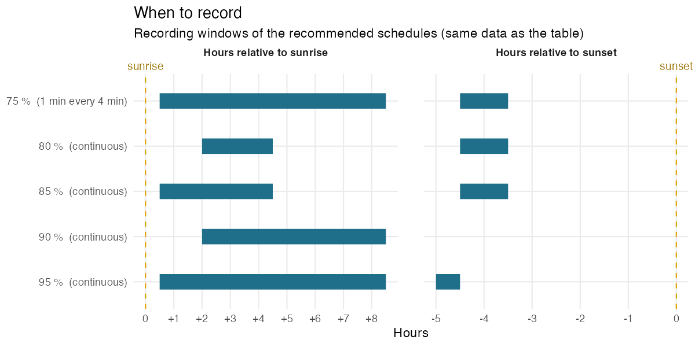
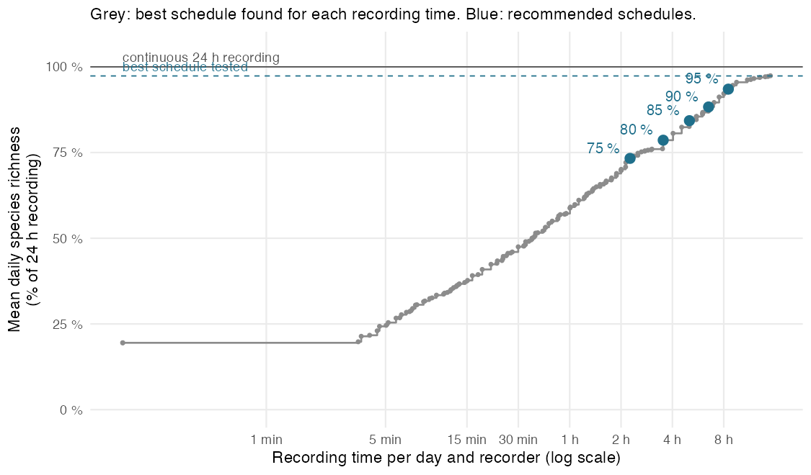
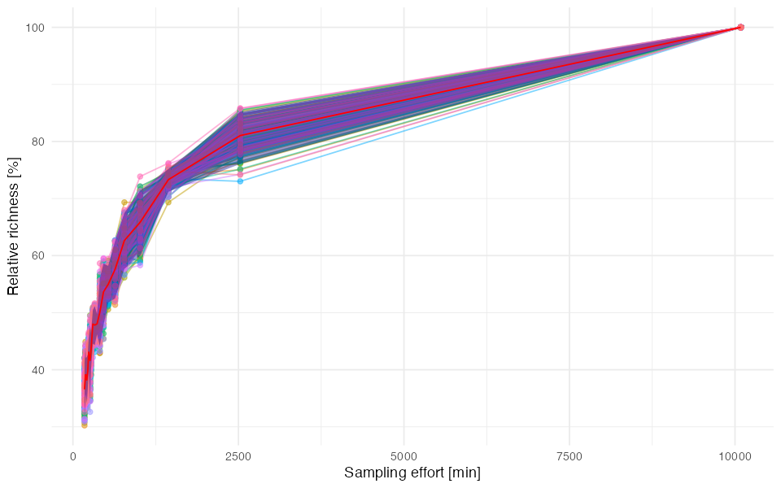
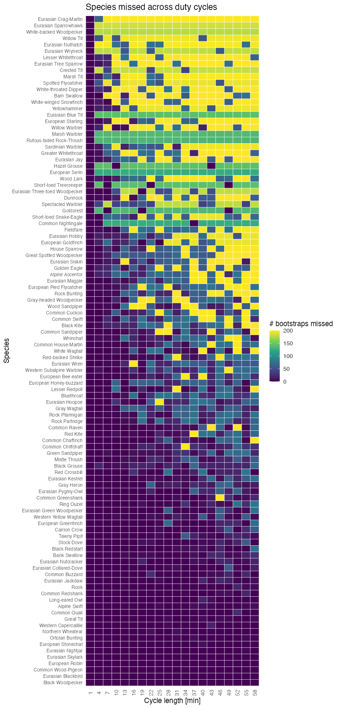
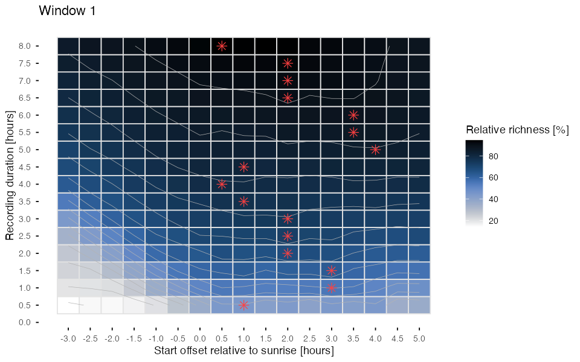
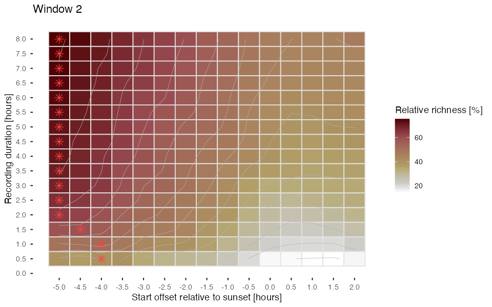
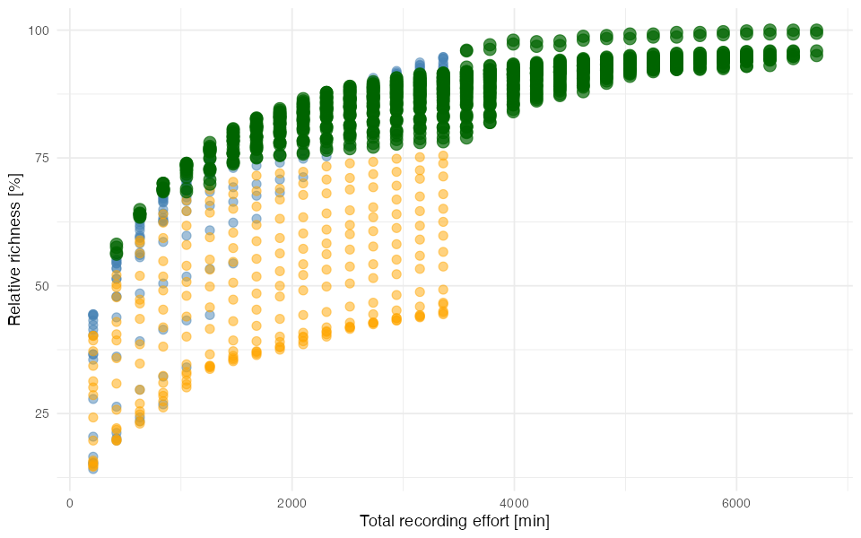
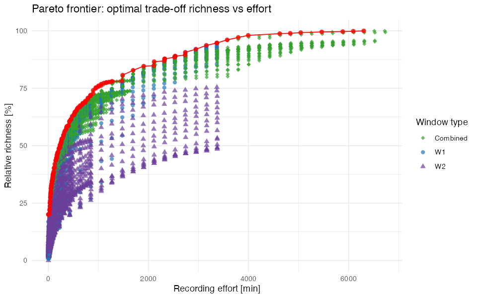

# Alpine bird community, Valais (CH): post-breeding season

`CH_Valais_2023-08-25_7d` · Amandine Serrurier · SCORE 1.1.0

[⬇ Download the preset (.json, for the SCORE app)](../presets/CH_Valais_2023-08-25_7d/CH_Valais_2023-08-25_7d.json) · [← Back to catalogue](../README.md)

> **Pilot data:** 7 days (2023-08-25 to 2023-08-31), 11 recorder(s), 123 species detected with continuous 24 h recording (97.4 species per day on average).

## Recommended schedules

For each target, the schedule that needs the **least recording** among the 20 445 schedules tested by SCORE.

| Target | Duty cycle | Time windows | Recording per day | Richness (% of 24 h) | Richness (% of best tested) | Species never detected |
|---|---|---|---|---|---|---|
| 75 % | 1 min every 4 min | from sunrise + 0 h 30 to sunrise + 8 h 30 (≈ 07:13–15:13) from sunset − 4 h 30 to sunset − 3 h 30 (≈ 15:47–16:47) | 136 min (9.41 % of 24 h) | 73.3 % | 75.3 % | 14 of 123 |
| 80 % | continuous | from sunrise + 2 h to sunrise + 4 h 30 (≈ 08:43–11:13) from sunset − 4 h 30 to sunset − 3 h 30 (≈ 15:47–16:47) | 212 min (14.72 % of 24 h) | 78.6 % | 80.7 % | 12 of 123 |
| 85 % | continuous | from sunrise + 0 h 30 to sunrise + 4 h 30 (≈ 07:13–11:13) from sunset − 4 h 30 to sunset − 3 h 30 (≈ 15:47–16:47) | 302 min (20.97 % of 24 h) | 84.3 % | 86.6 % | 7 of 123 |
| 90 % | continuous | from sunrise + 2 h to sunrise + 8 h 30 (≈ 08:43–15:13) | 391 min (27.15 % of 24 h) | 88.3 % | 90.7 % | 6 of 123 |
| 95 % | continuous | from sunrise + 0 h 30 to sunrise + 8 h 30 (≈ 07:13–15:13) from sunset − 5 h to sunset − 4 h 30 (≈ 15:17–15:47) | 511 min (35.45 % of 24 h) | 93.5 % | 96.1 % | 3 of 123 |

<b>How to read this table</b>

- **Target**: share of species richness to reach, relative to the *best schedule tested* (see below).
- **Duty cycle**: how to record *inside* the time windows. *Continuous* = record without pause; *1 min every 7 min* = record 1 min, pause 6 min. It is the duty cycle of the least-effort schedule found, not a fixed choice: when a short continuous window is cheaper than a long sampled one, SCORE recommends the continuous window.
- **Time windows**: relative to sunrise or sunset, so that they follow the season. Clock times (≈) are only indicative: they use the mean sunrise/sunset of the pilot days.
- **Recording per day**: per recorder.
- **Richness (% of 24 h)**: mean number of species detected per day with this schedule, as a % of the species detected per day with continuous 24 h recording (all recorders pooled per day).
- **Richness (% of best tested)**: same, but relative to the best schedule among those tested. SCORE only tests windows within the grid chosen in the app (Tab 3), so the best schedule tested can detect fewer species than 24 h recording (here: 97.3 % of 24 h). The targets refer to this value.
- **Species never detected**: species detected at least once during the pilot with 24 h recording but never with this schedule (details below).

*Each bar is a recording window of a recommended schedule (same data as the table). Positions are in hours relative to sunrise or sunset, so the windows follow the change of day length; the duty cycle in brackets applies inside the bars.*

## Species missed by each schedule

| Target | Recording per day | Species detected over the pilot | Species never detected | Mean daily omission |
|---|---|---|---|---|
| 75 % | 136 min | 109 of 123 | 14 (11.4 %) | 27.4 % |
| 80 % | 212 min | 111 of 123 | 12 (9.8 %) | 22.1 % |
| 85 % | 302 min | 116 of 123 | 7 (5.7 %) | 16.5 % |
| 90 % | 391 min | 117 of 123 | 6 (4.9 %) | 12.1 % |
| 95 % | 511 min | 120 of 123 | 3 (2.4 %) | 6.8 % |

- **Species never detected**: detected at least once with 24 h recording during the pilot, but on no day with this schedule.
- **Mean daily omission**: on an average day, share of the species detected with 24 h recording that the schedule misses.
- Detections per species and per schedule are in the table *Species* below.

<b>75 % schedule: 14 species never detected</b>

Crested Tit, Eurasian Blue Tit, Eurasian Nuthatch, Eurasian Sparrowhawk, Eurasian Wryneck, European Serin, Goldcrest, Hazel Grouse, Marsh Warbler, Rufous-tailed Rock-Thrush, Short-toed Treecreeper, White-backed Woodpecker, Willow Tit, Yellowhammer

<b>80 % schedule: 12 species never detected</b>

Common Nightingale, Eurasian Blue Tit, Eurasian Sparrowhawk, European Serin, Goldcrest, Hazel Grouse, Marsh Warbler, Rufous-tailed Rock-Thrush, Sardinian Warbler, White-backed Woodpecker, Willow Tit, Yellowhammer

<b>85 % schedule: 7 species never detected</b>

Eurasian Blue Tit, Eurasian Sparrowhawk, European Serin, Goldcrest, Marsh Warbler, Rufous-tailed Rock-Thrush, Willow Tit

<b>90 % schedule: 6 species never detected</b>

Common Nightingale, Eurasian Sparrowhawk, European Serin, Goldcrest, Hazel Grouse, Yellowhammer

<b>95 % schedule: 3 species never detected</b>

Eurasian Sparrowhawk, European Serin, Goldcrest

## Species

All species detected during the pilot (123), with BirdNET-Analyzer (confidence threshold: 0). Species names are those of the classifier; detections were not verified unless stated in the notes.

<b>Show the table of the 123 species</b>

- **Detections**: number of BirdNET detections during the pilot, all recorders.
- **Mean confidence**: mean classifier confidence of these detections (low values point to possible false positives).
- **24 h, 75 %, 80 %, 85 %, 90 %, 95 %**: number of pilot days (out of 7) on which the species was detected with continuous 24 h recording and with each recommended schedule.
- **Peak activity**: the hour, relative to sunrise, with the most detections.
- **Activity over the day**: detections per hour from 6 h before sunrise to 18 h after it; `┃` marks sunrise, `·` no detection.

| Species | Detections | Mean confidence | 24 h | 75 % | 80 % | 85 % | 90 % | 95 % | Peak activity | Activity over the day |
|---|---|---|---|---|---|---|---|---|---|---|
| Alpine Swift | 688 | 0.199 | 7 | 5 | 6 | 6 | 7 | 7 | 4–5 h after sunrise | `▁▁·▁▁·┃▁▁▁▂█▄▂▄▂▃▂▁▁▁▃▁▁▁` |
| Bank Swallow | 201 | 0.217 | 7 | 6 | 3 | 4 | 7 | 7 | 3–4 h after sunrise | `·····▁┃▃▆▇█▃▂▁▃▃▁▁··▁▁···` |
| Black Woodpecker | 888 | 0.248 | 7 | 7 | 7 | 7 | 7 | 7 | 1–2 h after sunrise | `▄▆▆▅▆▇┃██▅▄▂▃▃▄▃▃▄▅▂▁▁▁▃▂` |
| Carrion Crow | 219 | 0.178 | 7 | 6 | 7 | 7 | 7 | 7 | 1–2 h after sunrise | `▃▅▂▂▄▅┃▇█▅██▂▂▅▆▄▅▄▅▅▃▂▂▂` |
| Common Buzzard | 278 | 0.227 | 7 | 6 | 7 | 7 | 7 | 7 | 2–3 h after sunrise | `▂▂▁▄▂▁┃▄▇█▅▃▃▄▆▅▅▆▃▂▁▁▁▂▁` |
| Common Chaffinch | 182 | 0.195 | 7 | 5 | 6 | 7 | 6 | 7 | 8–9 h after sunrise | `··▁▁··┃▄█▃▃▃▄▂▃█▃▁▁▁▁·▁··` |
| Common Chiffchaff | 116 | 0.242 | 7 | 4 | 7 | 7 | 6 | 7 | 0–1 h after sunrise | `·····▁┃█▇▆▆▃▅▂▂▃█▅▄▆▂····` |
| Common Greenshank | 274 | 0.347 | 7 | 7 | 7 | 7 | 7 | 7 | 0–1 h after sunrise | `▁▁▁·▁▃┃█▇▅▆▅▅▃▆▅▄▆▃▆▂▁···` |
| Common House-Martin | 81 | 0.238 | 7 | 4 | 4 | 5 | 7 | 7 | 1–2 h after sunrise | `·····▃┃▄█▃·▃▂▂▄▃▃▂▁▁▃▁··▂` |
| Common Quail | 323 | 0.218 | 7 | 7 | 7 | 7 | 7 | 7 | 4–5 h after sunrise | `▆▇▃▅▅▃┃▄████▆▃▆▆▆▅▅▃▂▁▂▂▄` |
| Common Raven | 177 | 0.319 | 7 | 5 | 7 | 7 | 6 | 6 | 10–11 h after sunrise | `▁▂··▂▄┃▂·▅▇▅▃▃▆▅▂█▂▂···▁·` |
| Common Redpoll | 797 | 0.247 | 7 | 7 | 7 | 7 | 7 | 7 | 4–5 h after sunrise | `▂▂▁▄▂▂┃▅█▇▇█▇▆▆▇▇▂▃▄▁▁▁▁▁` |
| Common Redshank | 299 | 0.193 | 7 | 7 | 7 | 7 | 7 | 7 | 2–3 h after sunrise | `▅▄▄▁▃▃┃▆██▆▄▄▄▃▇▆▆▅▂▂▁▁▂▂` |
| Common Wood-Pigeon | 3099 | 0.292 | 7 | 7 | 7 | 7 | 7 | 7 | 12–13 h after sunrise | `▅▄▆▅▄▃┃▃▄▅▅▅▅▃▃▃▆▇██▅▄▃▅▅` |
| Eurasian Blackbird | 974 | 0.189 | 7 | 7 | 7 | 7 | 7 | 7 | 7–8 h after sunrise | `▄▂▅▄▂▂┃▂▂▃▆▄▇▅█▇▆▇▅▅▄▅█▃▃` |
| Eurasian Bullfinch | 1527 | 0.239 | 7 | 7 | 7 | 7 | 7 | 7 | 9–10 h after sunrise | `▃▄▄▄▄▃┃▃▇▅▆▅▇█████▇▅▃▁▂▃▃` |
| Eurasian Collared-Dove | 382 | 0.179 | 7 | 5 | 5 | 5 | 4 | 5 | 1–2 h before sunrise | `▅▄▅██▂┃▃▃▃▂▂▂▂▂▃▄▃▆▃▁▂▂▂▁` |
| Eurasian Dotterel | 2382 | 0.332 | 7 | 7 | 7 | 7 | 7 | 7 | 9–10 h after sunrise | `▁▁▁▁▁▂┃▄█▇▆▅▅▆▆▆██▄▂▁▁▁▁▁` |
| Eurasian Eagle-Owl | 2199 | 0.206 | 7 | 7 | 7 | 7 | 7 | 7 | 4–5 h before sunrise | `▇█▇▄▂▃┃▅▅▃▄▄▂▃▄▃▄▄▄▂▂▃▃▃▃` |
| Eurasian Green Woodpecker | 273 | 0.384 | 7 | 7 | 7 | 7 | 7 | 7 | 1–2 h after sunrise | `▁····▁┃▆█▆▅▁▂▂▂▂▂▂▂▄▂▁▁·▁` |
| Eurasian Hoopoe | 41 | 0.208 | 7 | 4 | 3 | 3 | 5 | 6 | 4–5 h before sunrise | `▃█▁▁▃▁┃▃·▁▃▁▅▁▃▃·····▃·▃▆` |
| Eurasian Jackdaw | 304 | 0.239 | 7 | 7 | 6 | 6 | 7 | 7 | 3–4 h after sunrise | `·····▁┃▃█▅█▆▇▅▄▂▆█▁▂▁····` |
| Eurasian Linnet | 1324 | 0.545 | 7 | 7 | 7 | 7 | 7 | 7 | 1–2 h after sunrise | `·▁▁··▁┃▆█▆▄▅▅▃▃▄▃▃▂▂▁··▁·` |
| Eurasian Magpie | 38 | 0.244 | 7 | 5 | 4 | 5 | 4 | 5 | 1–2 h after sunrise | `·▃·▂▂▅┃▅█▅▃··▂▆·█·▂·▃····` |
| Eurasian Nightjar | 1394 | 0.161 | 7 | 7 | 7 | 7 | 7 | 7 | 4–5 h after sunrise | `█▆▃▅▁▂┃▅▃▃▄█▆▅▆▅▅▅▄▄▄▃▄▂▆` |
| Eurasian Nutcracker | 363 | 0.354 | 7 | 5 | 6 | 6 | 7 | 7 | 1–2 h after sunrise | `·····▁┃▅█▇▅▅▃▄▃▄▃▅▄▂·····` |
| Eurasian Pygmy-Owl | 154 | 0.204 | 7 | 4 | 4 | 5 | 5 | 6 | 4–5 h before sunrise | `▇█▆▄▃▄┃▂▄▃▂▁▁▂▄▁▂▄▂▃▂▁▁▂▅` |
| Eurasian Skylark | 500 | 0.335 | 7 | 7 | 7 | 7 | 7 | 7 | 4–5 h after sunrise | `·····▁┃▁▃▅██▅█▄▅▄▂▁▁·····` |
| Eurasian Woodcock | 1087 | 0.203 | 7 | 7 | 7 | 7 | 7 | 7 | 4–5 h after sunrise | `▃▃▃▁▂▃┃▆█▆▇█▇▅▆▅▄█▇▄▂▅▃▃▃` |
| European Greenfinch | 190 | 0.222 | 7 | 6 | 7 | 7 | 7 | 7 | 9–10 h after sunrise | `·▁···▂┃▄▅▇▇▇▆▇▅▅█▃▂▁▁▁···` |
| European Pied Flycatcher | 34 | 0.205 | 7 | 2 | 2 | 5 | 5 | 6 | 0–1 h after sunrise | `··▂··▄┃█▇▄▅▂▂▅···▅▇▅▂····` |
| European Robin | 469 | 0.159 | 7 | 7 | 7 | 7 | 7 | 7 | 4–5 h before sunrise | `▇█▇▇▆▄┃██▇█▇▆▅▅▆▅▄▇▇▂▄▂▃▆` |
| European Stonechat | 582 | 0.209 | 7 | 5 | 5 | 6 | 6 | 7 | 3–4 h after sunrise | `·▁▁··▃┃█▆██▆▄▃▄▅▃▅▂▂▁···▁` |
| Gray Heron | 192 | 0.213 | 7 | 6 | 5 | 6 | 7 | 7 | 0–1 h after sunrise | `▁·▁▁▁▄┃█▃▅▂▃▂▂▅▃▁▁▁▂▁▁·▁▁` |
| Gray Wagtail | 49 | 0.245 | 7 | 5 | 3 | 4 | 5 | 5 | 0–1 h after sunrise | `·▂····┃█▂·▄▁▄▆▄▁··▂▁···▁·` |
| Great Tit | 254 | 0.238 | 7 | 5 | 7 | 7 | 6 | 7 | 16–17 h after sunrise | `▂▃▅▆▄▄┃▄▅▃▂▁▁▂▃▁▄▄█▂▂▂▄█▄` |
| Hawfinch | 671 | 0.212 | 7 | 6 | 7 | 7 | 7 | 7 | 0–1 h after sunrise | `▂▃▂▂▂▃┃█▅▃▄▄▆▅▄▃▃▃▄▃▁▂▁▂▂` |
| House Sparrow | 23 | 0.188 | 7 | 7 | 4 | 5 | 4 | 5 | 5–6 h after sunrise | `······┃▃·▇▄▃█▄▇▃▇▃·······` |
| Lesser Redpoll | 105 | 0.262 | 7 | 5 | 6 | 7 | 7 | 7 | 1–2 h after sunrise | `······┃▁█▆▃▅▆▂▄█▆▃·▂·····` |
| Long-eared Owl | 544 | 0.204 | 7 | 7 | 7 | 7 | 7 | 7 | 4–5 h before sunrise | `██▅▄▃▅┃▇▅▄▂▃▄▃▄▂▂▄▂▁▁▂▂▄▄` |
| Mallard | 2523 | 0.219 | 7 | 7 | 7 | 7 | 7 | 7 | 1–2 h after sunrise | `▄▆▃▄▄▄┃▇██▆▆▃▃▄▃▄▃▃▂▁▁▁▃▄` |
| Meadow Pipit | 10376 | 0.288 | 7 | 7 | 7 | 7 | 7 | 7 | 0–1 h after sunrise | `·▁▁▁·▃┃████▇▇▆▆▇▅▆▄▄▂·▁▁▁` |
| Northern Goshawk | 1465 | 0.176 | 7 | 7 | 7 | 7 | 7 | 7 | 15–16 h after sunrise | `▇▅▄▅▃▃┃▅▄▆▆▂▂▅█▆▄▇▅▃▄▆█▆▅` |
| Northern Wheatear | 1129 | 0.343 | 7 | 5 | 7 | 7 | 6 | 6 | 2–3 h after sunrise | `····▁▂┃▄▅█▅▅▂▂▃▄▅▄▃▃▁▁▁·▁` |
| Ortolan Bunting | 350 | 0.196 | 7 | 5 | 6 | 7 | 7 | 7 | 1–2 h after sunrise | `▃▃▃▁▁▂┃▆█▅▃▅▃▃▃▄▃▂▃▂▁▁▁▂▁` |
| Peregrine Falcon | 37581 | 0.242 | 7 | 7 | 7 | 7 | 7 | 7 | 6–7 h after sunrise | `▇▇▅▄▃▃┃▅▅▆▇▇▇███▇▆▆▇▇▇▇▇▇` |
| Red Crossbill | 207 | 0.196 | 7 | 6 | 7 | 7 | 7 | 7 | 5–6 h after sunrise | `▃▂▁▁▂▃┃▄▅▅▆▅██▅▇▄▂▃▃▁▁▁▁▃` |
| Red Kite | 75 | 0.157 | 7 | 5 | 5 | 5 | 6 | 6 | 11–12 h after sunrise | `▆▄▂▆▆▂┃▂▄▂▂▂▄▆▆▂▆▂█▄▂▂▂▄·` |
| Red-billed Chough | 9484 | 0.729 | 7 | 7 | 7 | 7 | 7 | 7 | 3–4 h after sunrise | `▁·····┃▂▆▇█▇▇▇▄▄▅█▂▁·▁··▁` |
| Ring Ouzel | 213 | 0.285 | 7 | 6 | 6 | 6 | 7 | 7 | 1–2 h after sunrise | `···▂▁▅┃███▅▆▂▂▄▄▆▄▁▂▁▁·▁▁` |
| Rock Pigeon | 5799 | 0.288 | 7 | 6 | 7 | 7 | 7 | 7 | 12–13 h after sunrise | `▄▄▄▄▃▃┃▄▄▄▄▅▄▄▃▄▆▇███▆▅▇▅` |
| Rock Ptarmigan | 75 | 0.279 | 7 | 2 | 2 | 3 | 6 | 6 | 0–1 h before sunrise | `▂▂·▃▂█┃▃▂▁··▁▂▂▃▂▂▃·▂▁▂▂·` |
| Rook | 559 | 0.26 | 7 | 5 | 7 | 7 | 7 | 7 | 4–5 h after sunrise | `▄▁▅▄▇▅┃▄▂▂██▅▃▄▃▅▄▄▄▃▆▇▇▄` |
| Song Thrush | 1148 | 0.219 | 7 | 7 | 7 | 7 | 7 | 7 | 1–2 h after sunrise | `▅▅▆▆▄▃┃▄█▄▆▇▆▅▅▇▇█▅▃▄▄▄▃▃` |
| Stock Dove | 248 | 0.196 | 7 | 5 | 6 | 6 | 6 | 6 | 3–4 h before sunrise | `▃▅█▂▁▁┃▂▁▂▁▁▁▁▁▂▁▄▁▂▁▁▂▁▁` |
| Tawny Owl | 5863 | 0.229 | 7 | 7 | 7 | 7 | 7 | 7 | 7–8 h after sunrise | `▆▅▅▅▅▅┃▇█▆▅▇▇▇█▆███▆▆▇▆▅▆` |
| Tawny Pipit | 207 | 0.222 | 7 | 6 | 6 | 6 | 7 | 7 | 2–3 h after sunrise | `·····▁┃▃██▅▅▅▇▄▂▄▁▁▁▁····` |
| Tree Pipit | 4594 | 0.3 | 7 | 7 | 7 | 7 | 7 | 7 | 0–1 h after sunrise | `▁▁▁▁▂▄┃███▆▇▆▆▆▆▄▄▃▃▁▁▁▁▁` |
| Water Pipit | 16700 | 0.497 | 7 | 7 | 7 | 7 | 7 | 7 | 2–3 h after sunrise | `···▁·▃┃█▇████▇▇▇▆▆▄▄▂··▁·` |
| Western Capercaillie | 998 | 0.185 | 7 | 5 | 6 | 7 | 6 | 7 | 13–14 h after sunrise | `▃▄▂▂▂▂┃▃▂▂▁▃▃▃▄▂▂▅▄▄██▇▅▄` |
| Wood Lark | 27 | 0.16 | 7 | 2 | 6 | 6 | 5 | 6 | 8–9 h after sunrise | `·····▃┃▂▃▂▄·▂·▂█▄▄▃·▂····` |
| Wood Sandpiper | 47 | 0.255 | 7 | 4 | 5 | 6 | 6 | 7 | 0–1 h after sunrise | `······┃█▅▃▇▄▁▁▃▄▂▃·······` |
| Yellow-billed Chough | 11350 | 0.687 | 7 | 7 | 7 | 7 | 7 | 7 | 3–4 h after sunrise | `······┃▃███▇▄▅▅▃▄▄▂▁·▁···` |
| Black Redstart | 272 | 0.186 | 6 | 5 | 5 | 5 | 6 | 6 | 1–2 h after sunrise | `▁····▃┃██▇▅▅▅▃▄▅▃▅▃▂▁▁··▁` |
| Bluethroat | 84 | 0.162 | 6 | 4 | 5 | 5 | 6 | 6 | 1–2 h after sunrise | `·····▂┃▃██▆▃▃▂▃▆▆▄▁▂·····` |
| Common Cuckoo | 35 | 0.205 | 6 | 1 | 2 | 2 | 3 | 3 | 5–6 h before sunrise | `█▇▄▂▄▃┃▂··▂▂▂···▂▂▄▂·▂·▄·` |
| Eurasian Siskin | 17 | 0.365 | 6 | 2 | 3 | 3 | 6 | 6 | 11–12 h after sunrise | `·····▃┃▃·▆▆··▆▆▃··█···▃··` |
| European Bee-eater | 70 | 0.305 | 6 | 5 | 6 | 6 | 6 | 6 | 3–4 h after sunrise | `······┃▄▆▅█▅▂▅▅▆▆▇▅▂▃··▂·` |
| European Honey-buzzard | 28 | 0.187 | 6 | 4 | 6 | 6 | 6 | 6 | 3–4 h after sunrise | `▃▃▆▆·▃┃·▃▆█▆▆▆▃▃▆▆▃···▃·▃` |
| Fieldfare | 25 | 0.201 | 6 | 1 | 4 | 5 | 4 | 4 | 1–2 h after sunrise | `·····▇┃▅█▄▄▅▄··▂▄···▂····` |
| Gray-headed Woodpecker | 26 | 0.198 | 6 | 3 | 2 | 5 | 3 | 5 | 1–2 h after sunrise | `▃·▂▄▂·┃▂█·▃▂▂···▂▃▂····▂·` |
| Green Sandpiper | 162 | 0.246 | 6 | 5 | 5 | 5 | 5 | 6 | 0–1 h after sunrise | `··▁··▁┃██▅▅▂▁▁▂▃▄▄▃▃·····` |
| Mistle Thrush | 119 | 0.216 | 6 | 5 | 4 | 4 | 5 | 6 | 9–10 h after sunrise | `······┃▁▃▇▆█▃▄▅▆█▃·▁·····` |
| Red-backed Shrike | 95 | 0.21 | 6 | 5 | 5 | 5 | 6 | 6 | 1–2 h after sunrise | `·····▂┃▄█▆▇▄·▃▂▅▆▂▁▁·····` |
| Rock Bunting | 52 | 0.323 | 6 | 3 | 2 | 4 | 3 | 5 | 1–2 h after sunrise | `·····▂┃▂█▁▁··▁▁··▂·······` |
| Rock Partridge | 58 | 0.252 | 6 | 3 | 4 | 6 | 4 | 6 | 0–1 h before sunrise | `·····█┃▇▅▆▂▅▂▂·▄▂·▂·▅····` |
| Western Subalpine Warbler | 104 | 0.199 | 6 | 3 | 5 | 5 | 4 | 4 | 2–3 h after sunrise | `······┃▃▆█▅▄▁▁▁▂▂▁▄▂▁···▁` |
| Whinchat | 72 | 0.168 | 6 | 3 | 5 | 5 | 6 | 6 | 2–3 h after sunrise | `······┃▃·█▆▂▂▂▃▅▃▂▁·····▁` |
| White Wagtail | 92 | 0.175 | 6 | 6 | 5 | 6 | 6 | 6 | 0–1 h after sunrise | `···▁·▄┃█▅▄▆▇▆▂▄▄▁▂▂▂▂▁·▁·` |
| Alpine Accentor | 30 | 0.231 | 5 | 2 | 4 | 4 | 5 | 5 | 2–3 h after sunrise | `······┃▂▂█▇▂▃▃·▂·········` |
| Black Grouse | 246 | 0.25 | 5 | 2 | 2 | 2 | 3 | 3 | 10–11 h after sunrise | `▁▂▂▄▂▂┃▂▄▄▂▆▃▂▂▁▅█▇▄▂▁▁▂▁` |
| Common Sandpiper | 63 | 0.241 | 5 | 5 | 5 | 5 | 5 | 5 | 0–1 h after sunrise | `·▁▁▁·▃┃█▄▂▃▁▁▁▁▄▁▃·······` |
| Dunnock | 20 | 0.2 | 5 | 2 | 4 | 5 | 3 | 4 | 5–6 h after sunrise | `·····▃┃▆▆▃▃▆█▆··▆·▆▆·····` |
| Eurasian Jay | 14 | 0.208 | 5 | 2 | 1 | 2 | 4 | 4 | 0–1 h after sunrise | `·····▂┃█▄▄···▂▆··········` |
| Eurasian Kestrel | 776 | 0.641 | 5 | 4 | 5 | 5 | 5 | 5 | 3–4 h after sunrise | `▁····▁┃▂▄▄█▃▁▁▂▂▃▂▃▂▁····` |
| Eurasian Tree Sparrow | 10 | 0.228 | 5 | 3 | 3 | 3 | 5 | 5 | 2–3 h after sunrise | `······┃··█·▄▂▂··▂········` |
| Golden Eagle | 25 | 0.178 | 5 | 2 | 2 | 2 | 4 | 4 | 5–6 h after sunrise | `▂▂····┃·▂▂▇▇█▂····▂▄▂···▂` |
| Greater Whitethroat | 17 | 0.204 | 5 | 2 | 2 | 2 | 4 | 4 | 1–2 h after sunrise | `······┃·███·▄█▄··█▄▄·····` |
| Lesser Whitethroat | 9 | 0.179 | 5 | 2 | 2 | 2 | 4 | 5 | 1–2 h after sunrise | `······┃·█▄···▄▄▄·█··▄····` |
| Western Yellow Wagtail | 441 | 0.335 | 5 | 5 | 4 | 5 | 5 | 5 | 0–1 h after sunrise | `·····▁┃█▃▃▄▄▃▃▃▂▁▁▁▁·····` |
| White-winged Snowfinch | 21 | 0.353 | 5 | 2 | 3 | 3 | 3 | 4 | 3–4 h after sunrise | `······┃▃··█▃··█▃▃········` |
| Barn Swallow | 13 | 0.132 | 4 | 3 | 4 | 4 | 3 | 3 | 0–1 h before sunrise | `·····█┃█▄▄▄██▄··▄········` |
| Black Kite | 29 | 0.176 | 4 | 3 | 3 | 3 | 3 | 3 | 2–3 h after sunrise | `····▄·┃·▃█·▄█▃█·▃▆▃▄···▆·` |
| Common Swift | 37 | 0.207 | 4 | 4 | 3 | 4 | 3 | 4 | 0–1 h after sunrise | `··▁···┃██▂▂▂·▁·▁▁·▁··▁···` |
| Eurasian Crag-Martin | 8 | 0.235 | 4 | 1 | 2 | 2 | 3 | 3 | 4–5 h after sunrise | `······┃···▃█▃▃·····▃·····` |
| Eurasian Nuthatch | 6 | 0.171 | 4 | 0 | 1 | 2 | 2 | 4 | 9–10 h after sunrise | `······┃▅·▅·▅···▅█········` |
| Eurasian Wren | 91 | 0.188 | 4 | 4 | 3 | 3 | 4 | 4 | 4–5 h after sunrise | `······┃▂▄▂▃█▄▄▄▇█▇▃▁·····` |
| European Starling | 13 | 0.159 | 4 | 3 | 3 | 3 | 4 | 4 | 2–3 h after sunrise | `······┃·▇█▂·▄▂···········` |
| Great Spotted Woodpecker | 13 | 0.206 | 4 | 3 | 2 | 2 | 4 | 4 | 7–8 h after sunrise | `······┃··▂··▂·█▃·▂·····▂·` |
| Marsh Tit | 9 | 0.243 | 4 | 2 | 4 | 4 | 4 | 4 | 3–4 h after sunrise | `······┃▄·▄█▂·············` |
| White-throated Dipper | 7 | 0.222 | 4 | 2 | 3 | 4 | 3 | 4 | 0–1 h after sunrise | `······┃██·███·█·█········` |
| Willow Warbler | 9 | 0.129 | 4 | 2 | 2 | 4 | 2 | 4 | 1–2 h after sunrise | `······┃▃██▃···▃··········` |
| Eurasian Hobby | 23 | 0.17 | 3 | 2 | 3 | 3 | 3 | 3 | 0–1 h before sunrise | `·▂▂··█┃·▂▅▇▄······▂·▂··▂▄` |
| European Goldfinch | 20 | 0.208 | 3 | 1 | 3 | 3 | 2 | 3 | 10–11 h after sunrise | `·····▂┃▆▂▂▃··▃··▂█······▂` |
| Sardinian Warbler | 15 | 0.255 | 3 | 2 | 0 | 1 | 3 | 3 | 0–1 h after sunrise | `·····▃┃█····█▃▆▆·▃·▃·····` |
| Short-toed Snake-Eagle | 11 | 0.253 | 3 | 3 | 1 | 1 | 3 | 3 | 6–7 h after sunrise | `······┃···▂·▆█···········` |
| Spotted Flycatcher | 9 | 0.172 | 3 | 1 | 2 | 2 | 3 | 3 | 2–3 h after sunrise | `······┃▄▄█·█···▄·········` |
| Willow Tit | 3 | 0.204 | 3 | 0 | 0 | 0 | 1 | 1 | 2–3 h before sunrise | `···█·█┃······█···········` |
| Yellowhammer | 9 | 0.2 | 3 | 0 | 0 | 1 | 0 | 2 | 0–1 h after sunrise | `·····▄┃█▄······▄·▄▄·█····` |
| Crested Tit | 4 | 0.163 | 2 | 0 | 1 | 1 | 2 | 2 | 0–1 h before sunrise | `·····█┃····▄··▄··········` |
| Eurasian Sparrowhawk | 3 | 0.132 | 2 | 0 | 0 | 0 | 0 | 0 | 1–2 h before sunrise | `····█·┃················██` |
| Eurasian Three-toed Woodpecker | 29 | 0.134 | 2 | 2 | 2 | 2 | 2 | 2 | 6–7 h after sunrise | `······┃···▁▃▅█·▂··▁······` |
| Eurasian Wryneck | 3 | 0.162 | 2 | 0 | 1 | 1 | 1 | 1 | 3–4 h after sunrise | `·····▄┃···█··············` |
| Spectacled Warbler | 5 | 0.147 | 2 | 1 | 1 | 1 | 2 | 2 | 3–4 h after sunrise | `······┃···███··█···█·····` |
| White-backed Woodpecker | 2 | 0.304 | 2 | 0 | 0 | 1 | 1 | 2 | 1–2 h after sunrise | `······┃·█····█···········` |
| Common Nightingale | 2 | 0.192 | 1 | 1 | 0 | 1 | 0 | 1 | 0–1 h after sunrise | `······┃█··········█······` |
| Eurasian Blue Tit | 1 | 0.136 | 1 | 0 | 0 | 0 | 1 | 1 | 6–7 h after sunrise | `······┃······█···········` |
| European Serin | 1 | 0.161 | 1 | 0 | 0 | 0 | 0 | 0 | 14–15 h after sunrise | `······┃··············█···` |
| Goldcrest | 3 | 0.149 | 1 | 0 | 0 | 0 | 0 | 0 | 4–5 h before sunrise | `·█·█··┃··················` |
| Hazel Grouse | 1 | 0.119 | 1 | 0 | 0 | 1 | 0 | 1 | 0–1 h after sunrise | `······┃█·················` |
| Marsh Warbler | 1 | 0.144 | 1 | 0 | 0 | 0 | 1 | 1 | 7–8 h after sunrise | `······┃·······█··········` |
| Rufous-tailed Rock-Thrush | 1 | 0.134 | 1 | 0 | 0 | 0 | 1 | 1 | 8–9 h after sunrise | `······┃········█·········` |
| Short-toed Treecreeper | 4 | 0.223 | 1 | 0 | 1 | 1 | 1 | 1 | 3–4 h before sunrise | `··█···┃··█··█······█·····` |

## How many species for how much recording?

*Each grey point is the best schedule found by SCORE for a given recording time per day (among 20 445 schedules tested). The curve shows how fast richness increases with recording time and where adding recording time brings few additional species. Use it to choose a compromise other than the recommended targets.*

## Study context

| Item | Value |
|---|---|
| Project | 15 recorders in 2 sites of swiss alps |
| Objective | community |
| Target taxa | birds |
| Country / region | Switzerland / Valais |
| Habitat (EUNIS) | E, South faced Alpine grassland, above treeline |
| Elevation | 2200 m (mean) |
| Location | 46.2° N, 8.1° E (rounded to ~10 km) |
| Period | 2023-08-25 to 2023-08-31 (7 days with data, Europe/Zurich) |
| Timing | post-breeding, August |
| Recorders | 11 × SMMini 2 |
| Sample rate | 48000 Hz |
| Deployment height | 1 m |
| Classifier | BirdNET-Analyzer 2.4 |
| Confidence threshold | 0 |

## How well does it transfer?

_No validation provided with this preset._

## Method

- Richness: mean daily species richness; all recorders pooled per day
- Duty cycles tested: 1 min every 1 to 58 min
- Schedules tested: 20 445 (duty cycles × time windows of the grid of Tab 3)
- Selection rule: least effort with richness >= target (% of best candidate); ties: highest richness

## Figures from the SCORE app

<b>Show the original figures of this analysis</b>

**Tab 2 – Richness by duty cycle (bootstrap)**

**Tab 2 – Species missed by duty cycle**

**Tab 3 – Richness by time window (window 1)**

**Tab 3 – Richness by time window (window 2)**

**Tab 3 – Richness of combined windows**

**Tab 4 – Multi-optimum: effort vs richness of all schedules tested**

## Cite

Serrurier et al. (in revision) SCORE: a user-friendly application to optimise recording schedules in passive acoustic monitoring. Journal of Avian Biology.

