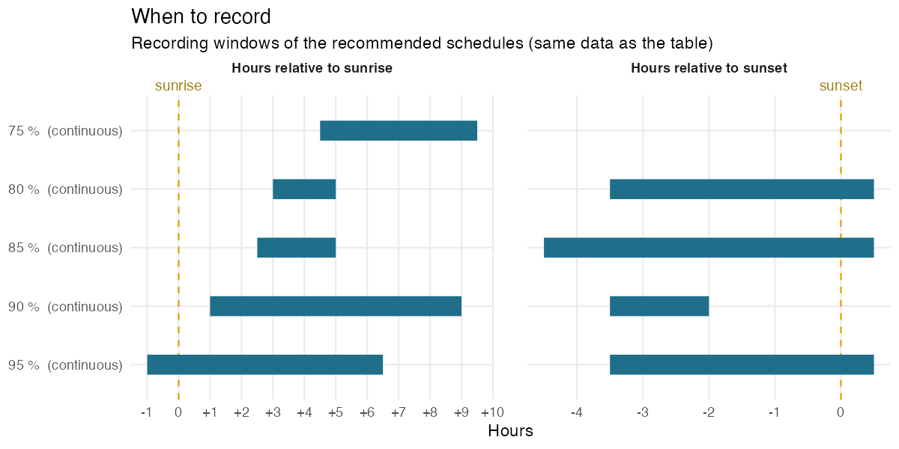
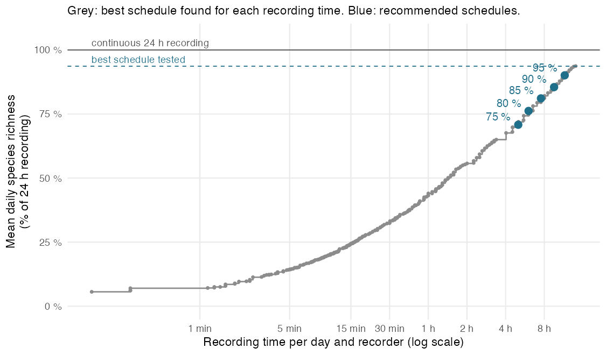
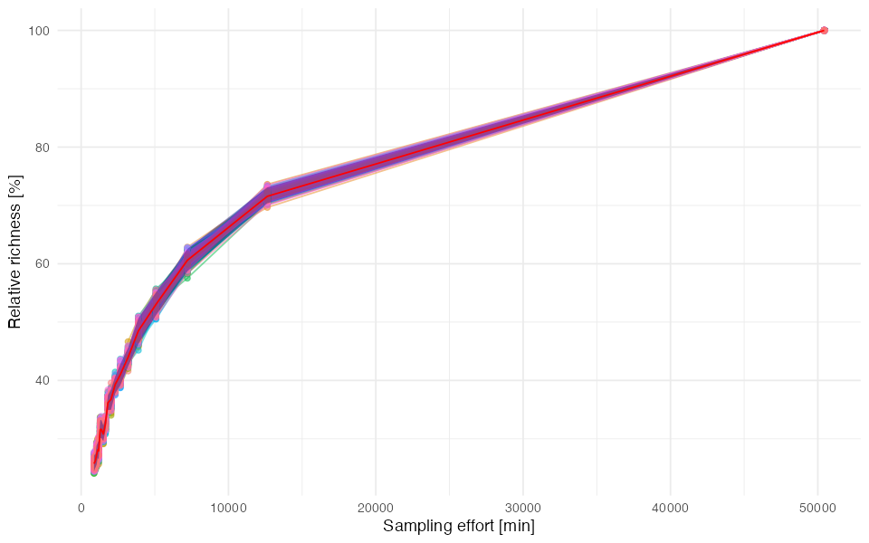
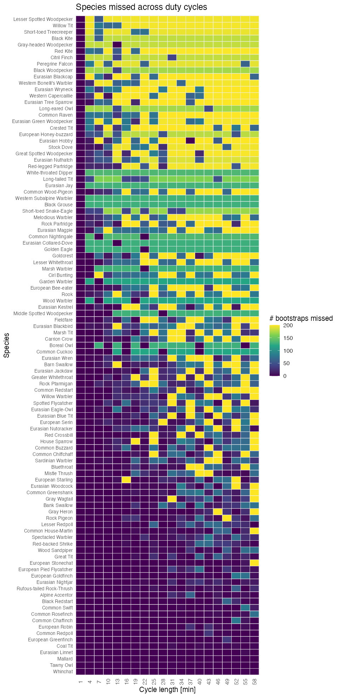
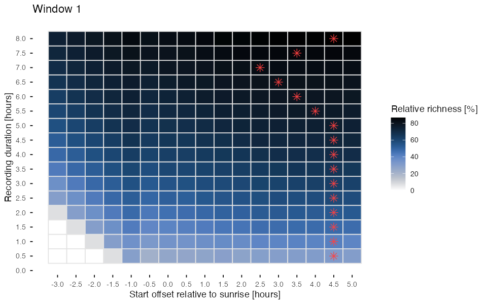
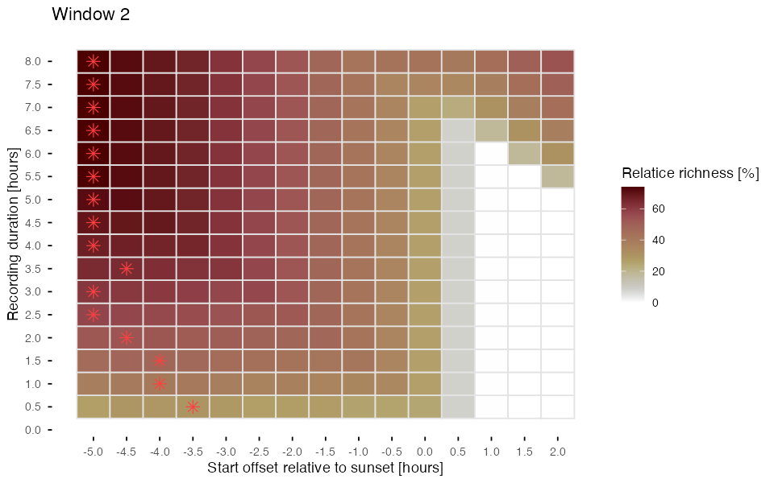
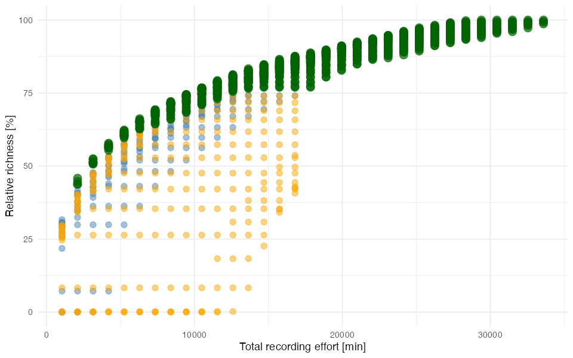
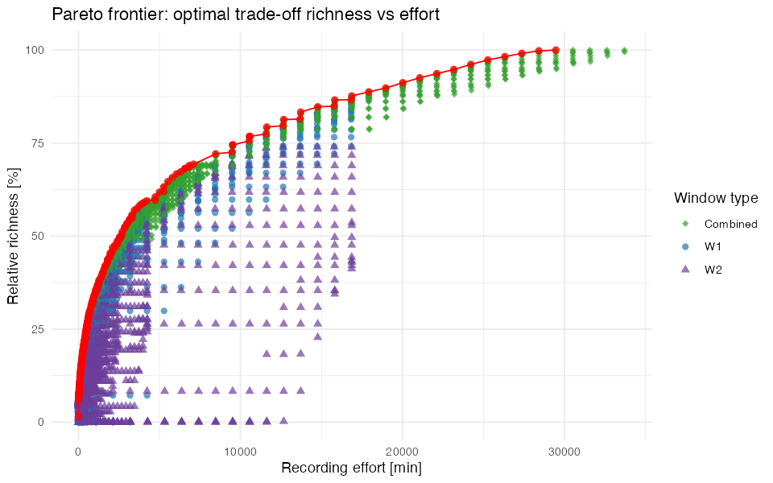

# –

`XX_2024-06-12_35d` · amana · SCORE 1.1.0

[⬇ Download the preset (.json, for the SCORE app)](../presets/XX_2024-06-12_35d/XX_2024-06-12_35d.json) · [← Back to catalogue](../README.md)

> **Pilot data:** 35 days (2024-06-12 to 2024-07-16), 1 recorder(s), 128 species detected with continuous 24 h recording (71.2 species per day on average).

## Recommended schedules

For each target, the schedule that needs the **least recording** among the 20 456 schedules tested by SCORE.

| Target | Duty cycle | Time windows | Recording per day | Richness (% of 24 h) | Richness (% of best tested) | Species never detected |
|---|---|---|---|---|---|---|
| 75 % | continuous | from sunrise + 4 h 30 to sunrise + 9 h 30 (≈ 10:11–15:11) | 301 min (20.9 % of 24 h) | 70.8 % | 75.6 % | 16 of 128 |
| 80 % | continuous | from sunrise + 3 h to sunrise + 5 h (≈ 08:41–10:41) from sunset − 3 h 30 to sunset + 0 h 30 (≈ 17:52–21:52) | 362 min (25.14 % of 24 h) | 76.2 % | 81.3 % | 14 of 128 |
| 85 % | continuous | from sunrise + 2 h 30 to sunrise + 5 h (≈ 08:11–10:41) from sunset − 4 h 30 to sunset + 0 h 30 (≈ 16:52–21:52) | 452 min (31.39 % of 24 h) | 81.1 % | 86.6 % | 13 of 128 |
| 90 % | continuous | from sunrise + 1 h to sunrise + 9 h (≈ 06:41–14:41) from sunset − 3 h 30 to sunset − 2 h (≈ 17:52–19:22) | 572 min (39.72 % of 24 h) | 85.5 % | 91.2 % | 5 of 128 |
| 95 % | continuous | from sunrise − 1 h to sunrise + 6 h 30 (≈ 04:41–12:11) from sunset − 3 h 30 to sunset + 0 h 30 (≈ 17:52–21:52) | 692 min (48.06 % of 24 h) | 90.1 % | 96.1 % | 4 of 128 |

<b>How to read this table</b>

- **Target**: share of species richness to reach, relative to the *best schedule tested* (see below).
- **Duty cycle**: how to record *inside* the time windows. *Continuous* = record without pause; *1 min every 7 min* = record 1 min, pause 6 min. It is the duty cycle of the least-effort schedule found, not a fixed choice: when a short continuous window is cheaper than a long sampled one, SCORE recommends the continuous window.
- **Time windows**: relative to sunrise or sunset, so that they follow the season. Clock times (≈) are only indicative: they use the mean sunrise/sunset of the pilot days.
- **Recording per day**: per recorder.
- **Richness (% of 24 h)**: mean number of species detected per day with this schedule, as a % of the species detected per day with continuous 24 h recording (all recorders pooled per day).
- **Richness (% of best tested)**: same, but relative to the best schedule among those tested. SCORE only tests windows within the grid chosen in the app (Tab 3), so the best schedule tested can detect fewer species than 24 h recording (here: 93.7 % of 24 h). The targets refer to this value.
- **Species never detected**: species detected at least once during the pilot with 24 h recording but never with this schedule (details below).

*Each bar is a recording window of a recommended schedule (same data as the table). Positions are in hours relative to sunrise or sunset, so the windows follow the change of day length; the duty cycle in brackets applies inside the bars.*

## Species missed by each schedule

| Target | Recording per day | Species detected over the pilot | Species never detected | Mean daily omission |
|---|---|---|---|---|
| 75 % | 301 min | 112 of 128 | 16 (12.5 %) | 29.1 % |
| 80 % | 362 min | 114 of 128 | 14 (10.9 %) | 23.9 % |
| 85 % | 452 min | 115 of 128 | 13 (10.2 %) | 19 % |
| 90 % | 572 min | 123 of 128 | 5 (3.9 %) | 14.6 % |
| 95 % | 692 min | 124 of 128 | 4 (3.1 %) | 10.1 % |

- **Species never detected**: detected at least once with 24 h recording during the pilot, but on no day with this schedule.
- **Mean daily omission**: on an average day, share of the species detected with 24 h recording that the schedule misses.
- Detections per species and per schedule are in the table *Species* below.

<b>75 % schedule: 16 species never detected</b>

Black Grouse, Citril Finch, Common Cuckoo, Common Nightingale, Eurasian Collared-Dove, Eurasian Nuthatch, Garden Warbler, Gray-headed Woodpecker, Lesser Spotted Woodpecker, Long-eared Owl, Marsh Warbler, Melodious Warbler, Middle Spotted Woodpecker, Red-legged Partridge, Rock Partridge, Western Capercaillie

<b>80 % schedule: 14 species never detected</b>

Black Grouse, Black Kite, Boreal Owl, Common Nightingale, Eurasian Jay, Garden Warbler, Golden Eagle, Long-tailed Tit, Marsh Warbler, Red-legged Partridge, Rock Partridge, Western Subalpine Warbler, White-throated Dipper, Wood Warbler

<b>85 % schedule: 13 species never detected</b>

Black Grouse, Black Kite, Boreal Owl, Common Nightingale, Eurasian Jay, Garden Warbler, Golden Eagle, Marsh Warbler, Red-legged Partridge, Rock Partridge, Western Subalpine Warbler, White-throated Dipper, Wood Warbler

<b>90 % schedule: 5 species never detected</b>

Black Grouse, Boreal Owl, Garden Warbler, Marsh Warbler, Middle Spotted Woodpecker

<b>95 % schedule: 4 species never detected</b>

Boreal Owl, Garden Warbler, Western Subalpine Warbler, Wood Warbler

## Species

All species detected during the pilot (128), with BirdNET-Analyzer (confidence threshold: 0). Species names are those of the classifier; detections were not verified unless stated in the notes.

<b>Show the table of the 128 species</b>

- **Detections**: number of BirdNET detections during the pilot, all recorders.
- **Mean confidence**: mean classifier confidence of these detections (low values point to possible false positives).
- **24 h, 75 %, 80 %, 85 %, 90 %, 95 %**: number of pilot days (out of 35) on which the species was detected with continuous 24 h recording and with each recommended schedule.
- **Peak activity**: the hour, relative to sunrise, with the most detections.
- **Activity over the day**: detections per hour from 6 h before sunrise to 18 h after it; `┃` marks sunrise, `·` no detection.

| Species | Detections | Mean confidence | 24 h | 75 % | 80 % | 85 % | 90 % | 95 % | Peak activity | Activity over the day |
|---|---|---|---|---|---|---|---|---|---|---|
| Alpine Swift | 5324 | 0.242 | 35 | 34 | 35 | 35 | 35 | 35 | 10–11 h after sunrise | `····▁▂┃▂▁▂▄▄▆▃▄█▅█▆▄▄▃▄▄·` |
| Common Chaffinch | 388 | 0.186 | 35 | 34 | 34 | 34 | 35 | 35 | 1–2 h after sunrise | `·····▂┃▄█▇██▅▆▄▅▃▄▆▄▃▃█▂·` |
| Common Quail | 2952 | 0.146 | 35 | 35 | 35 | 35 | 35 | 35 | 1–2 h after sunrise | `····▁▅┃▆██▆▆▅▄▃▃▂▂▃▂▃▂▂▁·` |
| Common Redpoll | 309 | 0.213 | 35 | 30 | 33 | 33 | 34 | 34 | 6–7 h after sunrise | `·····▃┃▄▆▆▅▅▆█▅▅▅▅▂▄▅▄▇▃·` |
| Common Rosefinch | 248 | 0.157 | 35 | 28 | 22 | 27 | 32 | 33 | 0–1 h before sunrise | `····▁█┃▃▃▅▄▆▆▆▇▅▅▃▇▄▃▄▁▁·` |
| Common Sandpiper | 752 | 0.261 | 35 | 28 | 34 | 35 | 35 | 35 | 15–16 h after sunrise | `·····▄┃▄▅▃▄▃▃▄▄▄▅▄▇▅█▆█▁·` |
| Dunnock | 1657 | 0.193 | 35 | 31 | 34 | 34 | 35 | 35 | 12–13 h after sunrise | `·····▂┃▃▂▂▃▃▄▅▅▇▆▇▇██▆▇▁·` |
| Eurasian Bullfinch | 1169 | 0.274 | 35 | 34 | 33 | 34 | 34 | 35 | 0–1 h after sunrise | `·····█┃█▆▆▇▇▇▇▆▅▆▅▅▆▆▇▆▂·` |
| Eurasian Dotterel | 1353 | 0.216 | 35 | 29 | 33 | 34 | 34 | 34 | 3–4 h after sunrise | `····▁▂┃▇███▆▆▅▄▅▇▅▅▅▅▃▁··` |
| Eurasian Linnet | 862 | 0.378 | 35 | 33 | 30 | 31 | 33 | 34 | 4–5 h after sunrise | `····▁▂┃▃▆▅▆█▆▅▇▆▆▅▅▄▃▂▂▁·` |
| Eurasian Siskin | 1002 | 0.249 | 35 | 34 | 33 | 33 | 35 | 35 | 0–1 h before sunrise | `····▁█┃▃▂▃▃▄▄▄▂▄▃▃▄▄▃▃▅▃·` |
| Eurasian Skylark | 46319 | 0.337 | 35 | 35 | 35 | 35 | 35 | 35 | 4–5 h after sunrise | `····▁▅┃▆█████▆▅▅▄▄▄▃▃▃▂▁·` |
| European Goldfinch | 241 | 0.216 | 35 | 30 | 31 | 33 | 32 | 35 | 5–6 h after sunrise | `·····▄┃▂▅▅▄▆█▆██▄▆▇▇▆▅▅▁·` |
| European Greenfinch | 373 | 0.208 | 35 | 34 | 33 | 34 | 34 | 35 | 3–4 h after sunrise | `·····▅┃▅▆▄█▇▅▆▃▅▅▃▆▂▄▃▄▄·` |
| Green Sandpiper | 655 | 0.241 | 35 | 34 | 35 | 35 | 35 | 35 | 0–1 h after sunrise | `····▁▇┃█▅▄▄▃▃▃▃▃▃▄▅▅▅▇█▃·` |
| Hawfinch | 3006 | 0.258 | 35 | 28 | 35 | 35 | 33 | 35 | 14–15 h after sunrise | `·····▂┃▅▄▃▂▃▄▅▄▄▃▄▆▆██▆▁·` |
| Mallard | 617 | 0.208 | 35 | 31 | 32 | 34 | 34 | 33 | 3–4 h after sunrise | `·····▁┃▂▆██▅▅▄▄▆▅▄▅▃▁▁▁··` |
| Meadow Pipit | 167642 | 0.359 | 35 | 35 | 35 | 35 | 35 | 35 | 0–1 h after sunrise | `·····▆┃███▇▇▇▇▇▇▇▇▇▇▇▇▅▁·` |
| Northern Wheatear | 14720 | 0.452 | 35 | 35 | 35 | 35 | 35 | 35 | 0–1 h before sunrise | `····▁█┃▃▃▄▃▃▂▃▃▃▃▃▃▄▄▄▄▂·` |
| Ortolan Bunting | 11122 | 0.229 | 35 | 35 | 35 | 35 | 35 | 35 | 14–15 h after sunrise | `····▁▅┃▅▅▅▄▄▃▃▃▃▃▄▄▅▆██▂·` |
| Ring Ouzel | 584 | 0.198 | 35 | 27 | 32 | 33 | 34 | 35 | 2–3 h after sunrise | `·····▅┃▃▅█▆▇▆▄▄▂▄▃▂▃▂▂▂▂·` |
| Song Thrush | 1397 | 0.159 | 35 | 29 | 35 | 35 | 33 | 35 | 15–16 h after sunrise | `····▁▂┃▃▂▂▂▂▂▂▂▃▃▃▃▃▅██▆·` |
| Tawny Owl | 727 | 0.188 | 35 | 32 | 33 | 34 | 34 | 35 | 8–9 h after sunrise | `····▁▂┃▃▃▄▇▆▅█▄█▆▆▄▆▆█▇▆·` |
| Tawny Pipit | 2937 | 0.188 | 35 | 35 | 35 | 35 | 35 | 35 | 2–3 h after sunrise | `····▁▆┃▄▆██▇▆▆▅▅▆▅▄▃▃▂▃▁·` |
| Tree Pipit | 77749 | 0.264 | 35 | 35 | 35 | 35 | 35 | 35 | 14–15 h after sunrise | `····▁▅┃██▇▆▆▆▆▆▆▆▇▆▇██▇▃·` |
| Water Pipit | 152488 | 0.351 | 35 | 35 | 35 | 35 | 35 | 35 | 0–1 h after sunrise | `·····▆┃███▇▇▇▇█▇▇▇▇▇▇▇▅··` |
| Western Yellow Wagtail | 881 | 0.163 | 35 | 34 | 34 | 34 | 35 | 35 | 2–3 h after sunrise | `·····▆┃▇▆█▅▆▇▆▆▆▅▆▆███▅··` |
| Whinchat | 664 | 0.166 | 35 | 31 | 32 | 34 | 35 | 34 | 0–1 h before sunrise | `····▁█┃▅▆▅▄▅▄▃▂▃▂▂▂▂▂▂▂▁·` |
| White Wagtail | 923 | 0.206 | 35 | 34 | 35 | 35 | 34 | 35 | 14–15 h after sunrise | `·····▂┃▃▃▃▂▃▅▅▆▅▅▅▆▇██▅▁·` |
| Wood Lark | 4306 | 0.192 | 35 | 35 | 35 | 35 | 35 | 35 | 0–1 h before sunrise | `····▁█┃▆▅▄▃▃▃▂▂▂▂▂▂▂▃▃▄▁·` |
| Yellow-billed Chough | 48236 | 0.692 | 35 | 35 | 35 | 35 | 35 | 35 | 3–4 h after sunrise | `······┃▂▆█████▇▆▇▅▃▂▁▁···` |
| Alpine Accentor | 230 | 0.208 | 34 | 23 | 24 | 26 | 30 | 31 | 4–5 h after sunrise | `·····▄┃▃▅▆▇██▅▆▇▅▅▄▃▃▂▁··` |
| Red-billed Chough | 3337 | 0.689 | 34 | 33 | 29 | 29 | 33 | 33 | 3–4 h after sunrise | `······┃▁▃▅█▅▆▅▃▃▃▁▂▁▁▁···` |
| White-winged Snowfinch | 1655 | 0.198 | 34 | 33 | 33 | 34 | 34 | 34 | 0–1 h before sunrise | `·····█┃▃▅▅▅▅▅▆▇▆▅▃▃▃▁▁▁··` |
| Wood Sandpiper | 170 | 0.21 | 34 | 15 | 30 | 31 | 26 | 34 | 0–1 h before sunrise | `····▁█┃▂▄▂▅▃▃▁▂▂▂▃▃▂▅▅▆▄·` |
| Yellowhammer | 1296 | 0.199 | 34 | 32 | 33 | 33 | 34 | 33 | 0–1 h after sunrise | `·····▅┃█▇▅▅▆▄▅▅▅▅▄▄▇▆▅▃▁·` |
| Black Redstart | 381 | 0.351 | 32 | 25 | 22 | 24 | 26 | 27 | 11–12 h after sunrise | `·····▄┃▂·▃▃▂▃▃▃▅▃▅█▅▇▅▆▁·` |
| Coal Tit | 267 | 0.213 | 32 | 28 | 27 | 27 | 30 | 30 | 4–5 h after sunrise | `·····▃┃▇▃▄▆█▄▄▄▆▄▆▅▆▅▄▃··` |
| Common House-Martin | 169 | 0.235 | 32 | 22 | 22 | 23 | 27 | 27 | 13–14 h after sunrise | `·····▂┃▂▃▃▂▃▃▇▃▄▄▃▄▃█▄▃··` |
| European Stonechat | 361 | 0.196 | 32 | 22 | 17 | 24 | 26 | 28 | 0–1 h before sunrise | `····▁█┃▃▂▁▁▁▁▁▂▁▁▁▁▁▁▁▁··` |
| Gray Heron | 143 | 0.253 | 32 | 22 | 20 | 25 | 28 | 25 | 9–10 h after sunrise | `······┃▂▃▅▆▂▅▄▄▄█▆██▂▃▂▁·` |
| Red-backed Shrike | 118 | 0.179 | 32 | 24 | 16 | 20 | 28 | 25 | 8–9 h after sunrise | `·····▃┃▁▆▅▅▄▅▅▆█▅▅▄▃·▁▂▃·` |
| Common Swift | 326 | 0.277 | 31 | 22 | 25 | 27 | 27 | 28 | 13–14 h after sunrise | `·····▃┃▆▅▅▂▃▆▆▂▃▂▂▃▆█▆▃··` |
| Common Chiffchaff | 63 | 0.17 | 30 | 15 | 14 | 17 | 20 | 23 | 7–8 h after sunrise | `·····▇┃▃▂·▂▁▃▃█▃▅▁▃▃▃▃▃▁·` |
| Eurasian Woodcock | 116 | 0.203 | 29 | 17 | 23 | 24 | 24 | 26 | 13–14 h after sunrise | `·····▁┃▃▂▄▄▂▆▂▃▄▁▆▄▆██▇▂·` |
| European Robin | 227 | 0.201 | 29 | 17 | 25 | 25 | 23 | 27 | 15–16 h after sunrise | `·····▃┃▂▁▁▂▃▂▂▃▂▂▂▄▃▅▆█▄·` |
| Lesser Redpoll | 126 | 0.2 | 28 | 13 | 21 | 22 | 21 | 28 | 14–15 h after sunrise | `·····▅┃▄▂▂▃▃▃▁▂▁▄▂·▃▄██▆·` |
| Common Redstart | 51 | 0.209 | 27 | 10 | 10 | 12 | 15 | 24 | 0–1 h before sunrise | `·····█┃▂·▁▁·▂·▂▃▂·▂▂▃▂▂··` |
| European Pied Flycatcher | 146 | 0.203 | 27 | 11 | 23 | 23 | 21 | 23 | 13–14 h after sunrise | `·····▄┃▁▁▁▂▁·▁▂▂▂▂▃▃█▆▅▁·` |
| European Starling | 110 | 0.15 | 27 | 23 | 15 | 18 | 27 | 24 | 5–6 h after sunrise | `······┃▁▂▅███▇▆▃▅▂·▂·····` |
| House Sparrow | 74 | 0.174 | 27 | 11 | 20 | 23 | 20 | 22 | 3–4 h after sunrise | `·····▁┃▁▂▃█▃▃▃▃▂▃▅▅▃▃▃▄▁·` |
| Red Crossbill | 98 | 0.188 | 27 | 11 | 19 | 21 | 22 | 25 | 1–2 h after sunrise | `·····▅┃▄█▇▅▄▂▁▆▃▃▆▅▃▅▁▄▃·` |
| Eurasian Nightjar | 178 | 0.213 | 26 | 15 | 13 | 16 | 21 | 18 | 2–3 h after sunrise | `·····▁┃▂▃█▃▂▁▂▂▁▁▁▃▁▃▃▁▁·` |
| Rufous-tailed Rock-Thrush | 286 | 0.235 | 26 | 11 | 15 | 17 | 21 | 23 | 14–15 h after sunrise | `····▁█┃▇▅▄▄▄▅▃▂▁▁▂▁▂▂█▂··` |
| Spectacled Warbler | 106 | 0.189 | 26 | 11 | 11 | 14 | 16 | 22 | 0–1 h before sunrise | `····▁█┃▂▁··▁▁▁▂▄▁▂▂▁▂▂▁··` |
| Bank Swallow | 82 | 0.218 | 25 | 19 | 13 | 15 | 24 | 19 | 6–7 h after sunrise | `·····▂┃▂·▃▂▃▆█▆▅▂▂▃▃▁▁▁··` |
| Common Greenshank | 99 | 0.194 | 25 | 16 | 19 | 20 | 18 | 22 | 15–16 h after sunrise | `·····▆┃▅▂▂▃▂▃▆▃▃▃▁▂▅▃▄█▂·` |
| Bluethroat | 73 | 0.141 | 24 | 13 | 11 | 15 | 19 | 20 | 0–1 h before sunrise | `·····█┃▄▇▁▂▃▃▂▂▃▁▃▃▂▂·▁··` |
| Gray Wagtail | 89 | 0.177 | 24 | 10 | 16 | 17 | 18 | 22 | 10–11 h after sunrise | `······┃▅▅▃▅▃▂▆▄▅▂█▅▆▆▅▄··` |
| Great Tit | 127 | 0.167 | 24 | 11 | 15 | 20 | 19 | 19 | 15–16 h after sunrise | `······┃▂▂▂▁▁·▂▁▃▂▁▃▃▄▆█··` |
| Eurasian Nutcracker | 46 | 0.255 | 23 | 10 | 6 | 9 | 18 | 13 | 10–11 h after sunrise | `······┃▂▄▃▄▄▄▃▃▅▄█▆▃·····` |
| Rock Pigeon | 130 | 0.324 | 23 | 12 | 15 | 17 | 19 | 19 | 10–11 h after sunrise | `·····▂┃·▁▁▅▃▂▂▁▁▄█▄▆▇·▁▁·` |
| Greater Whitethroat | 39 | 0.149 | 22 | 14 | 4 | 5 | 18 | 15 | 0–1 h before sunrise | `·····█┃·▃▂·▃▆▆▅▆▂▂▅·▃····` |
| Willow Warbler | 46 | 0.161 | 22 | 12 | 10 | 11 | 14 | 16 | 0–1 h before sunrise | `·····█┃▂▃▃▅▃▇▃▂▇▃▃▇▃▃▃▂··` |
| Barn Swallow | 53 | 0.191 | 21 | 6 | 15 | 18 | 14 | 19 | 12–13 h after sunrise | `·····▁┃▂▃▂▃▁▃·▂▁▁▂▆█▄▅▅▁·` |
| Eurasian Eagle-Owl | 44 | 0.2 | 21 | 8 | 7 | 10 | 11 | 11 | 9–10 h after sunrise | `·····▂┃▂·▂··▆▃·▄█▅▅▃▅▄▄▃·` |
| European Serin | 64 | 0.191 | 19 | 11 | 11 | 14 | 12 | 11 | 7–8 h after sunrise | `······┃····▁▂▂█▅▁▃█▅▅▂▂··` |
| Eurasian Jackdaw | 57 | 0.233 | 18 | 16 | 9 | 11 | 15 | 12 | 9–10 h after sunrise | `······┃·▂▅█▅▄▅▄▄█▁▂▂·····` |
| Fieldfare | 44 | 0.215 | 18 | 6 | 12 | 13 | 10 | 16 | 0–1 h before sunrise | `·····█┃▂▄▂▄▄▅·▄▂▂▂▂·▃▆▄▄·` |
| Marsh Tit | 37 | 0.18 | 17 | 7 | 10 | 13 | 13 | 12 | 9–10 h after sunrise | `······┃··▄▇▄·▄▃▇█▃█▇█▇▇··` |
| Mistle Thrush | 236 | 0.42 | 17 | 5 | 10 | 12 | 13 | 15 | 0–1 h after sunrise | `·····▁┃█▃▂▂▁▂·▇█▂▂··▄█▆··` |
| Sardinian Warbler | 89 | 0.235 | 17 | 5 | 4 | 5 | 6 | 15 | 0–1 h before sunrise | `·····█┃▁▁▁▁▁▁▁▂▄·▁▁··▂···` |
| Eurasian Blue Tit | 44 | 0.173 | 16 | 10 | 12 | 12 | 12 | 13 | 12–13 h after sunrise | `······┃▄▂·▆▂▂▃▃▂▆▆▂█▇▃▄▂·` |
| Rock Ptarmigan | 49 | 0.437 | 16 | 4 | 6 | 8 | 8 | 14 | 1–2 h after sunrise | `·····▇┃▄█▁·▄····▁▁▁▂▁·▁··` |
| Carrion Crow | 62 | 0.172 | 15 | 6 | 13 | 14 | 8 | 15 | 8–9 h after sunrise | `·····▁┃▁▂▁▂▁▄▃▂█▂·▅▃·▆▆▃·` |
| Common Buzzard | 29 | 0.258 | 14 | 9 | 8 | 9 | 11 | 11 | 6–7 h after sunrise | `······┃·▂▂▂▄▂█▆·▃▄·▂▄▂▂··` |
| Eurasian Blackbird | 35 | 0.151 | 14 | 5 | 9 | 9 | 8 | 13 | 5–6 h after sunrise | `·····▅┃▄··▂▃█▂▆▆▂···▂▃▄··` |
| Eurasian Kestrel | 52 | 0.587 | 13 | 3 | 8 | 9 | 7 | 10 | 10–11 h after sunrise | `······┃▁·▂···▁▂··█··▄▃▄▁·` |
| European Bee-eater | 21 | 0.279 | 13 | 5 | 3 | 7 | 8 | 4 | 8–9 h after sunrise | `······┃·▂··▂··▂█▆▄█▆▂····` |
| Lesser Whitethroat | 21 | 0.164 | 13 | 1 | 5 | 6 | 3 | 11 | 0–1 h before sunrise | `·····█┃·▁·▂···▁·▁·▁··▁▁▁·` |
| Spotted Flycatcher | 52 | 0.176 | 12 | 6 | 9 | 9 | 9 | 10 | 13–14 h after sunrise | `······┃▃·▁··▂▂▂▁·▁▂▅█▄▄▁·` |
| Eurasian Hobby | 15 | 0.211 | 11 | 5 | 4 | 4 | 9 | 9 | 0–1 h after sunrise | `······┃█▆·█··█▃▃·▃·▃·····` |
| Eurasian Magpie | 16 | 0.177 | 11 | 6 | 6 | 6 | 10 | 8 | 3–4 h after sunrise | `······┃·▃▃█·▃▃▃▆█··█·····` |
| Goldcrest | 21 | 0.222 | 11 | 3 | 8 | 8 | 6 | 9 | 13–14 h after sunrise | `······┃··▂·▆·▂·▄·▄·▄██▂··` |
| Rook | 18 | 0.217 | 11 | 1 | 3 | 6 | 3 | 7 | 9–10 h after sunrise | `·····▇┃··▃······█▄▄▄▃··▇·` |
| Common Wood-Pigeon | 13 | 0.184 | 10 | 3 | 4 | 4 | 7 | 5 | 10–11 h after sunrise | `······┃···▄▂▂▂▂▂·█·▄·····` |
| Eurasian Tree Sparrow | 14 | 0.244 | 10 | 6 | 5 | 5 | 9 | 6 | 8–9 h after sunrise | `······┃···▃▆·▆·█▃▆·▃▆····` |
| Eurasian Wren | 40 | 0.201 | 9 | 2 | 8 | 8 | 5 | 9 | 1–2 h after sunrise | `······┃▅█··▂··█▄▂▄··▇▇▅··` |
| Cirl Bunting | 13 | 0.192 | 8 | 1 | 5 | 6 | 4 | 6 | 13–14 h after sunrise | `·····▄┃·▂······▂·▄▂·█▂▂··` |
| Common Raven | 25 | 0.442 | 8 | 5 | 4 | 4 | 6 | 4 | 7–8 h after sunrise | `······┃···▄▂··█▇▇▄·▂·····` |
| Eurasian Blackcap | 16 | 0.252 | 8 | 1 | 5 | 7 | 6 | 7 | 12–13 h after sunrise | `·····▃┃▃·▆···▃·····█··▆▆·` |
| Western Capercaillie | 9 | 0.142 | 8 | 0 | 4 | 4 | 4 | 7 | 0–1 h before sunrise | `·····█┃·▄▄▄▄·····▄·▄▄····` |
| Eurasian Wryneck | 8 | 0.205 | 6 | 1 | 4 | 4 | 5 | 5 | 4–5 h after sunrise | `······┃··▄▄█·····▄·█▄····` |
| Melodious Warbler | 6 | 0.207 | 6 | 0 | 2 | 3 | 2 | 6 | 0–1 h before sunrise | `·····█┃▅·▅▅···········▅··` |
| Rock Partridge | 54 | 0.611 | 6 | 0 | 0 | 0 | 1 | 6 | 0–1 h before sunrise | `·····█┃▂▁················` |
| Crested Tit | 8 | 0.257 | 5 | 3 | 1 | 1 | 3 | 1 | 6–7 h after sunrise | `······┃····▄·█·▄▄█·······` |
| Eurasian Green Woodpecker | 6 | 0.27 | 5 | 2 | 2 | 2 | 2 | 4 | 14–15 h after sunrise | `······┃▅····▅·▅·▅····█···` |
| Great Spotted Woodpecker | 5 | 0.144 | 4 | 1 | 3 | 3 | 3 | 3 | 13–14 h after sunrise | `······┃········▄···▄█▄···` |
| Red Kite | 4 | 0.19 | 4 | 2 | 1 | 1 | 4 | 2 | 1–2 h after sunrise | `······┃·█····██·····█····` |
| Red-legged Partridge | 5 | 0.137 | 4 | 0 | 0 | 0 | 2 | 4 | 0–1 h before sunrise | `·····█┃▄▄▄···············` |
| Stock Dove | 6 | 0.164 | 4 | 1 | 2 | 2 | 2 | 2 | 10–11 h after sunrise | `······┃···▅··▅▅··█···▅···` |
| Western Bonelli's Warbler | 5 | 0.146 | 4 | 1 | 4 | 4 | 3 | 4 | 13–14 h after sunrise | `······┃··▄·▄········█·▄··` |
| Willow Tit | 5 | 0.131 | 4 | 2 | 2 | 2 | 3 | 4 | 5–6 h after sunrise | `······┃▄··▄·█·······▄····` |
| Eurasian Nuthatch | 4 | 0.14 | 3 | 0 | 1 | 1 | 3 | 3 | 1–2 h after sunrise | `······┃·█▄▄··············` |
| Lesser Spotted Woodpecker | 3 | 0.183 | 3 | 0 | 2 | 3 | 3 | 3 | 2–3 h after sunrise | `······┃··█·█·······█·····` |
| Peregrine Falcon | 3 | 0.196 | 3 | 1 | 1 | 1 | 2 | 1 | 3–4 h after sunrise | `······┃···█···█··█·······` |
| Short-toed Treecreeper | 4 | 0.24 | 3 | 1 | 1 | 1 | 2 | 3 | 0–1 h after sunrise | `······┃██·█··█···········` |
| Black Kite | 2 | 0.205 | 2 | 1 | 0 | 0 | 1 | 1 | 0–1 h after sunrise | `······┃█······█··········` |
| Black Woodpecker | 2 | 0.172 | 2 | 1 | 2 | 2 | 2 | 2 | 4–5 h after sunrise | `······┃····█·············` |
| Citril Finch | 2 | 0.188 | 2 | 0 | 1 | 1 | 1 | 2 | 1–2 h after sunrise | `······┃·█············█···` |
| European Honey-buzzard | 3 | 0.368 | 2 | 1 | 1 | 1 | 2 | 2 | 6–7 h after sunrise | `······┃····▄·█···········` |
| Gray-headed Woodpecker | 2 | 0.422 | 2 | 0 | 1 | 1 | 2 | 2 | 1–2 h after sunrise | `······┃·█··█·············` |
| Long-eared Owl | 2 | 0.182 | 2 | 0 | 2 | 2 | 2 | 2 | 3–4 h after sunrise | `······┃···█·········█····` |
| Long-tailed Tit | 2 | 0.106 | 2 | 1 | 0 | 1 | 1 | 1 | 2–3 h after sunrise | `······┃··█······█········` |
| Short-toed Snake-Eagle | 25 | 0.358 | 2 | 1 | 1 | 1 | 1 | 1 | 6–7 h after sunrise | `······┃······█···▃··▃····` |
| Black Grouse | 1 | 0.172 | 1 | 0 | 0 | 0 | 0 | 1 | 0–1 h after sunrise | `······┃█·················` |
| Boreal Owl | 3 | 0.174 | 1 | 1 | 0 | 0 | 0 | 0 | 9–10 h after sunrise | `······┃·········█········` |
| Common Cuckoo | 1 | 0.166 | 1 | 0 | 1 | 1 | 1 | 1 | 3–4 h after sunrise | `······┃···█··············` |
| Common Nightingale | 1 | 0.105 | 1 | 0 | 0 | 0 | 1 | 1 | 1–2 h after sunrise | `······┃·█················` |
| Eurasian Collared-Dove | 2 | 0.369 | 1 | 0 | 1 | 1 | 1 | 1 | 12–13 h after sunrise | `······┃············█·····` |
| Eurasian Jay | 1 | 0.115 | 1 | 1 | 0 | 0 | 1 | 1 | 5–6 h after sunrise | `······┃·····█············` |
| Garden Warbler | 1 | 0.109 | 1 | 0 | 0 | 0 | 0 | 0 | 9–10 h after sunrise | `······┃·········█········` |
| Golden Eagle | 1 | 0.156 | 1 | 1 | 0 | 0 | 1 | 1 | 6–7 h after sunrise | `······┃······█···········` |
| Marsh Warbler | 1 | 0.132 | 1 | 0 | 0 | 0 | 0 | 1 | 0–1 h after sunrise | `······┃█·················` |
| Middle Spotted Woodpecker | 1 | 0.109 | 1 | 0 | 1 | 1 | 0 | 1 | 15–16 h after sunrise | `······┃···············█··` |
| Western Subalpine Warbler | 1 | 0.132 | 1 | 1 | 0 | 0 | 1 | 0 | 8–9 h after sunrise | `······┃········█·········` |
| White-throated Dipper | 1 | 0.146 | 1 | 1 | 0 | 0 | 1 | 1 | 5–6 h after sunrise | `······┃·····█············` |
| Wood Warbler | 1 | 0.175 | 1 | 1 | 0 | 0 | 1 | 0 | 7–8 h after sunrise | `······┃·······█··········` |

## How many species for how much recording?

*Each grey point is the best schedule found by SCORE for a given recording time per day (among 20 456 schedules tested). The curve shows how fast richness increases with recording time and where adding recording time brings few additional species. Use it to choose a compromise other than the recommended targets.*

## Study context

| Item | Value |
|---|---|
| Objective | community |
| Target taxa | birds |
| Country / region | – / – |
| Habitat (EUNIS) | B |
| Location | not shared |
| Period | 2024-06-12 to 2024-07-16 (35 days with data, Europe/Zurich) |
| Recorders | 1 × – |
| Classifier | BirdNET-Analyzer – |
| Confidence threshold | 0 |

## How well does it transfer?

_No validation provided with this preset._

## Method

- Richness: mean daily species richness; all recorders pooled per day
- Duty cycles tested: 1 min every 1 to 58 min
- Schedules tested: 20 456 (duty cycles × time windows of the grid of Tab 3)
- Selection rule: least effort with richness >= target (% of best candidate); ties: highest richness

## Figures from the SCORE app

<b>Show the original figures of this analysis</b>

**Tab 2 – Richness by duty cycle (bootstrap)**

**Tab 2 – Species missed by duty cycle**

**Tab 3 – Richness by time window (window 1)**

**Tab 3 – Richness by time window (window 2)**

**Tab 3 – Richness of combined windows**

**Tab 4 – Multi-optimum: effort vs richness of all schedules tested**

## Cite

Serrurier et al. (in revision) SCORE: a user-friendly application to optimise recording schedules in passive acoustic monitoring. Journal of Avian Biology.

